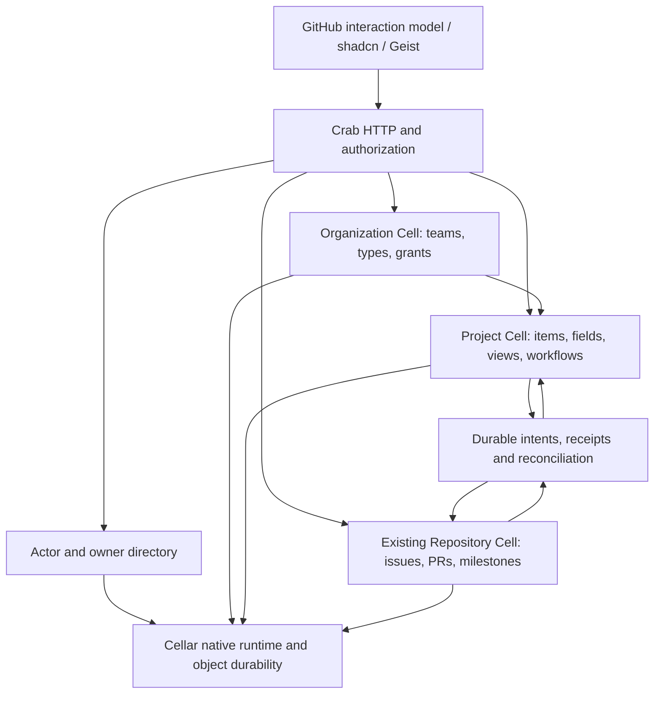

# GitHub collaboration on Cellar

Status: implementation in progress; source assessment and delivery plan recorded
2026-10-21. This expands [the UI parity checklist](github-ui-parity.md) to complete
Issues, Pull Requests, Projects, and Milestones. Existing completed slices retain
their evidence; this document does not mark the expansion implemented.

GitHub defines the layout and interaction reference. Crab uses its existing
shadcn components and Geist colors/typography. Fern supplies domain, workflow,
and test references. Its planning UI deliberately follows Linear, so copying
that UI would not satisfy the agreed GitHub experience.

## Source assessment

Fern was inspected through an authenticated, read-only checkout at
[`6bd28630b27da470c8da1ed23fdb4317b288fef2`](https://github.com/crabbuild/fern/tree/6bd28630b27da470c8da1ed23fdb4317b288fef2).
Its repository license is Apache-2.0. Preserve applicable license, attribution,
and third-party notices when copying code or assets; none were copied for this
assessment. Existing Fern test source was inspected, not executed here.

| Surface                                 | Fern evidence, paths relative to Fern                                                                                                                                   | Crab evidence, paths relative to Crab                                                                                                                                                | Delivery consequence                                                                                                                                                 |
| --------------------------------------- | ----------------------------------------------------------------------------------------------------------------------------------------------------------------------- | ------------------------------------------------------------------------------------------------------------------------------------------------------------------------------------ | -------------------------------------------------------------------------------------------------------------------------------------------------------------------- |
| Identity and organization access        | `apps/web/worker/project-data.ts`: current principal, tenant membership, source ACL/version guards; `issue-types-data.ts`: organization-only catalog                    | `crates/crab-server/src/catalog/mod.rs`: repository catalog/members; `app.rs`: admission/membership; `cells/directory/`: native public profiles; `cells/runtime.rs`: Repository, Directory and Organization namespaces                                   | Complete owner registry, teams, repository/project grants and cross-authority fencing. Native organization membership and public actor identities are implemented. |
| Issue lists and management              | `packages/contracts/src/issues.ts`, `issue-query.ts`; `apps/web/test/issues-authority.test.ts`: atomic bulk edits, closure time/reason, pins and replay                 | `cells/repository/issues/`, `search/`, `api/issues/`, `packages/ui/src/features/issues/`                                                                                           | Extend the canonical query/index and native commands; retain truthful counts, cursor invalidation and replay.                                                        |
| Types and saved views                   | `packages/contracts/src/issue-types.ts`, `issues.ts`; `apps/web/worker/issue-types-data.ts`, `issue-views-data.ts`                                                      | No organization type catalog or durable saved-view owner                                                                                                                             | Implement organization-owned types and private/shared saved views with separate administration permissions.                                                          |
| Hierarchy and dependencies              | `packages/contracts/src/issue-hierarchy.ts`, `issue-dependencies.ts`; `apps/web/worker/issue-hierarchy-data.ts`, `issue-dependency-data.ts`; related test suites        | `cells/repository/collaboration/links/` provides same-repository issue-to-PR related-work links                                                                                      | Parent/child, blocked-by/blocking, duplicate and related work need distinct typed invariants; existing links do not implement those semantics.                       |
| Projects                                | `packages/contracts/src/projects.ts`; `apps/web/worker/project-{routes,data,model}.ts`; `migrations/tenant/0015_projects.sql`; `apps/web/test/projects.test.ts`         | No canonical project, project item, field, view or project grant model                                                                                                               | Implement native project authority and real repository references; use Fern command/validation behavior as reference.                                                |
| Project draft conversion and automation | `project-data.ts`, `apps/web/test/project-draft-conversion.test.ts`: reserve, canonical creation, finalize, recover lost reply; event deduplication and automation jobs | Repository submission/command receipts exist; no project orchestration                                                                                                               | Build persisted cross-Cell workflows; never retry uncertain creation with a new identity.                                                                            |
| Milestones                              | `packages/contracts/src/index.ts`: versioned milestone/date/counts; `apps/web/test/issues-management.test.ts`                                                           | `cells/repository/collaboration/milestones/`, `api/milestones/`, `packages/ui/src/features/milestones/`; existing native/HTTP/browser/restart proof in `repository-collaboration.md` | Native search/filter choices are implemented; extend creation defaults, prioritization and missing interactions; do not introduce a second milestone store.                         |
| Pull requests                           | `apps/web/worker/pulls.ts`: review requests, comments, reserved merge publication/recovery; `repo-do.ts`: repository authority                                          | `cells/repository/pulls/`, `api/pulls/`, `packages/ui/src/features/pull-requests/`: review/thread/readiness/merge owners                                                             | Keep Crab's exact-head Git publication path. Port missing behavior and acceptance cases without replacing it with Fern's Artifacts transport.                        |
| Presentation                            | `docs/issues-projects-experience.md`, `apps/web/src/projects.tsx`: Linear planning, shadcn, table/board, contextual editing                                             | `packages/ui/src/components/ui/`, `components/discussion/`, `styles/globals.css`: shadcn/Geist foundation                                                                            | Share Crab primitives; reproduce GitHub navigation, keyboard/focus behavior and information hierarchy.                                                               |

Fern's project contracts explicitly bound projects to 100, items to 1,000,
custom fields to 20, views to 20, rules to 10, and a 900,000-byte document.
They define table/board views; custom text, number, date and select fields;
computed hierarchy fields; and added/open/closed/merged rules. These are useful
implemented behaviors, not evidence of complete GitHub parity or suitable Crab
scale limits. Do not import those limits or the whole-document persistence model
without qualification.

GitHub's [Projects reference](https://docs.github.com/en/issues/planning-and-tracking-with-projects/learning-about-projects/about-projects)
also includes roadmap views, iterations, charts/insights, templates, status
updates, and auto-add/archive workflows. Those remain required work beyond the
inspected Fern project schema. GitHub's feature inventory changes; each delivery
needs a dated reference and explicit acceptance cases, rather than a blanket
claim that Fern or Crab already has complete parity.

## Native ownership

Proposed topology, to qualify before introducing cross-authority writes:

Cellar 0.1.0's compiled `Registry::cell` supports named Cell classes;
`Context::namespace` resolves configured namespace bindings. Its
`Storage::transaction_sync` commits SQL/KV changes in the current Cell storage
scope, and its alarm API supports scheduled continuation. These contracts were
read in the published dependency's `application/mod.rs`, `application/cells.rs`,
and `application/storage/{transaction.rs,mod.rs}`. They support this direction;
they do not supply a distributed project/repository transaction.

Crab registers `Repository`/`REPOSITORIES`, `Directory`/`DIRECTORY` and
`Organization`/`ORGANIZATIONS` in
`crates/crab-server/src/cells/{application,runtime}.rs`. Typed target addresses,
class-bound commands/reads and target-bound read receipts share native ingress,
transactions and replay handling. Directory has explicit private initialization
and its own schema/dispatch. Organization owns membership/invitation authority
in its own native transactions. Project authority and cross-Cell recovery remain
new work; its UUIDs must not masquerade as Repository addresses or use that
dispatch table.

Keep authoritative issue/PR content, versions, local metadata, activity and
receipts in the existing Repository Cell. Project items store typed source
references and project-owned values; reads resolve authorized source content.
Do not persist private source titles/bodies into a broadly readable project
snapshot. A stale project projection cannot grant source access or prove merge
eligibility.

Separate identity from display data. Introduce stable public actor IDs mapped to
qualified authentication identities; usernames, avatars and names remain mutable
profile fields. Teams and organization/project grants have explicit owners,
versions and administration rights. Repository administrators cannot acquire
organization administration by choosing an owner name. Bootstrap and changes to
the existing catalog membership authority require an explicit, verified cutover;
do not keep two independent grant stores or create an owner from a read request.

Each Cell commits its state, indexes, activity, receipt and outgoing intents
atomically. Cross-Cell draft conversion, metadata edits, project membership,
automation and relationship changes require persisted operation identities,
source versions, deduplication, completion acknowledgement and restart recovery.
Pending and denied outcomes must be visible and truthful. Reauthorize private
reads and receipt responses; a replayed receipt cannot reveal revoked content.
Current access must also be enforced at the actual mutation/publication boundary.

The authorization/fencing protocol is an implementation prerequisite, not solved
by checking access before and after unrelated remote calls. Cross-repository
hierarchy needs a canonical graph authority and concurrent cycle/reparent proof;
separate per-issue checks do not prevent cycles. Choose its ownership from those
invariants before adding the HTTP workflow. Derived indexes may be asynchronous;
authorization and invariant decisions must use authoritative state.

Keep related Rust commands, validation, storage and tests with their domain
owners. Keep React feature models, requests, screens and tests together under
`packages/ui/src/features/`. Extract shared Cell execution machinery only where
multiple real authorities need it; retain one canonical implementation rather
than adapting repository commands into organization/project commands.

## Delivery and acceptance

The phases order dependencies; they do not reduce the four-surface parity goal.
Each unchecked capability needs implementation plus native, HTTP and browser
proof. Existing milestone/review/search work is reused and extended.

1. **Authority foundation.** Public actor/profile lookup, personal and organization
   owners, organization/team lifecycle, membership/invitations, repository and
   project visibility/grants. Prove bootstrap, revocation, stale authority,
   archive, concurrent edits, retries and restart before dependent mutations.
2. **Issues and search.** Organization issue types; closure reasons/time; unified
   tagged issue/PR search; actor, type, milestone, project, relationship, date and
   review filters; completion; saved/personal views; pins and bounded bulk edits.
   Add subscriptions, mentions/notifications, templates/forms, attachments,
   editing history, moderation/locking, transfer, duplicates, sub-issues and
   dependencies. Verify each reference against GitHub and preserve real counts,
   permissions, stable query cursors and focus through loading/error/reload.
3. **Projects.** Personal/organization projects, repository associations, grants,
   linked issues/PRs and drafts, draft conversion, field definitions/values,
   table/board/roadmap, keyboard/pointer ordering, groups/slices, saved views,
   iterations, search, archive/restore, workflows, auto-add/archive, templates,
   status updates and insights. Bidirectional metadata edits must invoke the
   canonical repository command and recover ambiguous results.
4. **Milestones.** Extend existing create/edit/close/reopen/assign/progress behavior
   with complete filters, sorting, issue creation defaults, mixed issue/PR
   results, prioritization and remaining reference interactions. Source:
   [GitHub milestones](https://docs.github.com/en/issues/using-labels-and-milestones-to-track-work/about-milestones).
5. **Pull requests.** Complete list/review workspaces, compare/create, conversation,
   commits/files, pending reviews, suggestions, reviewer/team requests, review
   dismissal, outdated/resolved threads, viewed files, checks and branch-rule
   rollups. Inventory and implement update-branch/conflict resolution,
   merge/squash/rebase, auto-merge, queues, revert and linked-issue closure where
   GitHub exposes them. Keep reservations, exact branch tips, check/review
   revision binding, publication locks and uncertain-result recovery intact.
   Source: [GitHub merge workflows](https://docs.github.com/en/pull-requests/how-tos/merge-and-close-pull-requests).
6. **Complete interaction and operational proof.** Match GitHub hierarchy,
   menus, dialogs, sidebars, selection, keyboard/focus, empty/loading/error and
   conflict states across light/dark and narrow/wide screens. Preserve
   whole-widget diagnostics behind `powerbar=1`. Run real browser actions through
   native Cellar and isolated object storage, then compare persisted state after
   restart/handoff, replay, access changes and interrupted cross-Cell operations.
   Qualify scale/cost using measured request counts and dataset sizes.

Product interaction parity does not itself establish drop-in GitHub REST,
GraphQL, webhook or CLI compatibility. Track any such compatibility claims with
separate protocol tests. Checks/automation integrations need real execution and
delivery contracts; adding a menu does not provide a CI runner or notification
delivery. These dependencies must be recorded instead of silently replacing
them with successful fixtures.

## Current proof and release limits

The existing [UI checklist](github-ui-parity.md) and
[collaboration evidence](repository-collaboration.md) record completed Crab
slices and their native/HTTP/browser/object-store qualification. Fern's cited
tests are acceptance references, not evidence that their Cellar ports pass.
The initial Fern assessment did not deploy or migrate anything. The subsequent
native profile slice adds a shared Directory with stable actor UUIDs, unique
chosen handles/names and private qualified `(issuer, subject)` keys. Its profile
HTTP routes and `/-/profile`/`/-/users/{uuid}` pages support enrollment,
versioned edits, explicit stale-draft recovery and reload. No Fern code was
copied. No organization/team/project grants, owner registry or catalog authority
cutover is implemented; matching a handle with an existing catalog owner grants
nothing. List authors now resolve their qualified snapshots to public actors;
detail/comment/review attribution remains separate work. Actor assignments now
have the explicit preparation described below. The authority phase remains incomplete.

The slice passed 325 isolated server tests (five existing ignored cases), 107 UI
unit tests and 72 browser tests, plus builds, Clippy and architecture checks.
Native proof includes Directory remote reads and replay after mTLS handoff.
A real RustFS browser run created/renamed a profile and verified its stable ID
and state after process restart and repository-index rebuild, alongside existing
Git/review/merge/replay proof. The persistent preview initializes the directory
empty and preserves both repositories' records; the operator chooses their own
profile. These checks qualify the implemented slice, not complete parity.

The subsequent milestone slice adds exact/excluded/missing milestone queries,
native suggestions and a shared searchable issue/PR dropdown. It uses the
existing milestone authority; no duplicate domain store or organization grants
were introduced. Native projections update atomically with source commands and
require explicit index-format-2 preparation for existing repositories. This
advances the Issues/Milestones phases while organization/owner authority
continues to require its explicit cutover.
The slice passed 329 isolated server tests (five existing ignored), 107 UI unit
tests and 75 browser tests, plus final focused mobile-margin proof. Real RustFS
browser filtering and restart/rebuild checks passed. The persistent preview's
two format-1 indexes were explicitly upgraded and canonical records compared
unchanged; [the UI evidence](github-ui-parity.md#verification-and-completion)
records the scope and remaining gaps.

The label slice adds bounded native catalog choices and shared issue/PR
multi-select controls, including exclusions and no-label queries. It reuses
canonical label records and index format 2 without another store or rebuild.
The full isolated server suite passed 333 tests (five existing ignored), all
80 browser tests passed, and real RustFS browser actions plus restart preserved
records, choices and counts. Both persistent preview repositories compared
unchanged. Recent label suggestions, actor-backed author/assignee integration,
organization/team authority and Projects remain unfinished; these incremental
filter controls do not establish full GitHub parity.

The shared workspace slice adds collapsible issue/PR navigation and persistent
browser-local comfortable/compact rows, without changing Cellar data or search
contracts. All 84 browser tests and 107 unit tests passed, along with UI/server
builds. The real embedded UI retained preferences through reload and displayed
both discussion kinds against RustFS; domain records remained unchanged.
These presentation preferences are not saved views or account settings. The
[UI evidence](github-ui-parity.md#verification-and-completion) records remaining
workflow and accessibility gaps.

The attribution slice connects mixed issue/PR lists and PR-only lists to current
public actors through one bounded native Directory read. It retains historical
source names and never guesses identity from a handle or display name. Both HTTP
owners recheck durable membership after enrichment; names do not grant access.
It passed 336 isolated server tests (five existing ignored), 107 unit tests and
86 browser tests, plus final maximum-handle/mobile-containment cases. Native
lookup succeeds after mTLS owner handoff; a real embedded RustFS browser workflow
followed author links and retained attribution across restart/index rebuild.
The preview's two repositories remained unchanged, with no profile enrolled.
Detail/comment/review attribution, assignee integration, actor search and the
organization/project authority cutover remain unfinished. Directory preparation
is now required before serving nonempty author-enriched lists; its schema and
repository/index formats are unchanged.

[CELLAR.md](../../../crates/crab-server/CELLAR.md) already records a release
blocker: the published SDK links SQLite 3.45.0, before the upstream WAL-reset
fix. A matched dependency upgrade and native release qualification remain
required; a UI smoke test cannot remove that blocker. Dependency changes need
their existing explicit approval. Cloudflare compute remains stopped.

The author-search slice adds qualified native predicates, bounded Directory
handle completion and real created/authored-by-me navigation. Current index
format 3 needs explicit rebuilds of older derived indexes; no source-record
migration or compatibility reader is added. Handle bindings also belong to
cursor fingerprints. Other actor predicates, organizations/teams and Projects
remain unfinished; a public handle still grants no authority.

The repository-role slice introduces Triage between Read and Write in the existing
membership authority. Both issue and PR state/assignment workflows and review
requests use it; code write, merge, readiness, definition catalogs and admin
permissions stay distinct. The UI supports revisioned grant edits and a separate
issue close capability. This advances authority modeling without inventing an
owner from a name, migrating grants implicitly or adding a second grant store.
It does not finish Maintain, native authority fencing, owner/organization/team
registration, qualified assignee migration or required-review role weighting.

Current-grant admission now resolves durable catalog roles before repository
access across browser APIs, Git and LFS, independently of routing refresh.
Credentials alone grant nothing; repository UUID and configured issuer bind the
admitted scope. Git-token format 2 also binds that UUID and retires name-only
tokens. Promotion, downgrade, authority failure, UUID reuse and real OAuth/RustFS
restart behavior are qualified. This improves the existing catalog boundary;
it does not migrate grants to Directory or supply atomic native authority fencing.

The Author menu now composes current public Directory choices with native query
navigation in both discussion workspaces. Selection, self/clear, exact truncation,
counts, reload, error/focus behavior and real OAuth/RustFS browser effects are
qualified. Directory read 8 has a bounded matches/truncation output and requires
coordinated peers. This adds no grant store or canonical schema change; recent
contributors, non-enrolled participants and the broader actor/project models
remain unfinished.

Directory format 2 separates private accounts from optional public profiles.
Qualified registration has stable UUIDs, exact realm separation and no implicit
grant effect. Existing format-1 profile identity/data/submissions migrate in
bounded atomic frames with durable progress; a new-code old-data process upgrade
and later UI enrollment preserve identity across restart. Explicit private CLI
operations own preparation and registration. Actor-based filters, organization/team authority and cross-authority fencing
remain delivery work; the registry never guesses historical bindings from names
or owner strings.

Assignee candidates and display names now come from the current durable catalog
membership, including additions, removals and renames before routing refresh.
Issue and PR edits validate selected members against the same late membership
snapshot that supplies the caller's triage permission. List/detail responses use
their final membership read for rendering. This follows Fern's current-access
eligibility rule in `apps/web/worker/thread-assignee-data.ts`; no Fern code was
copied. Canonical assignments now store actor UUIDs and name snapshots, with
optional public profiles in their DTOs. Explicit native migration requires
qualified per-record mappings for nonempty legacy assignments, preserves record
versions/content/submissions, and resumes bounded frames after restart. Its
conflict outcomes are recorded so later completion cannot change an earlier
retry decision. Repository/index preparation uses column renames and bounded
updates; serving never reads retired subject records. The shadcn metadata picker
supports current choices and removing unavailable historical people. The Assignee
list filter, native grants and cross-authority fencing remain separate work.

Assignee list filtering now shares native stable account IDs, public-handle/`@me`
resolution, boolean/count/cursor contracts and explicit actor-ID queries across
issues and PRs. The searchable shadcn menu combines current members, public
profiles and historical assignment snapshots; removed access does not erase
filterable history. Assigned-to-me navigation uses native selection flags.
Discussion index format 5 requires an explicit bounded rebuild for searchable
name snapshots. No canonical assignment, Directory, catalog-grant or public
submission conversion is needed for this derived-index step. Reviewer/involves/
mention predicates, native authority cutover and the remaining full parity
inventory remain open.

Reviewer relationship filtering now projects canonical qualified review/request
sources into native index format 6. Pending requests, submitted reviewers and
review involvement share transaction, count, cursor and explicit bounded rebuild
contracts. The PR workspace adds a shadcn Reviews menu and native Review requests
personal navigation. Author and reviewer resolution use the same public Directory
snapshot and final durable membership recheck. This does not implement team
requests, current-head review-status/merge policy, notifications/mentions,
general participant predicates, native authority cutover or complete parity.

The unified conversation slice replaces split UI history readers with native
indexed comment/review/activity windows, shared typed cards and explicit
format-10 preparation. It retains canonical source records and replay identities,
and verifies bounded rebuild restart, mixed history and real UI writes against
RustFS. All 113 browser scenarios and the affected native/HTTP suites pass; the
[UI evidence](github-ui-parity.md#unified-conversation) records the exact scope.
This advances the Issues/PR foundation; organization/team/project authority and
the remaining Projects/Milestones/issue/review inventory are still incomplete.

The organization foundation now has an independent native `Organization` class,
explicit provider-qualified first-owner bootstrap, current transactional member/
owner checks before receipt replay, membership tombstones, last-owner guards,
seven-day versioned invitations and recipient consent. Native SQL/KV audit and
state changes commit together. The shadcn/Geist People, Invitations, acceptance and
settings pages use those APIs. Fern's organization membership/current-role model
in `apps/web/worker/organization-data.ts` informed the ownership boundary; no Fern
code or direct-add membership behavior was copied. GitHub's documented invitation
acceptance/expiry contract informs consent and deadlines.

This does not finish phase 1: owner registry/discovery, personal owner namespaces,
teams, organization lifecycle/email invitations, repository authority cutover and
cross-Cell fencing remain open. Catalog grants retain their existing authority;
organization ownership grants no repository permissions. Existing issue/PR models
are preserved, and Projects/type/saved-view/advanced-review parity remains pending.

The issue lifecycle slice adds completed/not-planned reasons, reopening, nullable
close timestamps, typed timeline events and canonical reason search. A bounded
private preparation recovers only historically proven metadata without changing
original issue records, event history or command outcomes. Shadcn close controls
preserve comment drafts and stale-edit handling. See the
[issue lifecycle evidence](github-ui-parity.md#issue-closure-lifecycle).
Duplicate closure/relationships, date predicates, organization issue types, saved/bulk workflows and complete parity
remain unfinished.

The atomic composer slice now commits a comment and close/reopen together for
both discussion kinds. Canonical writers, rollback, milestone/search/history and
permanent intent recovery remain in the Repository transaction. Shared shadcn
controls retain drafts and distinguish confirmed rejections from uncertain replies,
including a permission failure after commit. See
[atomic action evidence](github-ui-parity.md#atomic-comment-and-state-actions).
The remaining owner/team/project authority, advanced issue relationships/reviews,
saved/bulk workflows and complete parity inventory stay open.

The bulk list slice binds stable repository UUIDs and adds page/range selection
and atomic state, label-delta, assignee-delta and milestone actions for both
discussion kinds. It reuses native
writers, permanent intent recovery and current catalog Triage authority; stale
versions reject the entire bounded selection. It does not add Project/type
mutations or solve native grant cutover. See the
[bulk triage evidence](github-ui-parity.md#bounded-bulk-list-triage).

The issue pin slice adds a native three-slot, independently versioned repository
collection, permanent submissions and pin/unpin conversation events. Shadcn cards
above search, sidebar pin/unpin and keyboard/drag ordering use current Write
capability; Read/Triage users keep the cards without mutation controls. Lost
replies retain their original intent, and recovery reloads the current order.
Fern's pin authority tests informed acceptance cases; no source was copied. See
[pin behavior and qualification](github-ui-parity.md#repository-issue-pins).
This advances issue management; saved views, Projects, remaining authority and
full Issues/PR/Milestones parity remain unfinished.
