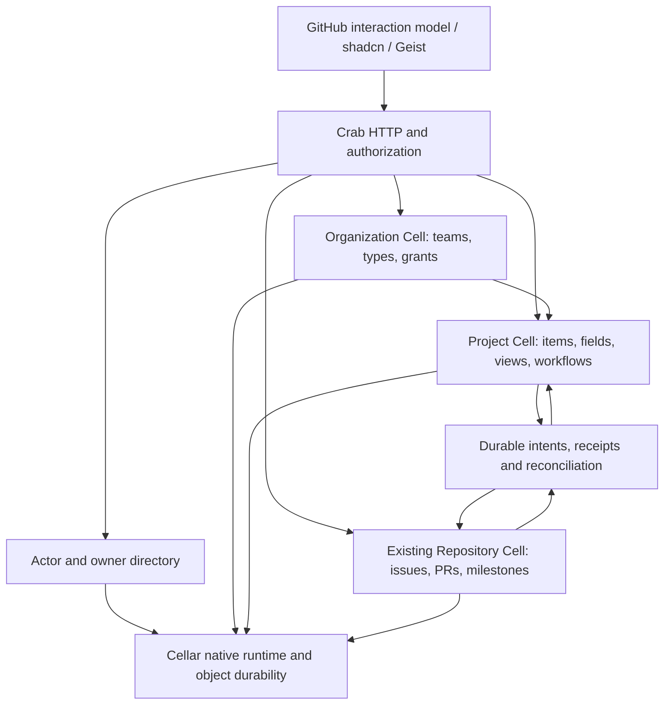

# GitHub collaboration on Cellar

Status: implementation in progress; source assessment and delivery plan recorded
2026-10-21. This expands [the UI parity checklist](github-ui-parity.md) to complete
Issues, Pull Requests, Projects, and Milestones. Existing completed slices retain
their evidence; this document does not mark the expansion implemented.

GitHub defines the layout and interaction reference. Crab uses its existing
shadcn components and Geist colors/typography. Fern supplies domain, workflow,
and test references. Its planning UI deliberately follows Linear, so copying
that UI would not satisfy the agreed GitHub experience.

## Source assessment

Fern was inspected through an authenticated, read-only checkout at
[`6bd28630b27da470c8da1ed23fdb4317b288fef2`](https://github.com/crabbuild/fern/tree/6bd28630b27da470c8da1ed23fdb4317b288fef2).
Its repository license is Apache-2.0. Preserve applicable license, attribution,
and third-party notices when copying code or assets; none were copied for this
assessment. Existing Fern test source was inspected, not executed here.

| Surface                                 | Fern evidence, paths relative to Fern                                                                                                                                   | Crab evidence, paths relative to Crab                                                                                                                                                | Delivery consequence                                                                                                                                                 |
| --------------------------------------- | ----------------------------------------------------------------------------------------------------------------------------------------------------------------------- | ------------------------------------------------------------------------------------------------------------------------------------------------------------------------------------ | -------------------------------------------------------------------------------------------------------------------------------------------------------------------- |
| Identity and organization access        | `apps/web/worker/project-data.ts`: current principal, tenant membership, source ACL/version guards; `issue-types-data.ts`: organization-only catalog                    | `crates/crab-server/src/catalog/mod.rs`: repository catalog/members; `app.rs`: admission/membership; `cells/runtime.rs`: repository namespace only                                   | Add real public actor identities, owners, organizations, teams and project grants before organization planning UI. An owner string is not an organization authority. |
| Issue lists and management              | `packages/contracts/src/issues.ts`, `issue-query.ts`; `apps/web/test/issues-authority.test.ts`: atomic bulk edits, closure time/reason, pins and replay                 | `cells/repository/issues.rs`, `search/`, `api/issues/`, `packages/ui/src/features/issues/`                                                                                           | Extend the canonical query/index and native commands; retain truthful counts, cursor invalidation and replay.                                                        |
| Types and saved views                   | `packages/contracts/src/issue-types.ts`, `issues.ts`; `apps/web/worker/issue-types-data.ts`, `issue-views-data.ts`                                                      | No organization type catalog or durable saved-view owner                                                                                                                             | Implement organization-owned types and private/shared saved views with separate administration permissions.                                                          |
| Hierarchy and dependencies              | `packages/contracts/src/issue-hierarchy.ts`, `issue-dependencies.ts`; `apps/web/worker/issue-hierarchy-data.ts`, `issue-dependency-data.ts`; related test suites        | `cells/repository/collaboration/links/` provides same-repository issue-to-PR related-work links                                                                                      | Parent/child, blocked-by/blocking, duplicate and related work need distinct typed invariants; existing links do not implement those semantics.                       |
| Projects                                | `packages/contracts/src/projects.ts`; `apps/web/worker/project-{routes,data,model}.ts`; `migrations/tenant/0015_projects.sql`; `apps/web/test/projects.test.ts`         | No canonical project, project item, field, view or project grant model                                                                                                               | Implement native project authority and real repository references; use Fern command/validation behavior as reference.                                                |
| Project draft conversion and automation | `project-data.ts`, `apps/web/test/project-draft-conversion.test.ts`: reserve, canonical creation, finalize, recover lost reply; event deduplication and automation jobs | Repository submission/command receipts exist; no project orchestration                                                                                                               | Build persisted cross-Cell workflows; never retry uncertain creation with a new identity.                                                                            |
| Milestones                              | `packages/contracts/src/index.ts`: versioned milestone/date/counts; `apps/web/test/issues-management.test.ts`                                                           | `cells/repository/collaboration/milestones/`, `api/milestones/`, `packages/ui/src/features/milestones/`; existing native/HTTP/browser/restart proof in `repository-collaboration.md` | Extend the existing owner for search, creation defaults, prioritization and missing interactions; do not introduce a second milestone store.                         |
| Pull requests                           | `apps/web/worker/pulls.ts`: review requests, comments, reserved merge publication/recovery; `repo-do.ts`: repository authority                                          | `cells/repository/pulls/`, `api/pulls/`, `packages/ui/src/features/pull-requests/`: review/thread/readiness/merge owners                                                             | Keep Crab's exact-head Git publication path. Port missing behavior and acceptance cases without replacing it with Fern's Artifacts transport.                        |
| Presentation                            | `docs/issues-projects-experience.md`, `apps/web/src/projects.tsx`: Linear planning, shadcn, table/board, contextual editing                                             | `packages/ui/src/components/ui/`, `components/discussion/`, `styles/globals.css`: shadcn/Geist foundation                                                                            | Share Crab primitives; reproduce GitHub navigation, keyboard/focus behavior and information hierarchy.                                                               |

Fern's project contracts explicitly bound projects to 100, items to 1,000,
custom fields to 20, views to 20, rules to 10, and a 900,000-byte document.
They define table/board views; custom text, number, date and select fields;
computed hierarchy fields; and added/open/closed/merged rules. These are useful
implemented behaviors, not evidence of complete GitHub parity or suitable Crab
scale limits. Do not import those limits or the whole-document persistence model
without qualification.

GitHub's [Projects reference](https://docs.github.com/en/issues/planning-and-tracking-with-projects/learning-about-projects/about-projects)
also includes roadmap views, iterations, charts/insights, templates, status
updates, and auto-add/archive workflows. Those remain required work beyond the
inspected Fern project schema. GitHub's feature inventory changes; each delivery
needs a dated reference and explicit acceptance cases, rather than a blanket
claim that Fern or Crab already has complete parity.

## Native ownership

Proposed topology, to qualify before introducing cross-authority writes:

Cellar 0.1.0's compiled `Registry::cell` supports named Cell classes;
`Context::namespace` resolves configured namespace bindings. Its
`Storage::transaction_sync` commits SQL/KV changes in the current Cell storage
scope, and its alarm API supports scheduled continuation. These contracts were
read in the published dependency's `application/mod.rs`, `application/cells.rs`,
and `application/storage/{transaction.rs,mod.rs}`. They support this direction;
they do not supply a distributed project/repository transaction.

Crab currently registers only `Repository` and `REPOSITORIES` in
`crates/crab-server/src/cells/{application,runtime}.rs`. Additional authorities,
their initialization, typed clients, admission, shutdown and recovery are new
implementation work. Do not pass organization/project UUIDs through the existing
repository request envelope or its repository dispatch table.

Keep authoritative issue/PR content, versions, local metadata, activity and
receipts in the existing Repository Cell. Project items store typed source
references and project-owned values; reads resolve authorized source content.
Do not persist private source titles/bodies into a broadly readable project
snapshot. A stale project projection cannot grant source access or prove merge
eligibility.

Separate identity from display data. Introduce stable public actor IDs mapped to
qualified authentication identities; usernames, avatars and names remain mutable
profile fields. Teams and organization/project grants have explicit owners,
versions and administration rights. Repository administrators cannot acquire
organization administration by choosing an owner name. Bootstrap and changes to
the existing catalog membership authority require an explicit, verified cutover;
do not keep two independent grant stores or create an owner from a read request.

Each Cell commits its state, indexes, activity, receipt and outgoing intents
atomically. Cross-Cell draft conversion, metadata edits, project membership,
automation and relationship changes require persisted operation identities,
source versions, deduplication, completion acknowledgement and restart recovery.
Pending and denied outcomes must be visible and truthful. Reauthorize private
reads and receipt responses; a replayed receipt cannot reveal revoked content.
Current access must also be enforced at the actual mutation/publication boundary.

The authorization/fencing protocol is an implementation prerequisite, not solved
by checking access before and after unrelated remote calls. Cross-repository
hierarchy needs a canonical graph authority and concurrent cycle/reparent proof;
separate per-issue checks do not prevent cycles. Choose its ownership from those
invariants before adding the HTTP workflow. Derived indexes may be asynchronous;
authorization and invariant decisions must use authoritative state.

Keep related Rust commands, validation, storage and tests with their domain
owners. Keep React feature models, requests, screens and tests together under
`packages/ui/src/features/`. Extract shared Cell execution machinery only where
multiple real authorities need it; retain one canonical implementation rather
than adapting repository commands into organization/project commands.

## Delivery and acceptance

The phases order dependencies; they do not reduce the four-surface parity goal.
Each unchecked capability needs implementation plus native, HTTP and browser
proof. Existing milestone/review/search work is reused and extended.

1. **Authority foundation.** Public actor/profile lookup, personal and organization
   owners, organization/team lifecycle, membership/invitations, repository and
   project visibility/grants. Prove bootstrap, revocation, stale authority,
   archive, concurrent edits, retries and restart before dependent mutations.
2. **Issues and search.** Organization issue types; closure reasons/time; unified
   tagged issue/PR search; actor, type, milestone, project, relationship, date and
   review filters; completion; saved/personal views; pins and bounded bulk edits.
   Add subscriptions, mentions/notifications, templates/forms, attachments,
   editing history, moderation/locking, transfer, duplicates, sub-issues and
   dependencies. Verify each reference against GitHub and preserve real counts,
   permissions, stable query cursors and focus through loading/error/reload.
3. **Projects.** Personal/organization projects, repository associations, grants,
   linked issues/PRs and drafts, draft conversion, field definitions/values,
   table/board/roadmap, keyboard/pointer ordering, groups/slices, saved views,
   iterations, search, archive/restore, workflows, auto-add/archive, templates,
   status updates and insights. Bidirectional metadata edits must invoke the
   canonical repository command and recover ambiguous results.
4. **Milestones.** Extend existing create/edit/close/reopen/assign/progress behavior
   with complete filters, sorting, issue creation defaults, mixed issue/PR
   results, prioritization and remaining reference interactions. Source:
   [GitHub milestones](https://docs.github.com/en/issues/using-labels-and-milestones-to-track-work/about-milestones).
5. **Pull requests.** Complete list/review workspaces, compare/create, conversation,
   commits/files, pending reviews, suggestions, reviewer/team requests, review
   dismissal, outdated/resolved threads, viewed files, checks and branch-rule
   rollups. Inventory and implement update-branch/conflict resolution,
   merge/squash/rebase, auto-merge, queues, revert and linked-issue closure where
   GitHub exposes them. Keep reservations, exact branch tips, check/review
   revision binding, publication locks and uncertain-result recovery intact.
   Source: [GitHub merge workflows](https://docs.github.com/en/pull-requests/how-tos/merge-and-close-pull-requests).
6. **Complete interaction and operational proof.** Match GitHub hierarchy,
   menus, dialogs, sidebars, selection, keyboard/focus, empty/loading/error and
   conflict states across light/dark and narrow/wide screens. Preserve
   whole-widget diagnostics behind `powerbar=1`. Run real browser actions through
   native Cellar and isolated object storage, then compare persisted state after
   restart/handoff, replay, access changes and interrupted cross-Cell operations.
   Qualify scale/cost using measured request counts and dataset sizes.

Product interaction parity does not itself establish drop-in GitHub REST,
GraphQL, webhook or CLI compatibility. Track any such compatibility claims with
separate protocol tests. Checks/automation integrations need real execution and
delivery contracts; adding a menu does not provide a CI runner or notification
delivery. These dependencies must be recorded instead of silently replacing
them with successful fixtures.

## Current proof and release limits

The existing [UI checklist](github-ui-parity.md) and
[collaboration evidence](repository-collaboration.md) record completed Crab
slices and their native/HTTP/browser/object-store qualification. Fern's cited
tests are acceptance references, not evidence that their Cellar ports pass.
No new product capability, cloud deployment or data migration was performed in
this assessment.

[CELLAR.md](../../../crates/crab-server/CELLAR.md) already records a release
blocker: the published SDK links SQLite 3.45.0, before the upstream WAL-reset
fix. A matched dependency upgrade and native release qualification remain
required; a UI smoke test cannot remove that blocker. Dependency changes need
their existing explicit approval. Cloudflare compute remains stopped.
