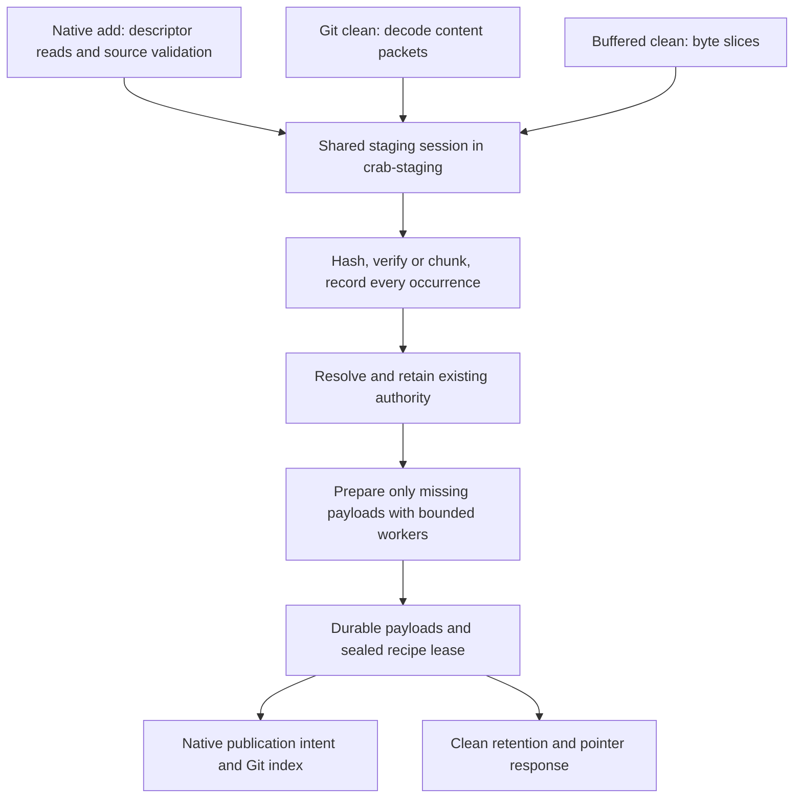

# Unified staging design and implementation plan

Status: implemented locally; focused tests and small RustFS qualification passed; 10 GiB qualification and final review pending. Implementation source baseline: `bb590b78f58`, including the large-file fixes in PR #521. This plan is a follow-up to that PR.

Unify native `crab add` and Git clean beneath their input adapters. One staging module should own content hashing, chunking, authority selection, bounded payload preparation, recipe recording, durability and rollback. File validation, Git framing and Git-index publication remain with their respective callers.

The immediate performance target is to remove the full-size local payload copy observed when alternating paths. The architectural target is one implementation of staging ownership and recovery, with both callers testing the same interface.

## Input differences and the shared interface

Git filter-process is packet framed. Its content packets contain arbitrary bytes; packet boundaries are unrelated to content-defined chunk boundaries. The adapter must consume the request's terminating flush before responding. It must use the supplied content, because the named working-tree file may differ or be absent. A one-shot clean filter instead receives raw stdin. These are input-adapter concerns. See the [Git filter contract](https://git-scm.com/docs/gitattributes#_long_running_filter_process).

Native add reads an open file descriptor. Git clean decodes payload packets. Both can feed bounded byte blocks into the same staging session. Neither a newline parser nor a temporary 10 GiB file belongs in the shared interface.



Today, native streaming prepares xorbs directly; changed-content Git clean writes provisional segments through its own batching and adoption lifecycle. Sharing only `Read`, the chunker, or a utility function would leave that duplication intact. The useful seam is the entire staging session. Its two concrete adapters provide leverage through shared correctness and locality through one lifecycle implementation.

## Evidence and ownership map

References identify the baseline; locate symbols again after rebasing.

| Surface | Baseline entry point and owner | Shared dependency or consumer | Required protection |
| --- | --- | --- | --- |
| Native add | `crab/src/cmd/add.rs:1046`; `crates/crab-staging/src/stream.rs:602` | `stream_chunk_and_stage`, `flush_batch`, prepared writer | One preparation across parallel files; descriptor/path checks; all-or-nothing unpublished batch rollback |
| Filter protocol | `crab/src/git/filter_process.rs:1080` | `FilterSession::clean_stream`; packet response | Request flush, binary bytes, lazy writer admission, protocol-only stdout |
| Clean ingestion | `crab/src/git/clean.rs:2084` | `StagingChunkStager`, `ProvisionalChunkStager` | Index/remote fast paths; unknown content fails when staging unavailable |
| Prepared verification | `crab/src/git/clean.rs:1024`, `crab/src/git/clean.rs:2243` | Recipe cursor, payload reads, changed-prefix replay | Exact input skips CDC and payload writes; changed input preserves verified prefix |
| Payload ownership | `crates/crab-staging/src/index.rs:2283` | Claims, recording terms, preparation payloads, sealed recipe leases | Lookup is not a lease; repeated occurrences must survive deduplication |
| Durable installation | `crates/crab-staging/src/push_plan.rs:726` | Prepared body validation, sync, installation | No recipe can authorize missing or incomplete payloads |
| Publication | `crab/src/cmd/add.rs:1412`; `crab/src/git/clean.rs:483` | Native publication intents; clean published batches; push snapshots | Staging finish is separate from Git publication |
| Push | `crab/src/git/xet_publication.rs` | Recipe-scoped prepared and remote authority | Complete historical reconstruction; flush before bundle publication |
| File-wrapper siblings | `crab/src/cmd/adopt.rs:576`; `crates/crab-vfs/src/publish.rs:1420`; `crates/crab-sdk/src/client/mutation/native_content.rs:82` | Shared streaming wrappers, batch/result contracts | Retain their validation, rollback and result requirements |
| Segment siblings | `crab/src/import/ingest.rs:825`; LFS migration callers of `stage_chunks_batch` | Segment storage and recovery | Keep actual segment consumers supported |

The chunking dependency is pinned by `Cargo.lock` to `xet-data` 1.6.0. Its `deduplication::Chunker` retains state between input blocks. Crab's wrapper calls `next_block(..., false)` and finalizes at content end: `crates/crab-xet/src/chunker.rs:34`. Existing conformance fixtures and `feed_partition_does_not_change_gearhash_v1_recipe` protect this contract. Preserve policy, hashes and serialized recipe/xorb formats.

This design follows `crab/docs/design/add.md` authority ownership and `crates/crab-staging/README.md` durability rules. It does not alter the upload-pack protocol in `crab/docs/design/adr-git-protocol-v2-local-helper.md` or expand the SDK delivery contract in `crab/docs/architecture/crab-sdk.md`.

## Proposed module design

Extract the mutable ingestion state from `crates/crab-staging/src/stream.rs` into `crates/crab-staging/src/ingest.rs`. Keep filesystem wrappers in `stream.rs`. The new module earns its existence by replacing both implementations; it must not become a forwarding layer over either one.

Expose only operations used by the two adapters. The implemented interface lives in `crates/crab-staging/src/ingest.rs`:

```rust
IngestSession::begin(staging, path, progress, cancel, prepared_candidate).await
IngestSession::feed(bytes).await
IngestSession::finish_input().await -> CompletedInput
CompletedInput::file_hash()
CompletedInput::size()
CompletedInput::seal().await -> StreamStageResult
IngestSession::abort().await
CompletedInput::abort().await
```

`CompletedInput` retains the operation's resources. It carries the verified hash and size, but cannot expose a publishable pointer. Native callers validate the original descriptor and pathname before calling `seal`; SDK callers also validate expected identity. Clean callers can seal after a valid request terminator and successful content verification. Invalid or truncated framing never calls `finish_input` as a successful EOF.

`seal` drains bounded workers, verifies/install-syncs prepared bodies, flushes segment dependencies, resolves outstanding claims, validates full recipe coverage, and installs recipe/path leases. Return the existing batch/hash/size/recipe/prepared-body information required by real callers; avoid a second broad result model. Finalizing the enclosing preparation remains separate because native add spans several files.

The session owns the whole-file hasher, one persistent chunker when needed, ordered recipe recorder, bounded batch, claims and prepared writer. Batching starts with native's existing limits of 1,024 chunks or 64 MiB. Retain shared admission, materialization and promotion budgets; changing concurrency is outside this refactor.

Do not make the new session depend on CLI, Git protocol, remote ref mutation or S3 credentials. Product code supplies already-proven remote candidates through the existing contract. Missing or unproven remote hints never authorize omission of local bytes.

### Verification and prepared replay

Move the storage-only prepared recipe cursor/verifier and replay mechanics beside the session. Git selects a retained recipe only when every occurrence has local payload authority, whether its batch is open or published. Keep that recipe retained for the entire verification/replay operation.

- Exact candidate: hash and verify incoming bytes, then acquire the new recipe lease. No CDC, new segments, new xorbs or full-file spool.
- First mismatch, truncation or extension: retain the verified prefix directly in bounded recording batches. Replay only its last verified chunk before processing differing bytes; the original EOF tail may not have been a natural CDC cut. This opens at most one prepared source xorb instead of rereading the entire prefix.
- Hash incoming bytes exactly once. Retained prefix terms and the one replayed chunk update only private chunk/recording state. The dependency proof is xet-data 1.6.0, revision `de71453d952bd8b806edaa997c72313051a49050`: [`next_boundary` and `reset_state`](https://github.com/huggingface/xet-core/blob/de71453d952bd8b806edaa997c72313051a49050/xet_data/src/deduplication/chunking.rs) reset Gear at each cut. Native-equivalent ordered recipes are tested for late mismatches, truncation, extension and multiple recording batches.
- Keep candidate ownership until the replacement recipe has durable leases or the operation aborts. Do not retire the old path as soon as a mismatch appears.

When writable staging is unavailable, keep the existing read-only clean path: consume/hash input, then check eligible Git-index or verified remote identity. A match may succeed without acquiring a writer. Unknown content fails without a pointer. This small verification path does not own mutable staging and must not be forced through an eager writable session.

### Async and input adapters

Use the existing filter loop's `spawn_blocking` and runtime handle bridge. Coalesce decoded packets into bounded input blocks; await backpressure through that bridge at block/batch boundaries. Do not create a runtime or spawn a worker for every packet. Native file reads await the same session directly.

Keep compression and expensive blocking work behind the existing bounded worker machinery. Never retain a synchronous SQLite guard across an await. Bound memory across concurrent files, including queued bodies and recipe pages; a per-file cap alone is insufficient. Preserve `Bytes` ownership where possible, without claiming end-to-end zero-copy Git input.

LFS routing, pointer pass-through, size/attribute policy, Git-index lookup and error-to-protocol translation stay in `crab/src/git/`. If an ingest error occurs before the request flush, drain that request within the existing framing rules before a normal error response, or terminate on unrecoverable framing failure; never parse its remaining content as the next request.

## Ownership and durability

The critical transition is:

```text
open operation and retained authority
  -> input complete
  -> caller validates source
  -> payloads durable and complete
  -> sealed recipe/path lease
  -> preparation finalized
  -> caller publishes or retains for pointer emission
```

Published ownership and push-snapshot ownership outlive the ingest operation. Git has no later filter message confirming that its index transaction committed. Therefore clean must establish durable retained ownership before emitting its pointer; it cannot release it merely because no acknowledgment arrives.

### Retaining reused payloads

The baseline `claim_prepared_chunks` returned `Prepared` and `Segment` without acquiring a new ownership reference. The implementation closes that gap:

1. Combine occurrence recording and local authority lookup/claim in one SQLite transaction. Keep all occurrences, including repeated hashes; deduplicate only physical payload work.
2. For reused prepared bodies, insert the existing `preparation_payloads` relation in that same transaction. This table already prevents prepared-body reclamation. Transfer protection to `prepared_leases` before removing the preparation.
3. For reused segments, make open `recipe_recording_terms` protect matching `chunk_payloads`. Add an indexed lookup on chunk hash, size and batch. Record-and-resolve atomically so retirement cannot run between lookup and retention. This reuses the existing operation journal rather than introducing another lease table.
4. Extend segment inventory retirement, sweep/abandonment candidate selection, compaction and destructive drop checks to respect recording protection and sealed recipe leases. `live_chunk_count == 0` alone is insufficient. Revalidate ownership inside the destructive transaction; unlink only after its commit.
5. On seal, install sealed recipe leases before deleting recording terms. On abort/reopen recovery, remove operation recording ownership and reclaim only payloads with no remaining recipe, preparation, pending-row or snapshot owner.

The implementation uses local layout version 2 and adds indexes for recording
ownership and segment payload inventory. Operation creation is transactional;
prepared verification candidates acquire a path lease before input is consumed.
The same lease is replaced on sealing, or removed on abort.

SQLite retains `synchronous=NORMAL` for recording batches. FULL WAL checkpoints
sync ownership before publication and reclamation; a busy/incomplete checkpoint
fails the operation. This follows the [SQLite checkpoint contract](https://sqlite.org/pragma.html#pragma_wal_checkpoint).

This changes the local index's ownership semantics. Version 1 shipped in release v1.2.4 (`76977b2af19`). `crab staging upgrade` validates that exact layout under exclusive admission, adds the two ownership indexes and advances the writer marker transactionally. It preserves payloads and leases; doctor directs users to upgrade and verify. Ordinary opens reject incompatible writers; no fallback reader is added. Pointer, remote-object and xorb formats remain unchanged.

`Pending` claims coordinate only siblings in the same preparation. Keep that scope. Different preparations remain subject to existing exclusive writer admission; do not add cross-process waiting or broaden lock ownership.

### Failure expectations

| Failure point | Required outcome |
| --- | --- |
| Read error, malformed request or native source replacement | No pointer/index update; abort unpublished operation; retain pre-existing authority |
| Writer/compression/install failure | No sealed recipe advertising incomplete data; wake sibling waiters with failure; drain/join workers |
| Cancellation after recording or payload installation | Explicit owner cleanup when possible; writable reopen recovers unfinished preparations |
| One native file fails | Abort all unpublished members of that add operation; preserve unrelated and previously published batches |
| Reused payload's old owner retires | In-progress operation keeps the payload readable until lease transfer or abort |
| Native Git-index publication fails | Existing publication-intent recovery determines outcome; do not confuse sealed with published |
| Clean response write fails | Conservatively retain ownership once pointer emission may have begun; later normal retirement handles it |
| Process dies after clean retention but before response | Retained orphan is reclaimable by established lifecycle; never eagerly delete possibly referenced data |

Do not rely on asynchronous `Drop` for durable cleanup. Explicit abort plus existing persistent preparation recovery is the mechanism.

## Ordered implementation changes

Each change must compile and preserve behavior. Use small commits in this order; integrate both adapters before declaring the refactor complete. No user-facing feature flag or permanent dual implementation.

| Step | Work and deletion targets | Exit evidence |
| --- | --- | --- |
| 1. Establish interface tests | Add shared fixtures for arbitrary bytes, repeated chunks, empty input and fragmentation; capture current native/clean outputs and physical payload accounting. Add regressions for ownership transfer before fixing them. | Same hashes/ordered recipes across fragmentation; reproduced missing retention test; baseline timing/counters recorded |
| 2. Make authority retention atomic | Change `index.rs`, `lib.rs`, segment cleanup/recovery and canonical schema policy as described above. Centralize the ownership predicate used by destructive paths. | Old owner retirement, compaction, shared rollback and crash/reopen cannot invalidate an active operation; index queries remain batched |
| 3. Extract session and migrate native | Move state from `stream.rs` into `ingest.rs`; keep file wrappers and native preparation coordination. Consolidate repeated error cleanup into operation abort. | Existing native stream tests pass; source mutation rejection, remote-only authority, bounded writers and shared-file rollback preserved |
| 4. Migrate all clean content entry points | Route ordinary streamed and buffered clean through the session. Move prepared verification/replay into storage-only code and connect exact/changed paths. Wire prepared writer resources from product code. Keep protocol and read-only fast paths local. | Real native→clean and clean→native reuse; exact match has zero CDC/payload writes; changed/truncated/extended input reconstructs correctly |
| 5. Delete duplicate lifecycle and update docs | Remove `BatchedChunkStager`, `ProvisionalChunkStager`, synthetic provisional IDs, adoption/cleanup helpers and duplicate CDC/recipe loops. Remove obsolete lifecycle methods from `ChunkStager`, or the trait if no real consumers remain. Update `add.md`, staging README and comments. | No old clean mutable ingestion path reachable; `git diff --numstat` demonstrates complexity removed; tests target behavior rather than deleted internals |
| 6. Qualify and publish implementation PR | Run focused checks, CI sibling/default-feature checks, small E2E and dedicated 10 GiB runs. Include performance comparison and remaining scope in PR. | Acceptance gates below; no unsupported “fully working” claim from unit tests alone |

Step 3 must check SDK, VFS and adopt callers immediately. Preserve existing wrapper inputs/results unless simplifying them removes real caller complexity. Import and LFS still consume segment storage, so keep those APIs and test their contracts. Their conversion is a later, separately measured initiative.

`crab/src/cmd/mod.rs:73` re-exports the shared streaming module; there is no standalone `crab/src/cmd/stream_stage.rs`. Correct that stale path in `add.md` when updating implementation docs.

## Validation gates

### Focused correctness

Extend existing tests rather than keeping tests for removed provisional helpers. Use real SQLite/filesystem staging for lifecycle claims; fake-stager tests alone cannot prove retention or durability.

| Property | Starting tests or surface |
| --- | --- |
| Packet/read fragmentation cannot change hash or ordered recipe | `crates/crab-xet/src/chunker.rs` conformance and partition property; new shared-session property covering both adapters |
| Every repeated occurrence is retained | `direct_stream_partial_overlap_has_one_canonical_prepared_placement`; file-version recipe read/reconstruction assertions |
| Exact prepared input skips CDC; mismatches replay correctly | `published_prepared_candidate_verifies_without_cdc`, `prepared_verification_and_changed_replay_preserve_all_input_bytes`; add late mismatch, EOF truncation and extension cases |
| Locked staging permits verified matches only | `git_index_pointer_match_short_circuits_clean_without_staging`, linked-worktree and unavailable-staging clean tests |
| Shared ownership survives abort/retirement | `rolling_back_one_shared_recipe_batch_preserves_other_lease`, `committed_retirement_preserves_same_recipe_owned_by_open_batch`; add reuse-during-retirement and segment-compaction cases |
| Crash/cancellation recovers without broken pointers | `writable_reopen_rolls_back_every_batch_in_unfinished_preparation`, writer failure and cancellation tests; add fault injection at lease-transfer and response boundaries |
| Native source validation survives extraction | Existing symlink, replacement and changed-file tests in `stream.rs` |
| Protocol remains aligned | Real filter-process tests: binary NUL/newline content, two requests in one process, request truncation and staging error before content flush |
| Siblings remain correct | Focused SDK native-content, VFS publication rollback, adopt, import and LFS tests; default-feature compile/tests in CI |

From the repository root, use a target unique to this checkout. Before compiling, verify `Workspace` resolves to the mounted workspace volume and the directory is writable; stop if unavailable. These are implementation-time commands, not claims of completed validation:

```sh
df -h "$HOME/Workspace"
mkdir -p "$HOME/Workspace/crabbuild-target/crab-3eb3-unified-staging"
test -w "$HOME/Workspace/crabbuild-target/crab-3eb3-unified-staging"

CARGO_TARGET_DIR="$HOME/Workspace/crabbuild-target/crab-3eb3-unified-staging" cargo test -p crab-xet --locked --features chunker --lib chunker::tests
CARGO_TARGET_DIR="$HOME/Workspace/crabbuild-target/crab-3eb3-unified-staging" cargo test -p crab-staging --locked --lib ingest::tests
CARGO_TARGET_DIR="$HOME/Workspace/crabbuild-target/crab-3eb3-unified-staging" cargo test -p crab --locked --no-default-features --features simd-accel,gix-pathmatch --lib git::clean::tests
CARGO_TARGET_DIR="$HOME/Workspace/crabbuild-target/crab-3eb3-unified-staging" cargo test -p crab --locked --no-default-features --features simd-accel,gix-pathmatch --lib git::filter_process::tests
cargo fmt --all -- --check
```

Add the new session test module to these commands after it exists. Run the ownership regression names introduced in step 1 against `crab-staging`; retain them after moving tests. Verify test counts so renamed filters cannot silently run zero tests. Broad staging/recovery suites, default-feature sibling checks and cross-platform checks belong in CI or the dedicated environment.

Before implementation push, build the affected binary and run strict Clippy on
touched crates. The stale `double_must_use` expectations in the staging crate
were removed after strict Clippy demonstrated they were unfulfilled. Report any
independently reproduced unrelated blocker rather than suppressing the gate.
No dependency or lockfile change is planned.

### Dedicated large-file qualification

Reuse `crab/scripts/e2e/run_large_file_edits_rustfs.py`: two initially identical, non-sparse 10 GiB files, 5,000 code files, divergent edits at beginning/middle/end, alternating native and Git adds, commit and Crab push after each version, then independent clone and fresh-cache reconstruction of all historical versions.

The harness records serialized prepared-payload file bytes written, logical input bytes reused by authority type, peak staging usage, hashing/verification/authority-index/packing/wait durations, and aggregate process-tree peak memory. These counters distinguish new physical representations from repeated recipe occurrences. End-of-add disk occupancy is not physical disk-write traffic. Keep counters in existing tracing/benchmark receipts rather than adding product configuration.

Use a disposable RustFS instance configured for the harness's test credentials (`crab`/`crab`) and a fresh bucket. The harness does not launch RustFS; set `CRAB_TEST_S3_ENDPOINT` to that instance. Never point these commands at a shared or production bucket. Each run needs a new run ID and bucket. Allocate the harness's checked disk budget, approximately 52 GiB minimum for this workload, on the workspace volume.

```sh
CARGO_TARGET_DIR="$HOME/Workspace/crabbuild-target/crab-3eb3-unified-staging" cargo build -p crab --release --locked --no-default-features --features simd-accel,gix-pathmatch

python3 crab/scripts/e2e/run_large_file_edits_rustfs.py \
  --root "$HOME/Workspace/CrabData/unified-staging-3eb3" \
  --run-id unified-10g-r1 \
  --bucket unified-staging-3eb3-r1 \
  --endpoint-url "${CRAB_TEST_S3_ENDPOINT:?Set the disposable RustFS endpoint}" \
  --crab-bin "$HOME/Workspace/crabbuild-target/crab-3eb3-unified-staging/release/crab" \
  --file-mib 10240 --code-files 5000
```

First run a 16 MiB smoke with a different ID/bucket. Then run the 10 GiB workload and add a clean-first variant plus unchanged native↔clean transitions. Use `--pre-push-edit` to commit a late edit before the first push and reconstruct both versions. Use separate target directories for baseline/candidate checkouts. For speed claims, run at least three comparable dedicated trials per revision with the same cache policy and report median plus range; do not label a historical single run as a controlled comparison.

Required outcomes:

- All eight historical file SHA-256 comparisons, Git fsck checks, remote Crab fsck and remote ref assertions pass after original source/staging/cache removal.
- Unchanged native↔clean transitions create zero payload bytes. Edited transitions add only missing chunk payloads and normal packing overhead; no new full-size segment mirror. Count metadata separately.
- Existing small-edit upload bound remains satisfied; new xorb bytes and requests do not increase without explanation. The historical edited pushes uploaded roughly 2.1–2.2 MB, not 10 GiB.
- Peak memory remains bounded with file size and concurrent files; no full-file spool. Exact-prepared verification still avoids CDC. Native add, clean add and push have no unexplained performance regression.
- Fault tests prove flush-before-pointer, complete recipes, owner transfer and recovery. Real S3/provider and protected-service tests remain separate qualification; local RustFS alone does not prove them.

## Implementation evidence map

| Surface and entry | Owner/callee | Siblings and proof |
| --- | --- | --- |
| `stream::stage_file_streaming_inner` and `CleanSession::crab_clean_content` | `IngestSession::feed`, `finish_input`, `CompletedInput::seal` | Descriptor mutation tests, packet framing tests and six linked-worktree edit/push/re-clone tests |
| `IngestSession::replay_changed` | Verified recipe pages; `record_and_claim_chunks`; one local chunk read | Native-equivalent CDC, all byte comparisons and at-most-one-source-read assertions, including multi-batch prefixes |
| `Index::record_and_claim_chunks` | Recording terms and preparation payload ownership in one transaction | Prepared-to-segment reuse while the original owner retires; recording retention and compaction properties |
| `CompletedInput::seal` | Prepared installation, segment flush, recipe lease, FULL checkpoint | Busy-checkpoint rejection/retry, writer failure, cancellation and unfinished-preparation recovery |
| Native publication intent and clean publication | Durable intent before Git mutation; durable published owner before response | Existing publication-intent recovery and failed transport tests; RustFS commits/pushes/history reconstruction |
| `StagingArea::upgrade_layout` | Exclusive admission; tagged schema validation; transactional index/version update | Staged-only content survives upgrade; active holders and unknown schemas rejected |
| SDK native content and VFS publication | Shared file adapter | SDK: 53 tests; VFS publication: 28 tests; import and LFS remain real segment consumers |

Current `origin/main` (`cc2e4e25f46`) still has `ChunkStager`,
`BatchedChunkStager` and `ProvisionalChunkStager` in clean, native ingestion in
`stream`, and local layout v1. This implementation removes that duplicate
mutable lifecycle. The unpublished-only recipe query remains because it is a
public contract reachable from release v1.2.4; both query forms use one index
implementation.

Local evidence so far: 233 staging tests passed (one manual RSS test ignored),
strict staging Clippy passed, the final release build passed, and final RustFS
smoke passed 133 checks across five committed versions. Large final-candidate
qualification and default-feature CI remain pending. An earlier candidate
passed the four-version 10 GiB workload with 120 checks; it is supplementary
evidence, not final-revision qualification.

The broad minimal-feature Crab suite passed 4,162 tests and exposed 12 failures.
One was related: staging admission masked an already parse-rejected atomic push;
production admission now skips such batches. The other failures concern tier,
provider and replication behavior outside this refactor; default-feature CI and
scoped baseline proof must distinguish them from staging regressions.

## Expected gains and limits

Historical baseline: `large-10g-r2` from the large-file audit. Receipts are retained outside Git under the audit's `artifacts/report.json` and `artifacts/large-file-edits.json`; the excluded benchmark summary files stay excluded from PR #521.

| Metric | Observed baseline | Initiative target |
| --- | --- | --- |
| Native add, initial / later version | 279.418 s / 209.544 s | Preserve native preparation efficiency; measure any gain from shared lifecycle/query improvements |
| Git add, first / later edited version | 486.400 s / 335.961 s | Avoid segment rewrite and duplicate ownership work; quantify with controlled trials |
| Local payload after initial native add | 10,744,916,848 prepared bytes; zero segment bytes | One retained physical authority for shared content |
| After first switch to Git clean | Same prepared bytes plus 10,739,857,220 segment bytes | Remove the extra approximately 10 GiB representation; roughly halve payload occupancy at that observed point, excluding metadata/cache/history effects |
| Incremental pushes | 2.795–3.737 s; 2,133,870–2,216,724 new xorb bytes | Preserve existing deduplicated upload behavior; no promised network speedup |
| Staging maintenance | Separate native and clean mutation lifecycles | One hash/chunk/record/retain/seal/abort implementation; thin input and publication adapters |

The strongest benefits are reduced local disk consumption and write amplification, one place to fix lifecycle bugs, and shared correctness tests for future optimizations. Prepared xorbs produced by either path can flow into the same push publication path. Existing segment users remain valid consumers, not another native/clean ingestion implementation.

Full input reads and hashing remain necessary for stream verification. Changed content may still require a full CDC scan; prepared mismatch replay reads at most one prepared source xorb for the last verified chunk. This initiative does not make a 10 GiB verification cost proportional to a 1 MiB edit, guarantee a percentage speedup, improve cold hydration by itself, or redesign remote Git publication.

## Completion and subsequent priorities

Complete only when both adapters use the shared module, old clean lifecycle code is deleted, sibling contracts pass, the dedicated workload proves byte-identical history, and measured disk accounting shows no full-size copy on path switches. Include `git diff --numstat` in review; explain any net non-test growth through ownership correctness or remove unnecessary abstractions.

After these gates, prioritize the dominant measured remaining cost: first hash/CDC/replay CPU versus storage writes, then small-file/index overhead for large codebases, then cold reconstruction throughput. Qualify real S3 latency, retries and interrupted uploads separately before calling the full remote production-ready. Review whether this remains the best fix by checking that complexity was actually removed from both callers, not relocated behind a larger interface.
