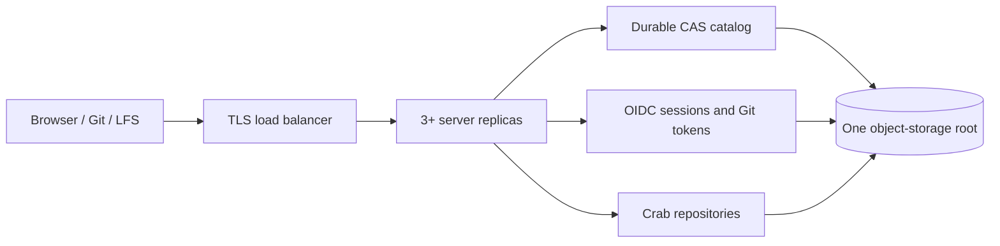
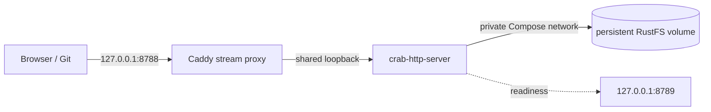
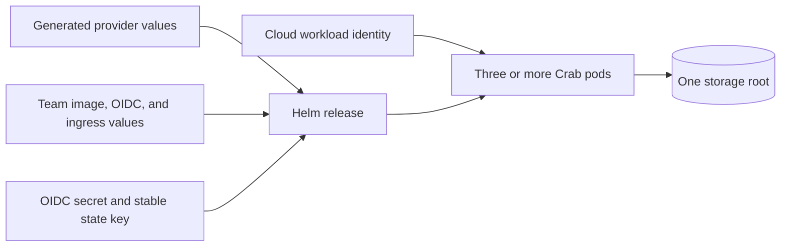

# Deployment profiles

The server embeds Cellar 0.1.0. Native process smoke and peer handoff have been
verified locally; provider, fault, restore, scale, and upgrade qualification are
required before release. See [the runtime contract](../CELLAR.md).

`crab-http-server` has one provider-neutral runtime contract, a one-command local stack, and checked-in deployment profiles for three cloud storage providers:



| Target | Deployment asset | Workload identity | Status |
| --- | --- | --- | --- |
| Local Docker | `compose.yaml` | Synthetic local credentials | Native process smoke passed; container qualification pending |
| EKS | `helm/crab-http-server` | EKS Pod Identity association | Recommended team profile; live qualification required |
| GKE | `helm/crab-http-server` | GKE Workload Identity Federation | Recommended team profile; live qualification required |
| AKS | `helm/crab-http-server` | AKS Workload ID | Recommended team profile; live qualification required |
| ECS/Fargate | `ecs/task-definition.example.json` | ECS task role | Evaluation profile; replacement grace is too short |

The Kubernetes chart generates configuration from typed values, runs three or more replicas,
private probes and Prometheus metrics, an optional Prometheus Operator
`PodMonitor` and alert rules, a disruption budget, ingress isolation, optional
Transport Layer Security (TLS) ingress, and optional autoscaling. A provider is
release-qualified only after its live test matrix passes.

The disruption budget protects ready replicas while allowing an unhealthy pod
to be evicted during a node drain, so a broken process cannot indefinitely
block cluster maintenance.

S3 and GCS Terraform roots bound noncurrent repository versions to a configurable
90-day recovery window and remove abandoned multipart uploads after one day.
Azure versions remain unexpired because its available lifecycle condition cannot
measure age since becoming noncurrent safely. Provider cost alerts and the
restore runbook remain operator responsibilities.

Container CI exercises repository creation, an issue mutation and identical replay,
Git push, and process restart against a private RustFS instance. It retains a
native receipt bound to the exact source and image digest. Backup restore, LFS
faults, and broader provider matrices require new native qualification.

The server image also includes the system `git` executable for the browser's
Git import workflow. That workflow copies Git history and refs only; it does
not include Git LFS payload migration. Configure `[import].allowed_hosts` and
allow the server workload outbound HTTPS/SSH to those hosts (or through the
configured proxy) when this workflow is enabled.

Release publication is disabled until native qualification binds the exact
source, image, SDK version, and provider configuration. The container workflow
builds candidates and retains process-smoke receipts; it does not publish a
qualified server release.

## Start locally with Docker Compose

Docker Engine with Compose v2 is the only prerequisite. From the repository
root, run:

```sh
docker compose --file crates/crab-http-server/deploy/compose.yaml \
  up --detach --build --wait
```

Open <http://127.0.0.1:8788/demo/hello>. The first start builds the locked
server image, starts a private RustFS object store, creates its bucket, creates
the `demo/hello` Crab repository, and waits until the complete stack is ready.
Later starts are idempotent.



The proxy shares the server's network namespace. It is the only process bound
to Docker's published port; Crab still binds to loopback and keeps its
unauthenticated local-trust invariant. The management listener and RustFS are
not published to the host. Compose creates the peer CA and leaf once in a
persistent identity volume, so ordinary container recreation remains in the
same Cell fleet. A partial identity volume fails closed instead of silently
creating a different fleet. The repository initializer publishes its initial native SQLite root before
server startup.
Compose then waits until the catalog is valid and every repository can open its
current Git view. This profile is for local development and evaluation, not
remote or multi-user service. Caddy preserves the validated external loopback
authority, so Git LFS action URLs also follow a custom `CRAB_HTTP_SERVER_PORT`.

### Operate the local stack

Use the one-shot repository service to manage the durable catalog:

```sh
docker compose --file crates/crab-http-server/deploy/compose.yaml run --rm \
  repository-init --config /etc/crab/server.toml repository create \
  --owner my-team --name my-project --prefix my-team/my-project

docker compose --file crates/crab-http-server/deploy/compose.yaml run --rm \
  repository-init --config /etc/crab/server.toml repository list
```

Create returns only after the initial repository SQLite/LTX root has been
published, restored, identity-checked and marked `cell_ready`. Adopted
repositories first verify their complete capsule-v2 Git and shard/xorb closure,
then follow the same empty-Cell initialization and readiness transition; old
collaboration application data is not imported.

Inspect or stop the stack without deleting repositories:

```sh
docker compose --file crates/crab-http-server/deploy/compose.yaml exec server \
  crab-http-server --config /etc/crab/server.toml cells capacity --json --live
docker compose --file crates/crab-http-server/deploy/compose.yaml logs --follow server proxy
docker compose --file crates/crab-http-server/deploy/compose.yaml down
```

The capacity report is the server's resource-derived admission envelope, not a
benchmark result. It reports the configured local-disk limit and current
filesystem free space separately, plus effective capacity as the smaller of
that limit and the backing filesystem total. The configured limit is the
admission ceiling even when the host filesystem is larger. Record it beside
live RSS, file-descriptor, latency and RustFS measurements when qualifying a
node profile.

The local-disk limit bounds Crab staging. Native Cellar cache needs an
appropriate filesystem quota; it does not share the staging budget.

`docker compose down --volumes` permanently removes the local RustFS and peer
identity volumes, including the catalog and every repository. The next start
therefore creates a new, empty Cell fleet. The defaults need no
`.env` file. These optional environment variables customize local operation:

| Variable | Default | Purpose |
|---|---|---|
| `CRAB_HTTP_SERVER_PORT` | `8788` | Localhost port published by Docker |
| `CRAB_TMP_SIZE` | `2g` | Bounded receive-pack and index scratch space |
| `CRAB_HTTP_SERVER_IMAGE` | `crab-http-server:local` | Server image name or prebuilt image reference |

The local Compose stack and native process qualification pin RustFS `1.0.0-glibc` GA by its multi-platform image digest. Use a fresh
project and volume for qualification; earlier beta.8 records retain their original
provider identity and do not qualify GA. The GA image has passed local
Colima startup, bucket creation, peer certificate initialization and the
HTTP/mTLS remote-owner publication/recovery test. Full GA fleet measurements
remain a separate gate.

The dependency images are version- and digest-pinned. `RUSTFS_IMAGE`,
`AWS_CLI_IMAGE`, and `CADDY_IMAGE` exist for controlled mirrors; keep them
pinned when overriding. To use a prebuilt server image, set
`CRAB_HTTP_SERVER_IMAGE` to its manifest digest and add `--no-build` to `up`:

```sh
CRAB_HTTP_SERVER_IMAGE=ghcr.io/crabbuild/crab-http-server@sha256:qualified_digest_here \
  docker compose --file crates/crab-http-server/deploy/compose.yaml \
    up --detach --no-build --wait
```

### Qualify the native runtime

Build the binary with the external `CARGO_TARGET_DIR`, then run
`tests/qualify_cellar_process.py` as described in [the runtime guide](../CELLAR.md).
The native peer tests cover mTLS routing and graceful owner handoff. The process
script covers HTTP, Git publication, and restart recovery against RustFS.

Native multi-process crash, partition, restore, scale, and provider matrices
remain release gates.

## Deploy for a team

Use the Helm chart on Amazon Elastic Kubernetes Service (EKS), Google Kubernetes Engine (GKE), or Azure Kubernetes Service (AKS). One chart preserves the server runtime contract across providers.

The shortest supported team path is:

| Owner | One-time setup | Per release |
| --- | --- | --- |
| Platform team | Apply one provider Terraform root; configure DNS, TLS, ingress, and workload identity | Review infrastructure drift |
| Identity team | Register the OIDC callback and store the client secret | Rotate under the runbook |
| Crab service owner | Create the namespace, stable state-key Secret, and team values | Verify the signed release record, change one image digest, and run `helm upgrade` plus `helm test` |

No repository list belongs in the server configuration. Create or adopt a
repository once through the management CLI; every replica discovers the shared
catalog update from object storage.



Complete the setup in this order:

1. Create versioned storage and provider workload identity with `terraform/aws`, `terraform/gcp`, or `terraform/azure`.
2. Grant the workload identity access only to the dedicated storage boundary.
3. Register the OpenID Connect (OIDC) callback `https://git.example.com/auth/callback`
   and Back-Channel Logout URI `https://git.example.com/auth/backchannel-logout`.
   Set `backchannel_logout_session_required=false`; Crab currently supports
   subject-scoped Logout Tokens, not `sid`-only delivery.
4. Export Terraform's generated provider values and edit the provider-neutral team values file.
5. Create a dedicated namespace with the Restricted Pod Security policy, create
   the Kubernetes Secret, and install the chart.
6. Run `helm test` to prove a fresh workload can read, list, write, conditionally update, and delete through its cloud workload identity.
7. Create the first repository through a running pod.
8. Complete and run the native multi-replica provider/fault qualification before admitting critical repositories; the historical protected workflow currently fails closed.

Do not grant team members direct write credentials for the storage root. Git,
LFS, browser, and administration traffic must pass through the server so its
authorization, locking, and atomic publication rules remain authoritative.
The production chart also rejects static cloud credentials, credential-source
overrides, unsigned or cleartext storage modes, and custom provider endpoints
in `extraEnv`; the provider ServiceAccount is the only supported credential
path.

[The infrastructure bootstrap guide](terraform/README.md) creates storage and
identity. [The Kubernetes deployment guide](helm/crab-http-server/README.md)
contains install commands. [The operations runbook](operations.md) covers
rollout, rollback, rotation, incidents, and restore qualification.

## Repository lifecycle

The server discovers repositories from a bounded, versioned catalog below the
configured storage root. It never scans a bucket and never treats GC metadata
as an application registry.

```sh
crab-http-server --config server.toml repository create \
  --owner my-team --name my-project --prefix my-team/my-project \
  --members-file members.toml

crab-http-server --config server.toml repository adopt \
  --owner my-team --name existing --prefix imports/existing \
  --members-file members.toml

crab-http-server --config server.toml repository set-members \
  --owner my-team --name my-project --members-file members.toml

crab-http-server --config server.toml repository list
```

Pass `--members-file -` to read the TOML membership document from standard
input, which is useful with `kubectl exec --stdin`. Authenticated deployments
require at least one `admin` member when creating or adopting a repository;
unauthenticated loopback deployments may omit membership.

`create` initializes canonical Crab layout and manifest objects, CAS-publishes
`empty_cell_pending`, provisions and verifies the initial SQLite/LTX root, then
CASes `cell_ready`. Exact retries retain the catalog UUID and restore the
published root before completing. `adopt` requires canonical Git objects,
publishes `empty_cell_pending`, initializes a new empty application Cell and
then publishes `cell_ready`. `set-members` uses one conditional catalog update
and reports a conflict instead of replaying a stale decision over a concurrent
change. Browser Settings → Members uses the same revision contract and CSRF
protection. Both paths create one durable membership audit event with the
accepted catalog change. Only version 3 catalogs with canonical relative audit
paths are accepted. Every running replica checks the catalog every five seconds and
swaps routing only after all records pass Cell readiness validation; in-flight
requests retain the previous repository handle.

Back-channel delivery invalidates all browser sessions and derived Git tokens
for the Logout Token's exact issuer and subject. The identity index is mandatory;
sessions without a matching marker require sign-in again. A valid or replayed delivery returns
200, while malformed or invalid tokens return 400.

## Why Lambda is excluded

Lambda is not a supported full data-plane target. Native receive, upload-pack,
LFS, archive downloads, and maintenance can stream for minutes and use large
bounded scratch space. API Gateway and Lambda buffering, payload, duration,
and ephemeral-runtime constraints change those semantics. A future Lambda
adapter may host bounded control-plane operations, but it must not be described
as the same server deployment.
