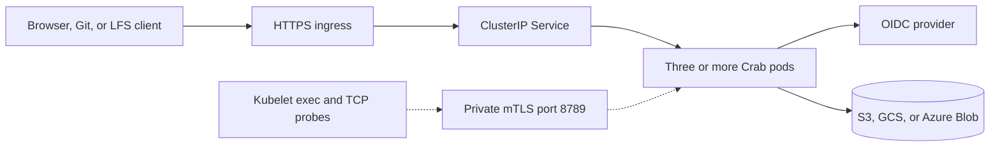

# Deploy Crab for a team on Kubernetes

> Native Cellar 0.1.0 profiles are under qualification. Protected provider/fault
> evidence and published image/chart releases remain pending. See
> [the migration guide](../../../CELLAR.md).

This chart runs `crab-http-server` on Amazon Elastic Kubernetes Service (EKS), Google Kubernetes Engine (GKE), or Azure Kubernetes Service (AKS). Combine one generated provider overlay with one provider-neutral team overlay, create the application and peer-identity Secrets, and install one chart. The chart renders the server configuration and manages replicas, probes, disruption budget, network policy, optional ingress, and optional autoscaling. HTTPS ingress also needs a TLS Secret, usually managed by the platform or cert-manager.

> Production qualification is still incomplete. Read [Production boundaries](#production-boundaries) before serving critical repositories.

## Understand the deployment

Every pod reads one durable catalog and its repositories from the same object-storage root. Pods keep no authoritative state on their scratch volumes.



The private ClusterIP Service exposes port 8788 inside the cluster. The TLS
ingress is the only supported public path. The chart never exposes management
port 8789 through a Service or ingress. The default NetworkPolicy admits public
traffic only on the named `http` port. It admits management traffic between
Crab Pods with the chart selector; metrics scraping requires an additional
explicit source.

## Prepare the platform

Create these resources before installing Crab:

- A Kubernetes 1.29 or newer cluster with at least three schedulable nodes across
  at least two zones, plus capacity for one rollout surge pod
- Helm 3
- GitHub CLI with artifact-attestation support, `jq`, and OpenSSL for release
  verification
- A NetworkPolicy-capable Container Network Interface (CNI)
- Pod Security Admission enabled for the dedicated Crab namespace
- A versioned S3 bucket, Google Cloud Storage (GCS) bucket, or Azure Blob container
- A workload identity with list, read, create, conditional-update, and delete access below one storage prefix
- An OpenID Connect (OIDC) client with `https://git.example.com/auth/callback` as its redirect URI
- An HTTPS ingress controller and TLS Secret when `ingress.enabled` is `true`
- The Kubernetes metrics API when `autoscaling.enabled` is `true`

Use one workload identity mechanism:

| Platform | Identity mechanism | Storage URL |
| --- | --- | --- |
| EKS | [EKS Pod Identity](https://docs.aws.amazon.com/eks/latest/userguide/pod-identities.html) | `s3://bucket/root` |
| GKE | [Workload Identity Federation for GKE](https://docs.cloud.google.com/kubernetes-engine/docs/how-to/workload-identity); metadata-server node selector on Standard only | `gs://bucket/root` |
| AKS | [Microsoft Entra Workload ID](https://learn.microsoft.com/en-us/azure/aks/workload-identity-deploy-cluster) | `az://account/container/root` |

Grant access only below the configured root. Don’t put static cloud keys in the Kubernetes Secret.

Use [the Terraform provider roots](../../terraform/README.md) to create dedicated versioned storage and workload identity for an existing cluster. Skip them when your platform team already manages those resources.

### Preserve workload-identity egress

The chart's NetworkPolicy controls ingress only. If the namespace or cluster has
a separate default-deny egress policy, allow DNS plus the exact identity,
storage, and OIDC destinations used by the deployment:

| Platform | Identity egress required from Crab pods |
| --- | --- |
| EKS | EKS Pod Identity Agent at `169.254.170.23:80` or `[fd00:ec2::23]:80` |
| GKE | GKE metadata server at `169.254.169.254:80`, or `169.254.169.252:988` on clusters that use that endpoint |
| AKS | `login.microsoftonline.com:443`, or the matching sovereign-cloud authority |

Every platform also needs HTTPS access to its object-storage endpoint and the
configured OIDC issuer's discovery, JSON Web Key Set, authorization, and token
endpoints. Prefer provider private endpoints and approved egress gateways when
available. Kubernetes NetworkPolicy has no portable fully qualified domain name
selector, so the chart cannot safely manufacture these provider- and
network-specific rules.

When EKS pods use an outbound proxy, add the Pod Identity link-local addresses
to `NO_PROXY`; otherwise the SDK can send credential requests to the proxy.
See the provider contracts for [EKS Pod Identity](https://docs.aws.amazon.com/eks/latest/userguide/pod-identities.html),
[GKE Workload Identity Federation](https://docs.cloud.google.com/kubernetes-engine/docs/concepts/workload-identity),
and [AKS outbound workload-identity rules](https://learn.microsoft.com/en-us/azure/aks/outbound-rules-control-egress).

## Select an immutable image

Maintainer releases publish `linux/amd64` and `linux/arm64` images to
`ghcr.io/crabbuild/crab-http-server`. The release workflow accepts only an
annotated `crab-http-server-vX.Y.Z` tag that matches this crate's version and is
reachable from `main`. A push of that tag is the only publication trigger. The
workflow qualifies that exact source, generates SBOM and
provenance attestations, and publishes both the version and source-commit tags.
The same release publishes this chart to
`oci://ghcr.io/crabbuild/charts/crab-http-server` with the matching version and
a registry-backed provenance attestation. Its GitHub Release retains the
packaged chart, `crab-http-server-release.json`, and the manifest's offline
attestation bundle. The JSON record is the canonical handoff from release
maintainer to operator: it binds the tag and source commit to the exact image
and chart digests.

Download and verify that handoff before copying its image digest into team
values:

```sh
gh release download crab-http-server-v0.1.0 \
  --repo crabbuild/crab \
  --pattern 'crab-http-server-*'
source_commit=$(jq --raw-output .source_commit crab-http-server-release.json)
gh attestation verify \
  crab-http-server-release.json \
  --bundle crab-http-server-release.attestation.json \
  --repo crabbuild/crab \
  --signer-workflow crabbuild/crab/.github/workflows/http-server-release.yml \
  --source-ref refs/tags/crab-http-server-v0.1.0 \
  --source-digest "$source_commit" \
  --deny-self-hosted-runners
chart_package=$(jq --raw-output .chart.package crab-http-server-release.json)
expected_package_digest=$(jq --raw-output .chart.package_digest crab-http-server-release.json)
actual_package_digest="sha256:$(openssl dgst -sha256 "$chart_package" | awk '{print $NF}')"
test "$actual_package_digest" = "$expected_package_digest"
jq . crab-http-server-release.json
```

Authenticate to GHCR first when the package is private. Put
`.image.repository` in `image.repository` and `.image.digest` in
`image.digest`; the chart never deploys a mutable tag. Verify the image and
chart registry attestations from their `.reference` fields as described in the
[operations preflight](../../operations.md#run-the-preflight-checks).

Until a server release is published, or when maintaining a custom downstream
image, build from the repository root and push the architectures used by your
cluster:

```sh
docker buildx build --platform linux/amd64,linux/arm64 --push \
  --file crates/crab-http-server/deploy/Dockerfile \
  --tag registry.example.com/crab-http-server:release_name_here .
docker buildx imagetools inspect \
  registry.example.com/crab-http-server:release_name_here
```

Copy the reported manifest digest into `image.digest`. Keep the repository in
`image.repository`; don’t put a tag in that value.

## Configure the provider and team overlays

After applying a checked-in Terraform root, export its non-secret provider
values directly:

```sh
terraform -chdir=crates/crab-http-server/deploy/terraform/aws \
  output -raw helm_values > /secure/crab-provider-values.yaml
cp crates/crab-http-server/deploy/helm/crab-http-server/team-values.example.yaml \
  /secure/crab-team-values.yaml
```

Replace `aws` with `gcp` or `azure`. When a platform team manages storage and
identity outside these Terraform roots, copy the matching `eks`, `gke`, or
`aks` provider example to `/secure/crab-provider-values.yaml` and replace its
values.

Without a source checkout, unpack the verified chart downloaded with the
release record, then copy the team and provider examples from that directory:

```sh
chart_package=$(jq --raw-output .chart.package crab-http-server-release.json)
tar -xzf "$chart_package" --directory /secure
cp /secure/crab-http-server/eks-values.example.yaml \
  /secure/crab-provider-values.yaml
cp /secure/crab-http-server/team-values.example.yaml \
  /secure/crab-team-values.yaml
```

Choose `gke-values.example.yaml` or `aks-values.example.yaml` for those
platforms.

The GKE example targets Standard clusters and selects metadata-server-enabled
nodes. Remove its `nodeSelector` on Autopilot. Terraform's required
`gke_cluster_mode` input generates the correct form automatically.

| Overlay | Usually owned by | Contains |
| --- | --- | --- |
| Provider | Platform team / Terraform | Storage root and workload-identity wiring |
| Team | Crab service owner | Image digest, OIDC client, public host, Secret name, ingress and monitoring policy |

Replace or verify every example value across the two overlays:

| Value | Required change |
| --- | --- |
| `image.repository` | Your private image repository |
| `image.digest` | The qualified immutable image digest |
| `config.storageUrl` | Generated by Terraform, or your dedicated object-storage root |
| `config.auth.*` | Your OIDC issuer, client ID, and public HTTPS URL |
| `cells.existingSecret` | Secret containing the peer certificate, Ed25519 key, and CA |
| `cells.tlsServerName` | DNS identity covered by the peer certificate, shared only for TLS name verification |
| `scratch.sizeBytes` | Integer byte limit for both Crab admission and the Pod `emptyDir` |
| `serviceAccount.*` | Your provider workload identity |
| `ingress` and `networkPolicy.publicIngressFrom` | Your HTTPS host, ingress class, TLS Secret, and allowed controller source |
| `metrics` and `networkPolicy.metricsIngressFrom` | Your private Prometheus discovery and allowed scraper source |

The chart rejects image tags, missing digests, unknown top-level values,
automatic Kubernetes API credentials, disabled network isolation, unrestricted
ingress, direct load balancers, overrides of chart-owned pod metadata, fewer
than three replicas, an impossible disruption budget, soft or single-domain
placement, a shutdown budget shorter than 630 seconds, duplicate environment
variables, and cloud credential or storage-endpoint overrides in `extraEnv`.

Use `extraEnv` only for non-credential process settings such as `RUST_LOG` or
an organization proxy. The EKS, GKE, and AKS identity integrations inject or
resolve their credentials after Helm renders the workload; do not copy access
keys, bearer tokens, client secrets, identity endpoints, or provider endpoint
overrides into a values file. `AWS_REGION` and `AWS_DEFAULT_REGION` are the only
provider-prefixed values accepted because the EKS profile needs an explicit
region while still obtaining credentials through Pod Identity.

The PodDisruptionBudget keeps the configured minimum of ready replicas during
voluntary disruption and uses `AlwaysAllow` for unhealthy pods. A running but
permanently unready process therefore cannot block a node drain; healthy pods
remain protected by `minAvailable`.

`config.existingConfigMap` is an advanced escape hatch for teams that own the
complete `server.toml`. Do not combine it with the generated provider overlay,
because that overlay intentionally sets `config.storageUrl`; instead, carry
only its `serviceAccount`, `podLabels`, and permitted region values into a
separate overlay. The chart accepts exactly one configuration source. Its
`cells.local_disk_limit_bytes` must equal `scratch.sizeBytes`; live
qualification rejects a mismatch.

## Create the application and peer Secrets

Write the OIDC client secret and a stable random state key to private files. Keep the state key unchanged across replicas and rollouts.

```sh
mkdir -p /secure/crab-http-server
openssl rand -out /secure/crab-http-server/state-key 32
chmod 0700 /secure/crab-http-server
chmod 0600 /secure/crab-http-server/state-key \
  /secure/crab-http-server/oidc-client-secret
```

Create the namespace, pin all three Pod Security Admission modes to the
supported Restricted policy floor, and create the Secret from those files:

```sh
kubectl create namespace crab --dry-run=client -o yaml | kubectl apply -f -
kubectl label namespace crab --overwrite \
  pod-security.kubernetes.io/enforce=restricted \
  pod-security.kubernetes.io/enforce-version=v1.29 \
  pod-security.kubernetes.io/audit=restricted \
  pod-security.kubernetes.io/audit-version=v1.29 \
  pod-security.kubernetes.io/warn=restricted \
  pod-security.kubernetes.io/warn-version=v1.29
kubectl --namespace crab create secret generic crab-http-server \
  --from-file=oidc-client-secret=/secure/crab-http-server/oidc-client-secret \
  --from-file=state-key=/secure/crab-http-server/state-key \
  --dry-run=client -o yaml | kubectl apply -f -
```

When the identity provider registers Crab as a public Proof Key for Code Exchange (PKCE) client, set `secrets.oidcClientSecretKey` to an empty string. The chart omits `client_secret_file`, and the Secret needs only `state-key`.

Create an Ed25519 peer CA and a fleet certificate with both client and server
authentication. Its DNS SAN must equal `cells.tlsServerName`; the default is
`crab-http-server-peer`. The advertised endpoint is each Pod IP. Crab verifies
the CA chain against the stable TLS name, then pins the exact leaf certificate
and public key recorded in the signed node advertisement before sending a peer
request.

```sh
openssl genpkey -algorithm ED25519 -out /secure/crab-http-server/peer-ca.key
openssl req -x509 -new -days 365 -key /secure/crab-http-server/peer-ca.key \
  -addext 'basicConstraints=critical,CA:TRUE' \
  -addext 'keyUsage=critical,keyCertSign,cRLSign' \
  -subj /CN=Crab-Peer-CA -out /secure/crab-http-server/peer-ca.crt
openssl genpkey -algorithm ED25519 -out /secure/crab-http-server/peer.key
openssl req -new -key /secure/crab-http-server/peer.key \
  -subj /CN=crab-http-server-peer \
  -out /secure/crab-http-server/peer.csr
printf '%s\n' \
  'basicConstraints=critical,CA:FALSE' \
  'keyUsage=critical,digitalSignature' \
  'extendedKeyUsage=serverAuth,clientAuth' \
  'subjectAltName=DNS:crab-http-server-peer' \
  > /secure/crab-http-server/peer.ext
openssl x509 -req -days 90 -CAcreateserial \
  -CA /secure/crab-http-server/peer-ca.crt \
  -CAkey /secure/crab-http-server/peer-ca.key \
  -in /secure/crab-http-server/peer.csr \
  -extfile /secure/crab-http-server/peer.ext \
  -out /secure/crab-http-server/peer.crt
kubectl --namespace crab create secret generic crab-http-server-peer \
  --from-file=tls.crt=/secure/crab-http-server/peer.crt \
  --from-file=tls.key=/secure/crab-http-server/peer.key \
  --from-file=ca.crt=/secure/crab-http-server/peer-ca.crt \
  --dry-run=client -o yaml | kubectl apply -f -
```

Keep the CA key offline. Rotate a leaf signed by the same CA through a
one-Pod-at-a-time rollout; signed advertisements make peers pin each live
process's exact replacement leaf. A CA rotation requires one reviewed trust
bundle on every Pod before any certificate starts using the new CA.

## Install the server

Install or upgrade Crab with both overlays:

```sh
helm upgrade --install crab-http-server \
  crates/crab-http-server/deploy/helm/crab-http-server \
  --namespace crab --create-namespace \
  --values /secure/crab-provider-values.yaml \
  --values /secure/crab-team-values.yaml \
  --atomic --history-max 10 --timeout 15m
```

When installing without a source checkout, replace the local chart path with
the verified package returned by
`jq --raw-output .chart.package crab-http-server-release.json`. Installing the
downloaded file avoids resolving a mutable registry version between
verification and rollout.

Pods start the native Cellar runtime directly. Mixed-version rollout and rollback
must be qualified before release. See [the runtime contract](../../../CELLAR.md).

The Deployment becomes ready only after a pod can read and validate the durable
catalog and open the current Git view of every discovered repository. Confirm
the rollout and inspect the catalog:

```sh
kubectl --namespace crab rollout status deployment/crab-http-server --timeout=15m
kubectl --namespace crab exec deployment/crab-http-server -- \
  crab-http-server --config /etc/crab/http-server/server.toml healthcheck
kubectl --namespace crab exec deployment/crab-http-server -- \
  crab-http-server --config /etc/crab/http-server/server.toml repository list
helm test crab-http-server --namespace crab --logs --timeout 3m
```

The Helm test starts a fresh hardened pod with the release ServiceAccount,
configuration, Secret, cloud environment, and immutable image. Its
`storage-probe` command reads the durable catalog, performs a bounded list,
claims and releases a dedicated coordination slot with conditional writes,
writes and deletes a unique probe object, and confirms that deletion is
visible. It does not send traffic through ingress; use the live qualification
below for that boundary.

## Create the first repository

Run repository administration through a pod that already has configuration
and workload identity. First create a private local membership file using the
OIDC provider's stable `sub` claim for the initial administrator. After the
administrator signs in, Crab displays that subject on the empty repository
page and returns it from `/api/session`:

```toml
members = [
  { subject = "provider-subject-for-alice", name = "Alice", access = "admin" },
]
```

Pipe that file over standard input so it is neither baked into the image nor
persisted in a Kubernetes object:

```sh
kubectl --namespace crab exec --stdin deployment/crab-http-server -- \
  crab-http-server --config /etc/crab/http-server/server.toml repository create \
  --owner your_team --name your_project \
  --prefix your_team/your_project --default-branch main \
  --members-file - < /secure/crab-members.toml
```

Authenticated repository creation and adoption fail unless the supplied
membership contains at least one administrator; this prevents creating a
repository that nobody can manage or open. Create publishes and verifies the
initial SQLite/LTX root before marking the record `cell_ready`. Every healthy
replica discovers that ready record on its next five-second catalog poll. A
pending record fails the refresh readiness gate and is never routed. Use
`repository adopt` when the target prefix already contains a canonical Crab Git
repository. Adoption authenticates its capsule-v2 view, embedded Git packs, and
complete shard/xorb closure before catalog publication; missing or corrupt data
leaves the catalog unchanged. It creates a new empty application Cell and does
not import old collaboration data.

Use the same private-file pattern to replace membership later:

```sh
kubectl --namespace crab exec --stdin deployment/crab-http-server -- \
  crab-http-server --config /etc/crab/http-server/server.toml \
  repository set-members --owner your_team --name your_project \
  --members-file - < /secure/crab-members.toml
```

The command uses one conditional catalog update and fails on a concurrent
catalog change. Review `repository list` before retrying so a stale operator
decision cannot overwrite newer membership. Browser administrators can make the
same complete replacement in **Settings → Members** with the session CSRF token;
both paths produce a durable membership audit event. Only version 3 catalogs
with canonical relative audit paths are accepted.

Register `https://git.example.com/auth/backchannel-logout` with the OIDC
provider and set `backchannel_logout_session_required=false`. It accepts signed
subject-scoped Logout Tokens and returns 200 for valid or replayed delivery,
400 for invalid delivery. It does not support `sid`-only tokens. Sessions require
a matching identity-index marker; unindexed sessions must sign in again. Prove a
test user's browser sessions and scoped Git token fail after provider logout.

## Qualify the live deployment

The chart is a deployment profile. Native provider, crash/partition, restore,
scale, and upgrade qualification remain required before production release.
Use [the native verification guide](../../../CELLAR.md#verification) for current
process and peer smoke proof; these checks do not qualify a cloud deployment.

Workload identity can be inspected independently with
`qualification/verify-workload-identity.sh`. Keep cluster access separate from
the server's object-storage identity.

## Enable HTTPS ingress

Enable ingress only after installing an ingress controller and creating the TLS Secret. The ingress host must match `config.auth.publicUrl`; the chart rejects a mismatch.

```yaml
ingress:
  enabled: true
  className: nginx
  annotations:
    nginx.ingress.kubernetes.io/proxy-body-size: "0"
    nginx.ingress.kubernetes.io/proxy-buffering: "off"
    nginx.ingress.kubernetes.io/proxy-http-version: "1.1"
    nginx.ingress.kubernetes.io/proxy-next-upstream: "off"
    nginx.ingress.kubernetes.io/proxy-read-timeout: "630"
    nginx.ingress.kubernetes.io/proxy-request-buffering: "off"
    nginx.ingress.kubernetes.io/proxy-send-timeout: "630"
    nginx.ingress.kubernetes.io/ssl-redirect: "true"
  host: git.example.com
  tlsSecretName: crab-http-server-tls

networkPolicy:
  publicIngressFrom:
    - namespaceSelector:
        matchLabels:
          kubernetes.io/metadata.name: ingress-nginx
```

The checked-in team overlay applies these ingress-nginx settings. They stream
request and response bodies, preserve HTTP/1.1 to the server, delegate request
size enforcement to Crab, require HTTPS redirection, and keep an idle upstream
connection open beyond the ten-minute archive budget. Upstream retries are
disabled because `GET /auth/callback` consumes one-time OIDC state; the server
or client, not the proxy, owns recovery from an indeterminate request. For
another ingress controller, replace the annotations with equivalent
request-body, streaming, upstream timeout, idle timeout, HTTPS redirect,
single-attempt, and connection-drain settings.

## Enable autoscaling

Enable the Horizontal Pod Autoscaler (HPA) after the cluster reports pod CPU metrics:

```yaml
autoscaling:
  enabled: true
  minReplicas: 2
  maxReplicas: 10
  targetCPUUtilizationPercentage: 70
```

CPU scaling protects general request capacity. It does not raise long-running
transfer capacity: every replica shares four renewable object-store CAS slots
for Git, LFS, archive, and release-asset transfers. Application, interactive
read, and maintenance admission remain process-local. Scale only after the
shared-admission rejection counter and storage latency show that more general
request capacity will help.

## Scrape Prometheus metrics

The private management listener serves `GET /metrics`. On a cluster with the
Prometheus Operator, let the chart create a `PodMonitor` and allow only the
namespace or pods that run your scraper. Its labels must match the Prometheus
`podMonitorSelector`:

```yaml
metrics:
  podMonitor:
    enabled: true
    existingSecret: crab-http-server-metrics
    labels:
      prometheus: platform
    interval: 30s
    scrapeTimeout: 10s

networkPolicy:
  metricsIngressFrom:
    - namespaceSelector:
        matchLabels:
          kubernetes.io/metadata.name: monitoring
```

`crab-http-server-metrics` must contain `tls.crt`, `tls.key`, and `ca.crt`.
Issue an Ed25519 client-auth certificate from the same CA as the Cell peers,
but use a separate Secret: the peer Secret also carries node identity and must
not be mounted into Prometheus. The PodMonitor verifies
`cells.tlsServerName` while scraping the management listener over mTLS.

The application Service and ingress never expose port 8789. Metrics have
bounded labels and retain request duration through streaming response
completion. The `PodMonitor` selects Crab pods directly, so no public or
management Service is created.

### Install baseline alert rules

Clusters with the Prometheus Operator can install Crab's optional
`PrometheusRule`. Its metadata labels must match the Prometheus
`ruleSelector`. The scrape configuration must retain the standard `namespace`
and `pod` target labels used to isolate one Helm release:

```yaml
metrics:
  podMonitor:
    enabled: true
    existingSecret: crab-http-server-metrics
    labels:
      prometheus: platform
  prometheusRule:
    enabled: true
    labels:
      prometheus: platform
      role: alert-rules
    runbookUrl: https://operations.example.com/runbooks/crab-http-server

networkPolicy:
  metricsIngressFrom:
    - namespaceSelector:
        matchLabels:
          kubernetes.io/metadata.name: monitoring
```

The `PodMonitor` labels must match the Prometheus `podMonitorSelector`; the rule
labels must independently match its `ruleSelector`. The rules alert on missing
metrics, sustained catalog failure, repeated catalog refresh failures,
sustained local Git admission exhaustion, repeated deployment-wide transfer
rejections, and a five-percent 5xx rate after a minimum traffic floor. They are
disabled by default because the `PrometheusRule` custom
resource must already exist. The chart rejects rules without metrics discovery
or an explicit private scraper source. Route the included `critical` and
`warning` severities through Alertmanager, then tune thresholds only from
recorded workload evidence.

## Restrict network sources

The NetworkPolicy blocks every source until you select the pods, namespaces, or
IP ranges allowed to reach port 8788. Ingress rejects an empty
`publicIngressFrom`; the `PodMonitor` rejects an empty
`metricsIngressFrom`. Select an ingress controller with a standard
`namespaceSelector`, `podSelector`, or `ipBlock` entry:

```yaml
networkPolicy:
  publicIngressFrom:
    - namespaceSelector:
        matchLabels:
          kubernetes.io/metadata.name: ingress-nginx
```

The chart does not allow the policy to be disabled. Verify that your CNI
enforces it and that kubelet readiness probes still succeed before exposing the
ingress. This chart-owned policy intentionally has no `Egress` policy type; any
cluster-owned egress policy must preserve the destinations above. The Service
is always private `ClusterIP`; public traffic has one supported path through
the TLS ingress.

Every public or metrics peer must contain a nonempty label or expression
selector, or a bounded CIDR. Empty peers, selectors that match everything by
themselves, and the unrestricted `0.0.0.0/0` and `::/0` CIDRs fail rendering.
A namespace selector may remain empty only when a pod selector narrows the
source across namespaces.

## Roll out configuration and secret changes

The chart hashes its generated server configuration, so a typed configuration change starts a rolling replacement. Externally managed ConfigMaps and Secrets don’t change the pod template automatically.

Set a new rollout token after rotating an external input:

```sh
helm upgrade crab-http-server \
  crates/crab-http-server/deploy/helm/crab-http-server \
  --namespace crab \
  --values /secure/crab-provider-values.yaml \
  --values /secure/crab-team-values.yaml \
  --set-string rolloutToken="$(date -u +%Y%m%dT%H%M%SZ)" \
  --atomic --history-max 10 --timeout 15m
```

Rotate the OIDC client secret without changing the state key. Changing the state key invalidates browser sessions and in-flight OIDC transactions.

## Production boundaries

The chart is portable deployment evidence, not provider qualification. Before production use, run a dedicated live test for push, fetch, LFS upload/download, OIDC callback routing across replicas, rolling replacement, and object-store restore.

The current server still lacks complete abrupt-process-crash qualification,
provider-scale admission and throughput evidence, and a
version-selected provider restore drill. Local container CI proves the portable
complete-root copy and independent restored reads, not a cloud recovery point.
Prefer Kubernetes over AWS Fargate for long streams: Fargate limits container
stop timeout to 120 seconds, while Crab permits operations lasting up to ten
minutes.

Use [the operations runbook](../../operations.md) for rollout, rollback, rotation, incident response, and restore qualification.
