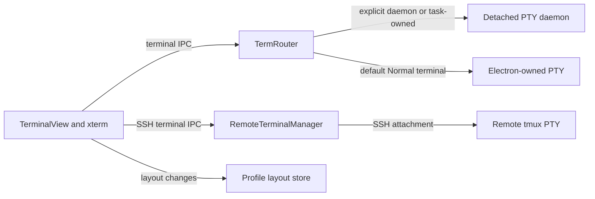

# Terminal Subsystem Architecture

The terminal subsystem provides a full-featured terminal emulator
within Crab Desktop. It manages PTY processes, handles shell
environment detection, implements split panes, and integrates with
the broader application through shell integration and command
detection.

## System Overview



Electron owns ordinary Normal terminals, routing, and renderer attachments.
The daemon owns explicitly durable shells and task/agent sessions.
Closing an app window, quitting, or
upgrading disconnects the client without killing daemon PTYs. The next app
instance discovers live owners and routes each existing session back to its daemon.
New sessions use the current application's runtime, so deleting an older app bundle
does not block daemon creation. Normal terminals remain ephemeral.
The packaged daemon launches through its logical
`app.asar/dist-electron/daemon/daemon-main.cjs` entry. Electron resolves its native
modules into the unpacked files; using the physical `.unpacked` entry makes
node-pty expand its helper path twice and prevents macOS shell creation.
Live daemon replacement is deferred while PTYs exist: the adopted-fd backend
cannot resize those PTYs. Application updates retain existing owners and start
a current runtime for new sessions. Owner-specific disconnects only close that
owner's renderer attachments.

Repository and task surfaces compose `TerminalView`, including its emulator,
input routing, toolbar, and persistence. The toolbar's Daemon/Normal selection
applies to subsequent tabs and splits. It does not convert existing processes.
Normal terminals use the same emulator capabilities with Electron-owned lifetime.
Daemon unavailability disables durable creation and leaves explicit normal creation
available. Daemon tab close detaches; normal tab close terminates.
The window loads before terminal initialization. Once both bridges register their
IPC handlers, the main process publishes readiness and configured mode so an
early failed renderer query cannot leave working daemon controls disabled.

Daemon control files remain home-scoped under `daemon/runtimes/<entry-path-hash>/`.
The app discovers these owners and the root endpoint shipped in v2.0.0-alpha.1.
Only existing sessions route to previous owners; they are never killed to make
room for new terminals. Quota configuration stays at `daemon/quotas.json` and
applies to each owner. Histories belong to each runtime, preventing cold restore
of another owner's live process. On startup, atomic directory moves claim history
from dead owners (including alpha.1's global history); live histories stay put.
Unix socket paths that fit retain their filesystem address. Longer paths use a hash of the complete
control path in a private, user-owned directory under `/tmp`; tokens and PID
metadata stay in the home directory. Startup rejects public or symlinked
socket directories. Clients, stale cleanup and daemon shutdown resolve the
same address, so long homes do not lose terminals or collide through pathname
truncation. Windows uses its separate hashed named-pipe namespace.

Each terminal has a UUID-based renderer ID. Daemon IDs combine the repository
or task owner with that ID; creating a terminal after a restart cannot reuse a
surviving session's identity. The same router ID reaches the local bridge.

`TerminalKeepAlive` keys its bounded renderer cache by repository path. LRU
eviction disposes xterm, timers and subscriptions, and detaches durable sessions.
The layout store saves tab identities, pane membership, nested split directions
and sizes, active tabs and focused pane whenever they change. Writes use atomic
replacement, independent of window-close and updater event timing. Existing v1
flat layouts remain readable for the v2.0.0-alpha.1 upgrade boundary.
Each saved local tab records its resolved session type. Normal tabs restore as
fresh normal shells without requiring the daemon; a daemon-list failure must
not block them or change their ownership. Layouts predating this field keep the
existing live-session discovery and configured-default behavior.

Warm attach maps saved identities to live sessions before reconstructing the
split tree. Snapshots enter the alternate screen before painting agent content;
remaining terminal modes are restored without clearing that screen. Every input
surface uses the same backend selection, including paste, broadcast and command
replay. Failed restores keep tab identities and allow Enter to retry. A missing
local process may reopen as a fresh shell; saved startup commands and credentials
are not replayed.

SSH terminals use remote tmux through a separate `crab-desktop` socket. An SSH
channel is an attachment, not the owner of the remote process. The layout stores
profile and remote terminal identities. Restore checks that session exists, then
attaches and lets tmux redraw. Detach preserves it; explicit termination kills
only that named session. Missing tmux and missing sessions are visible failures.

The PTY prewarm pool is disabled. `crab:term-pool-hint` remains a no-op for the
preload API shipped in v2.0.0-alpha.1.

## Shell Environment

On macOS, GUI applications don't inherit the user's shell PATH. The
terminal subsystem builds an expanded environment:

### PATH Resolution

1. Read the user's login shell PATH: `$SHELL -ilc 'printf "%s" "$PATH"'`
2. Append common tool directories:
   - `~/.cargo/bin` (Rust tools, crab)
   - `/usr/local/bin` (Homebrew on Intel Mac)
   - `/opt/homebrew/bin` (Homebrew on Apple Silicon)
   - `~/.local/bin` (pip, pipx)
   - `~/.local/share/mise/shims` (mise version manager)
   - `~/.npm-global/bin` (npm global packages)
3. Detect nvm installations and add Node version directories
4. Detect mise-installed Node versions

### Environment Variables

| Variable | Value | Purpose |
|----------|-------|---------|
| `TERM` | `xterm-256color` | Terminal type for color support |
| `COLORTERM` | `truecolor` | 24-bit color support |
| `LANG` | Inherited | Locale for character encoding |
| `HOME` | Inherited | User's home directory |
| `SHELL` | Detected | User's login shell |

## Split Pane Management

The terminal view supports multiple panes in a grid layout:

```
┌─────────────────────────────────────────┐
│  Terminal 1          │  Terminal 2       │
│  ~/project (main)   │  ~/project (main) │
│  $ npm run test     │  $ git log        │
│  ...                │  ...              │
├─────────────────────┤                   │
│  Terminal 3          │                   │
│  ~/project (main)   │                   │
│  $ htop             │                   │
└─────────────────────┴───────────────────┘
```

Panes are managed using `react-resizable-panels`:
- Horizontal splits create side-by-side panes
- Vertical splits create stacked panes
- Each pane has its own PTY process and XTerm instance
- Pane sizes are user-adjustable via drag handles

## Font rendering

Repository, SSH, and task terminals share the WebGL eligibility check in
`src/lib/terminal-font.ts`. Before loading the addon, it checks the canvas font
syntax xterm uses for upright glyphs. Electron's Chromium parser can silently
reject that syntax and leave the atlas at `10px sans-serif`
([upstream report](https://github.com/electron/electron/issues/55616)). In that
runtime, xterm keeps its built-in DOM renderer and the selected font settings.
Resetting preferences cannot repair a runtime parser. The check enables WebGL
automatically once the parser supports that syntax; remove it when the minimum
runtime and xterm versions no longer need it. Saved log replay already uses DOM
rendering.

## Shell Integration

When the shell supports it (zsh with precmd/preexec hooks), the
terminal tracks command execution:

### Tracked State

```typescript
interface ShellIntegrationState {
  cwd: string;              // Current working directory
  lastCommand: string;      // Most recent command text
  lastExitCode: number;     // Exit code of last command
  commandStart: number;     // Timestamp when command started
  commandEnd: number;       // Timestamp when command finished
  isRunning: boolean;       // Whether a command is currently executing
}
```

### Features Enabled by Shell Integration

- **Breadcrumb bar**: Shows current directory and branch
- **Command duration**: Displays elapsed time for long commands
- **Exit code indicator**: Shows success/failure per command
- **Notification triggers**: Notifies on completion of long commands
- **Command bookmarking**: Save commands by clicking the bookmark icon

## Terminal Registry

A global registry tracks all terminal instances for cross-component
access:

```typescript
// Register a new terminal
registerTerminal(id, { shell, cwd, createdAt });

// Append output (for logging/replay)
appendOutput(id, data);

// Get recent output (for crash dumps)
terminalTail(id, lines);

// Mark as closed
markTerminalClosed(id);
```

## Paste Guard

The paste guard protects against accidental execution of dangerous
content:

### Analysis

```typescript
interface PasteAnalysis {
  lineCount: number;        // Multi-line detection
  hasSudo: boolean;         // Privilege escalation
  hasRm: boolean;           // Destructive commands
  hasPipe: boolean;         // Piped commands (harder to review)
  estimatedCommands: number; // Number of commands in paste
  risk: "low" | "medium" | "high";
}
```

### Confirmation Dialog

When risk is medium or high, a dialog shows:
- The paste content (syntax highlighted)
- Risk assessment
- Options: Paste as-is, Paste with bracketed paste mode, Cancel

## Scrollback Management

Scrollback is configurable with memory awareness:

| Setting | Range | Default |
|---------|-------|---------|
| Max lines | 1,000 – 100,000 | 10,000 |
| Estimated memory | 200 KB – 20 MB | 2 MB |

The memory estimate assumes ~200 bytes per line (characters +
terminal attributes). This is displayed in settings to help users
make informed choices.

## Crash Recovery

If a PTY process dies unexpectedly:

1. The terminal shows a crash banner with the error
2. Scrollback from before the crash is preserved
3. A "Restart" button spawns a new PTY in the same pane
4. Other panes are unaffected (process isolation)

The crash banner includes:
- Exit code or signal that killed the process
- Last few lines of stderr (if available)
- Restart and Close buttons
