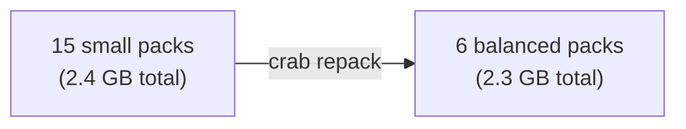

## Optimizing Remote Storage Layout

Every push creates a new pack file in the remote store. Over time, dozens or hundreds of small packs accumulate. This increases S3 listing latency, adds per-object overhead costs, and slows down clone and fetch operations.

Repacking uses Git's geometric policy to roll up smaller packs into fewer,
progressively larger ones. Large stable packs stay in place, so maintenance
does not repeatedly rewrite the full history.



## How Repacking Works

1. Requires Capsule authority and captures the authenticated repository root.
2. Opens the complete repack view from that root, including current catalogs and
   visibility.
3. Selects a geometric suffix from compressed physical source sizes; format
   admission can also require consolidation. Stable-prefix sources remain intact.
4. Consolidates selected sources with verified Git pack mechanics, then publishes
   their checkpoint with an exact-root compare-and-swap.
5. Reports actual selected body I/O and the resulting inventory for this pass.
   A following no-op reports zero body work.

Small frontiers reuse already authenticated capsule bodies; larger frontiers use
bounded control and range reads. This path does not write a unified manifest,
legacy locator, or generation receipt.

Old sources leave the active checkpoint inventory, but immutable recovery history
can continue referencing them. Repack improves active reads. To reclaim older
storage, preview and apply a retained-history boundary before repository GC.

### Atomicity and Safety

Publication stays bound to the captured root and preserves concurrent ref updates
as an authenticated suffix. A competing root replacement leaves the pass
unpublished; its summary retains the input inventory and actual body work rather
than attributing another writer's result to this command. GC-fence conflicts
remain retryable; uncertain publication retains evidence for reconciliation.

Dry-run does not publish or read pack bodies. It reports captured pack count and
bytes, with zero body-work counters. It does not estimate replacement size.

## Usage

### Preview pack statistics

```bash
crab repack --dry-run
```

`repack dry run: 15 packs, 2400000000 bytes, 0.1s`

### Run the repack

```bash
crab repack
```

```text
repack complete: 15 → 6 packs, 2400000000 → 2300000000 bytes, 4.2s
```

## When to Repack

| Signal | Action |
|--------|--------|
| Many small pushes accumulated | Repack to consolidate |
| `crab du --remote` shows high object count | Repack to reduce listing overhead |
| Clone/fetch feels slow | Fewer packs = fewer round-trips |
| Periodic maintenance | Run weekly in CI for active repos |

The `repack_auto_threshold` config option emits an advisory warning after a
fetch when the pack count exceeds a threshold. It does not run consolidation
on the developer's push/fetch path:

```toml
# .crab/local.toml
repack_auto_threshold = 20
```

## Repack vs. Xorb Optimization

These optimize different things:

| | `crab optimize packs` | `crab optimize xorbs` |
|---|---|---|
| **Operates on** | Git pack files | Content-addressed xorbs |
| **Goal** | Reduce pack count and listing overhead | Optimize xorb size for access patterns |
| **When** | After many pushes | When xorb sizes don't match your workload |

## CLI Reference

For complete command syntax and all available flags, see the [crab repack reference](/docs/cli/reference/crab-repack).
