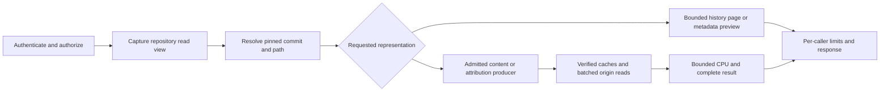

# Plan 020: Harden Crab v2 attribution, history, and content reads

> **Executor instructions:** Read this plan completely. Execute one packet at a
> time, honor its dependencies, and retain source-bound proof before changing its
> status. Source existence or passing fixture tests do not establish production
> performance. Do not implement the conditional storage-format work until its
> decision gate passes. Follow root and nearest scoped `AGENTS.md` instructions.
>
> **Drift check, from repository root:**
> `git status --short`, then
> `git diff --stat aafb6d256c5e8d3a8e768d31dd887a18f2afd2e4 -- crates/crab-remote-git crates/crab-server crates/crab-sdk crates/crab-read crates/crab-metadata crates/crab-remote/examples packages/ui crab/scripts/e2e .github/workflows plans/020-crab-v2-read-hardening.md`
> Inspect relevant untracked files separately. Reconcile expected changes from
> completed packets; stop on unexpected contract or ownership drift. Never
> overwrite another task's changes to satisfy an excerpt.

## Status and scope

- **Priority:** P1 read-path hardening; correctness gates precede tuning.
- **Effort:** L, delivered through separately reviewable packets.
- **Risk:** HIGH overall; cursor, authority, cancellation, and budget semantics
  are more sensitive than the individual speedups.
- **Category:** performance, correctness, resource ownership, qualification.
- **Planned at:** `aafb6d256c5e8d3a8e768d31dd887a18f2afd2e4`, 2026-11-17.
- **Target:** `crab-v2`; revalidate the target before execution.
- **Target synchronization:** rebased onto `14c847e13fa`, which adopts published
  Cellar 0.1.2. The retired `590640c7ce49` Git pin is removed. Older runtime
  results retain their original SDK/source binding; published-dependency builds
  and live verification are separate. The packaged SDK's 1,085 code files match
  the approved source, with matching feature definitions. Clean production builds,
  54 two-replica RustFS checks, minimum-profile Linux OAuth and an explicit
  real RustFS three-node Fleet handoff now pass at `bf5cb36e176`. Published-SDK
  repeatability and composed numerical/targeted resource gates also pass;
  integrated acceptance remains open for CI gaps.
- **Delivery status:** IMPLEMENTED; ACCEPTANCE OPEN. R0–R5 are implemented.
  Current source-bound two-replica Git-read/session smoke and focused native
  Git/work-counter comparisons pass. Earlier ARM64 minimum-profile proof keeps
  its actual compiled revision. The approved Cellar fix now passes a fresh two-replica
  cold/aged/local-reload sequence. Independent-growth and lifecycle component
  checks pass. Failed performance profiles remain retained; the composed
  comparison and fresh soak proof are recorded separately. See the
  [combined qualification report](../crab/docs/benchmarks/v2-read-hardening-rustfs-2026-11-19.md).
- **Remaining priorities:** resolve SDK read-limit coverage and current-head CI
  failures before claiming integrated acceptance. A separate SDK content-cache
  follow-up must diagnose warm large-file origin-byte amplification near 2.0×.
  Metadata batching/page reuse is implemented; all 200 independent-growth
  controls, thirteen lifecycle checks and 27 repeatability timing bands pass.
  A fresh ten-arm follow-up passes all four resource gates, four clean exits,
  active durability proofs and 21 clock checks, including two 600-second soaks
  per variant. Composing all 126 valid original short arms with all ten fresh
  arms passes the original 22-case numerical gates over 14,317,090 measured
  successful Git comparisons. This does not relabel the original failed full
  profile; its compiler overlaps and reference RSS failures remain retained.
  Raw benchmark JSON stays outside the PR.
- **Depends on:** existing read/authority contracts and the applicable resource
  ownership work in `plans/017-local-cache-read-hardening.md`.

This plan covers repository-wide first-parent history, file/path history,
directory/file last-change attribution, first-parent line blame, ordinary Git
file previews/downloads, and the shared runtime they consume. It strengthens
correctness and throughput together. It does not claim to harden every Crab v2
subsystem or complete the broader product/release roadmaps.

`plans/017-post-launch-product-hardening.md` and
`plans/018-product-readiness-roadmap.md` remain product-level owners.
`crab/docs/architecture/indexed-remote-reads.md` remains the existing indexed-read
evidence ledger. Reuse its implemented indexes and retained failures; do not
restart that initiative or mark its outstanding gates complete from this plan.

## Outcome and decision summary

After the first delivery wave, late first-parent history pages do page-sized
work, oversized file inspection avoids full payload reconstruction, identical
cold blame requests share one producer, and expensive reads cannot consume all
interactive capacity. Verification and authorization remain authoritative on
cache hits. Every claimed improvement has deterministic work counters plus
real HTTP/provider measurements.

| Packet | Deliverable                                                              | Effort | Risk | Depends on             | Status      |
| ------ | ------------------------------------------------------------------------ | ------ | ---- | ---------------------- | ----------- |
| R0     | Freeze contracts, add missing measurements, retain the baseline          | M      | MED  | —                      | MEASURED    |
| R1     | Resume first-parent history without prefix rewalking                     | M      | HIGH | R0                     | IMPLEMENTED |
| R2     | Add a truthful metadata-first file-preview representation                | M      | MED  | R0                     | IMPLEMENTED |
| R3     | Coalesce blame with independent waiter budgets and fair HTTP admission   | L      | HIGH | R0                     | IMPLEMENTED |
| R4     | Bound and offload cache verification and diff CPU work                   | M      | HIGH | R0; coordinate with R3 | IMPLEMENTED |
| R5     | Add authorized conditional reads for selected representations            | M      | HIGH | R2                     | IMPLEMENTED |
| R6     | Decide whether persistent attribution or a new range representation pays | L      | HIGH | R1–R5 measurements     | DEFERRED    |
| R7     | Qualify the combined source and publish the supported envelope           | L      | HIGH | R1–R5                  | GATES OPEN  |

Recommended order: R0; R1 and R2; R4; R3; R5; R7. R1 and R2 can use independent
worktrees after R0 freezes their contracts. R3 and R4 share runtime/budget code;
integrate them sequentially. R6 is not required for accepting the first wave.

### Current read-optimization priorities

1. **Metadata-index I/O:** implemented in `a5d6015e2c8`. Adjacent requested cold
   pages share exact transfers within the existing 8-MiB/256-entry cache and
   whole-wave admission. At 10,000 commits, object-batch query reads fall
   45 → 32 and history 115 → 108, with identical bytes and Git results. Warm
   pages and unselected gaps are excluded; independent page validation remains.
   Further changes require a measured remaining bottleneck.
2. **Combined-load gates and repeatability:** full native scaling passes all
   72 original cells after 1,200 fresh processes and 7,200 Git checks. The prior
   complete 128-trial HTTP comparison improves the named late-history p95 by
   32.8%, but retains 15 short-case latency failures. The allocator correction
   passes all four sustained resource checks; thirteen of twenty-seven
   identical-code timing controls still fail. A parallel provider relay shows
   no consistent benefit and is removed. Queued session verification now
   reduces actual RustFS GETs per HTTP attempt by 4.6% under mixed load and 8.6%
   at 32 clients across twelve fixed trials, with zero Git mismatches. This
   isolates storage-work reduction; latency acceptance remains open. A new
   360-trial same-executable check completes with all four resource checks
   passed, but 20 of 27 timing bands failed in both directions. All 10,320,137
   measured Git comparisons pass. The full original R0/current comparison,
   including both 600-second soaks, remains gated. The next prospective check
   uses the existing fifteen-quiet-seconds pair protocol with independent
   compiler monitoring; interrupted pairs and every error remain retained.
   Exact journals, percentiles, workloads and numeric thresholds stay unchanged.
   The published-SDK attempt reaches 216 accepted trials before the test VM
   jumps to year 2122; an incomplete arm has one request error. The failed run
   is retained and the full comparison never starts. The owned VM is restarted;
   clock health and fresh, verified fixtures precede the next complete run.
   Fresh fixtures now pass all 54 HTTP checks and minimum-resource Linux OAuth;
   the next schedule adds fatal clock checks before and after every pair.
3. **Independent growth and minimum-resource lifecycle:** all 200 original growth
   timing controls pass across 2,000 fresh processes and 20,000 canonical Git
   queries, with 1 CPU / 1 GiB / no additional swap per reader. The naturally
   aged cold-reader GC sequence passes 13 checks and 40 Git queries. Current
   allocator runtime's ARM64 process/three-node recovery CI passes, including
   3-GiB stock Git LFS recovery and full Root copy verification. The corrected
   session source passes all 54 two-replica RustFS smoke checks and actual
   minimum-resource Linux OAuth/allocator probes. Its 81-minute HTTP check also
   passes all four RSS/resource gates, drain, clean exits and both active
   durability proofs; peak process RSS is 148.4 MiB. Those results use runtime
   `8bf89f37aba` and the approved source pin. After the published-SDK target sync,
   551 native inputs remain byte-identical; the other two changes are an unused
   workspace dependency entry and a documentation version reference. Cellar and
   the server remain absent from the native dependency graph. Current
   HTTP timing acceptance and current-source broad CI remain separate
   from the earlier passing native and recovery proofs.

Persistent attribution and new range formats remain conditional R6 decisions.
Bounded pack-window reuse and warm history-buffer reuse are already implemented.
These optimizations change the existing reader without adding storage formats,
public configuration or a second read path.



## Domain and invariants

Use `CONTEXT.md` vocabulary. A **Repository read view** is an immutable generation
plus its validated committed-journal overlay. A **Repository handle** owns a
repository lifetime but does not itself imply a pinned generation. A
**Checkpoint** is the stored immutable view; **Hydration** materializes pointer
content into a working tree and is not a synonym for every range read.

Preserve these rules throughout:

1. Authorize the current repository UUID and prove snapshot/path visibility
   before serving data, a cached result, or a `304`.
2. A cache is an accelerator, never an authority. Keep repository identity,
   placement, generation/snapshot binding, and negative-cache isolation.
3. A selected advertised index that is missing or corrupt fails closed. An
   absent optional index and a corrupt advertised index are different states.
4. Every operation/session closes on success, failure, cancellation, and
   abandonment. Producer shutdown must drain admitted work before releasing
   permits, read pins, and reservations.
5. Every waiter independently honors its limits, deadline, cancellation, and
   response budget. Sharing computation does not share authorization or waive
   admission. Depth is a maximum, not an additive work counter.
6. Blame is complete or errors. Preserve ordinary UTF-8, first-parent semantics,
   deletion boundaries, Myers line-slider behavior, and unsupported-content
   errors. Do not add merge-parent, rename, move, whitespace-ignore, or Xet-line
   blame semantics here.
7. Ordinary Git, LFS, and Xet content have different verification/range costs.
   Never release unverified ordinary Git bytes merely to improve TTFB.
8. No new environment variables, tuning modes, fallback readers, or dependency
   patches. Prefer existing resource authority, runtime limits, and canonical
   owners. Prove a missing resource contract before proposing a new option.

## Current state and evidence map

The following source was inspected at the planned revision. Line numbers are
navigation aids; symbols and excerpts are the drift checks.

| Surface        | Entry/caller and owner                                                                                                              | Callee/sibling proof                                                                                                 | Existing tests/evidence                                                                                                             |
| -------------- | ----------------------------------------------------------------------------------------------------------------------------------- | -------------------------------------------------------------------------------------------------------------------- | ----------------------------------------------------------------------------------------------------------------------------------- |
| History        | `crates/crab-server/src/api/query.rs`, `Action::Commits`; `crates/crab-remote-git/src/snapshot.rs:72`, `RemoteGitSnapshot::history` | `traversal.rs:152`, history codec; `operation.read_commit`; SDK `Snapshot::history`; ahead and path-history siblings | `history_pages_are_deterministic_and_bound_to_start_and_mode`; indexed/raw/native-Git comparison                                    |
| File preview   | `query.rs:262`, `Action::File`; `representation.rs:96`, `content_json`                                                              | `snapshot.rs:1347`, `blob_metadata`; SDK `file_metadata`; `content_json` is also used by Diff                        | `api::tests::file_metadata_keeps_large_utf8_available_without_embedding_it_in_json`; metadata fixtures; UI repository browser tests |
| Content ranges | `representation.rs:12`, `blob_response`; `query.rs:258`, `Action::Blob`                                                             | `snapshot.read_blob`; SDK `read_blob_with_options`; logical Xet and LFS readers                                      | `blob_ranges_*`; `crates/crab-sdk/tests/remote_blob/ranges.rs`                                                                      |
| Blame          | `query.rs:309`, `Action::Blame`; `snapshot.rs:731`, `blame`                                                                         | `path_state.rs::last_change`; `git_line_matches`; runtime result/comparison LRU; SDK `Snapshot::blame`               | `immutable_blame_cache_is_bounded_and_replays_semantic_budgets`; stricter comparison-budget test; native Git oracle                 |
| Shared work    | `runtime/read_flight.rs:38`, `ReadFlights::run`; `budget/shared.rs:113`, late joining                                               | existing object/index flights; `budget.rs:159`, `charge_cached`; operation finalization                              | last-waiter cancellation, sibling cancellation, budget, and close-fault tests                                                       |
| Cache CPU      | `reader.rs:2172`, `verified_cached_object`                                                                                          | single reads, batched reads, delta bases, admitted packed reads; `runtime.rs` owns caches and tracked blocking work  | `corrupt_cached_object_is_discarded_and_reported`; `admitted_packed_read_rechecks_verified_cache_and_caller_limits`                 |
| HTTP capacity  | `server/mod.rs:27`, `READ_ADMISSION_CAPACITY = 16`; `api/mod.rs:245`, admission before opening                                      | `repository/mod.rs:321`, pinned opening; shared runtime origin/decode admission                                      | server browse/authorization tests; new mixed-load proof required                                                                    |
| Qualification  | `crates/crab-remote/examples/qualify_remote.rs`; `crab/scripts/e2e/run_remote_read_scaling_rustfs.py`                               | `verify_remote_browse.py`; support counters; SDK/architecture/container CI                                           | current isolated cold/warm and native Git oracles; no existing mixed-HTTP/deep-page qualification                                   |

Relevant current code:

```rust
// snapshot.rs::history: each request starts at the original commit.
let mut pending = vec![self.commit_oid];
let mut traversed = 0u64;
// Commits before `skip` are still read and traversed.
let commit = operation.read_commit(oid).await?;
```

```rust
// query.rs: /file fully reads before representation policy runs.
Action::File => content_json(&snapshot.read_blob(&path, &operation).await?),
```

```rust
// representation.rs: size omission currently follows content inspection.
let text = decoded.filter(|_| blob.bytes.len() <= MAX_INLINE_TEXT_BYTES);
```

```rust
// reader.rs::verified_cached_object: full synchronous checksum on a hit.
gix_object::Data::new(&object.data, object.kind, gix_hash::Kind::Sha1)
    .verify_checksum(&object.oid)
```

The HTTP server also charges the full `read_blob` result against its response
budget before `/file` omits large text. Its configured response budget is 8 MiB;
the inline preview policy is 1 MiB. This is both unnecessary payload work and an
important large-file inspection test case.

## Released contracts: decisions that are not optional cleanup

The reviewers checked tag `v2.0.0-alpha.1`, peeled commit
`7e8aa458cc5356c1f9040e50b4feb075bbd33130`.

| Contract                                                                                     | Decision and proof obligation                                                                                                                                                                                                                                                                                                                                                                                                               |
| -------------------------------------------------------------------------------------------- | ------------------------------------------------------------------------------------------------------------------------------------------------------------------------------------------------------------------------------------------------------------------------------------------------------------------------------------------------------------------------------------------------------------------------------------------- |
| Lower-level `crab_remote_git::PageCursor::{from_bytes,as_bytes}` and version-1 history bytes | Preserve decoding and meaning of the released offset cursor. Issue a distinctly versioned seek cursor for new first-parent pages. Never reinterpret old bytes. Retire its reader only through an explicit breaking-release/restart-pagination contract. Doctor cannot rewrite cursor bytes held by remote clients.                                                                                                                          |
| Untrusted cursor exposure                                                                    | `crab-remote-git/README.md:83` requires callers to sign cursors. HTTP already MACs bytes in `api/representation.rs:179`; SDK `read_types.rs:167` uses opaque in-process wrappers bound to context. Preserve both. Raw import is not authentication. Audit every raw cursor importer before relying on a resume OID.                                                                                                                         |
| Cursor signing across replicas                                                               | Production already derives the key from the shared `auth.state_key_file`; non-loopback authentication requires it. `server/mod.rs:281`, `auth/mod.rs:243`, `config/mod.rs:248`, and `DESIGN.md:219` establish the contract. Same-key replicas/restarts must work; key rotation rejects old signatures. Loopback without a configured key has process-local cursors by design. No new signing-key configuration or sticky routing is needed. |
| Tagged `/file` response                                                                      | `text_truncated=true` means inspected UTF-8 omitted due size; false is not a license to label uninspected large bytes binary. Preserve `/file` and its Diff sibling. Add a separately named canonical first-party preview representation with explicit unknown/omitted state.                                                                                                                                                               |
| Per-hit cache verification                                                                   | Preserve size checks, checksum failures, eviction, `CacheCorrupt`, current limits, and cancellation. First offload/bound verification. A private verified-cache redesign is a separate measured follow-up, not permission to delete checks.                                                                                                                                                                                                 |
| Git/LFS/Xet ranges                                                                           | Raw Git ranges slice a complete verified blob. Cold LFS range tests permit a full download. Xet has independently chunk-verified ranges. Report those costs separately.                                                                                                                                                                                                                                                                     |

The retained `/file` endpoint and v1 cursor decoder are named tagged contracts,
not generic compatibility stacks. New first-party UI code uses only the new
preview endpoint; it must not try the new endpoint and then silently retry the
old endpoint. Removal of the old endpoint requires a declared breaking API
boundary with client recovery documentation, not elapsed time or a test edit.

## Target design

### History continuation

Add a new history-kind cursor version for `FirstParent`. It carries the pinned
start commit, traversal mode, next commit OID, and required context binding.
Do not expose provider/repository namespace strings in the cursor; use existing
opaque context binding/digests where needed. Retain the released version-1
offset reader and its bounded behavior. Preserve current page-size-changing
behavior unless the tagged contract audit proves otherwise.

Only a continuation issued by a trusted caller boundary may authorize resuming
at that OID. HTTP MAC verification and SDK identity/generation/commit validation
must happen before the new cursor is consumed. An arbitrary caller-selected OID
must not become a way to read history outside the pinned start. If any exposed
consumer lacks that trust boundary, stop: general ancestry is not proof of an
exact first-parent position, and replaying the entire prefix would lose the
optimization. Resolve the validation design explicitly.

The existing HTTP MAC authenticates the low-level payload but does not include
a repository UUID. SDK wrappers do bind identity. Add two-repository tests using
same-commit forks, then issue a versioned UUID-bound HTTP envelope for new
cursors, preserving the named tagged envelope reader explicitly. Independent
target-repository authorization already applies; do not describe the current
cross-repository acceptance of equivalent payloads as an authorization bypass.
Do not claim that the current signature alone proves repository identity.

Read page-sized first-parent batches through existing graph and `read_commits`
mechanics when available, preserving raw-object verification and ordering. With
no optional index, a trusted seek cursor still resumes at the verified next
commit and performs page-sized serial work. Do not silently change `AllParents`,
ahead history, or indexed file/path-history ordering or continuations.

### Truthful metadata-first previews

Add `GET /api/repos/{owner}/{name}/file-preview` as the canonical first-party
inspection route. Its server-owned representation contains existing identity,
size, mode, and classification plus one discriminated preview state:

```text
preview = { state: "inline", text: string }
        | { state: "omitted_size" }
        | { state: "binary" }
        | { state: "unsupported_encoding" }
```

The enclosing reply also retains pinned `commit` and `generation`. For objects
over the existing 1 MiB inline limit, return `omitted_size` from authenticated
metadata without inspecting the entire encoding. The UI says “Preview omitted
because of file size,” not “Large text file” or “Binary file.” For smaller
objects, read and verify bytes before selecting inline/binary/encoding state.
Pointer-sized objects still require the existing Crab/LFS inspection. Inline
pointer bytes remain the Git representation, not hydrated payload content.

Keep this product policy in the server; reuse `blob_metadata` rather than adding
a second metadata engine. Migrate all first-party browse consumers and browser
fixtures together. Keep tagged `/file`, raw downloads, assets, and Diff on their
existing explicit contracts. In particular, do not change shared `content_json`
to guess encodings from size.

### Shared attribution and resource ownership

Introduce bounded semantic blame flights in the existing runtime owner, keyed
by repository read-view identity, pinned commit, raw path, blame semantics, and
the reader's `ObjectLimits` admission profile. Different immutable-object limits
must not silently share the more generous reader. Per-operation work limits
remain independently charged waiter constraints rather than part of that key.
Use an immutable shared result plus a work ledger. The producer owns its own
operation/session, cancellation scope, and lifetime; it is not owned by the
first HTTP caller. A joining waiter is authorized separately.

Do not open the producer with the first waiter's `OperationLimits` or silently
use repository defaults as a semantic ceiling. Existing `operation_with_limits`
pins a budget and deadline, so its ownership needs an explicit internal refactor.
The producer's semantic budget owner must charge every live waiter's ledger,
detach exhausted/expired waiters with their own errors, and continue only while
an eligible waiter remains. Its remaining allowance and deadline follow those
live participants; immutable `ObjectLimits` come from the matched flight profile.
Physical CPU/memory/backend reservations remain independently bounded by the
runtime. A later generous waiter must neither inherit an earlier strict ceiling
nor erase already incurred work. Preserve callers that intentionally supply
operation limits above repository defaults. If the existing operation/session
owner cannot support this contract, stop and resolve that refactor before
enabling sharing; do not clamp callers or create an unchecked producer budget.

Existing `ReadFlights` is a lifecycle exemplar, not a complete whole-blame budget
implementation. Its late-join replay currently includes only storage requests,
fetched bytes, and inflated bytes. Implement and test semantic accounting before
enabling shared blame:

- Replay prior work and charge new work independently for every participant.
- Include logical objects, entries, history commits, blame lines/comparisons,
  response bytes, and the maximum traversal depth where applicable.
- Keep physical provider/CPU telemetry counted once per actual producer; do not
  multiply origin bytes by waiter count in performance reports.
- Preserve each waiter's deadline, maximum object/input sizes, and other
  admission constraints; a generous caller cannot sponsor a stricter one.
- Removing one waiter cannot cancel remaining participants. Last-waiter
  abandonment cancels pending admission and drains admitted backend/CPU work.
- Preserve original typed provider/corruption/close failures; cancellation must
  not disguise an independently completed error.

Keep total pending HTTP work bounded. Initial internal policy retains the
existing total of 16 admitted browse requests and allows at most 12 bulk
requests/waiters, leaving four slots for metadata and inline-preview work.
Classify by server-verified operation/representation cost, not a caller's priority
flag. Bulk followers still consume bulk/request capacity; coalescing alone does
not free their HTTP slots. Preserve the existing fail-fast busy response instead
of adding an unbounded queue. Reuse current CPU/resource authority and introduce
no user-facing tuning knobs in this wave.

Bound actual producers independently from HTTP waiters and apply bounded CPU
admission around checksum/Myers work. Never hold the same decode permit across
the entire blame operation and then acquire it again while decoding its blobs.
Account for active working sets, retained result Arcs, serialization buffers, and
response lifetimes separately from LRU map occupancy. If the existing owners
cannot enforce the frozen memory envelope, land the required shared reservation
work from Plan 017 before enabling the affected production packet. Do not claim
an LRU byte cap bounds total RSS or raise concurrency to hide admission failures.

### Verification and cache identity

Run large cache-hit checks and Myers work in tracked blocking jobs with bounded
CPU admission. Retain the exact immutable object while work runs, and keep
permits/reservations until it actually finishes. Preserve pre/post CPU
cancellation checks; do not promise preemption inside the dependency's opaque
diff implementation. Reuse its existing Myers and line-slider semantics.

Keep cache keys unchanged in the first wave. Current hits precede locator
lookup, so removing generation/snapshot identity can bypass current visibility.
Audit single-object, batch, delta-base, and admitted packed insertion paths
before any later private verified-object type is proposed. Keep the public
`RemoteGitObject` DTO unchanged and preserve corruption tests. Broader positive
cache reuse requires a new explicit current-view visibility proof; negative
caches always stay state-scoped.

### Conditional HTTP reads

Opt only the new preview representation and deliberately selected raw content
responses into private revalidation. Keep the global default `no-store` and
unrelated account/discussion/mutation responses unchanged. Authenticate,
authorize, capture the current repository read view, and resolve visible path
metadata before deciding a `304`.

Use a strong representation validator, not one universal blob validator. JSON
identity includes format, preview policy/state, mode/classification, commit, and
generation as well as content identity. Account for selected content coding and
`Vary` wherever negotiation changes the actual bytes. Raw byte identity and JSON identity are
different. Do not serialize secret storage namespaces into validators. For an
opted-in browser representation, `Cache-Control: private, no-cache` requires
revalidation and prevents shared-cache storage. Use HTTP caching semantics, not
another long-lived JavaScript data cache or manual `304` JSON parsing.

Do not promise cold backend range savings for ordinary packed Git or LFS.
Validate ranges against authenticated size before expensive work when possible;
serve warmed ranges from verified content. Keep Xet's existing independently
verified chunk-range path and full-file-versus-range integrity distinction.

## Commands and execution environment

Use a suitable existing worktree unless the operator requests isolation. New
worktrees use the Codex worktree tool when available. Implementation branches use
`codex/v2-read-<packet>`. Commit logical changes with conventional subjects. Do
not push, open issues/PRs, or merge without the operator's authorization.

Before any local compilation, resolve and verify the mounted workspace volume.
Run from repository root; redo this setup in every new shell invocation:

```sh
python3 - <<'PY'
import os
from pathlib import Path
root = Path.home() / "Workspace"
assert root.is_dir(), "Workspace unavailable"
assert root.resolve().stat().st_dev != Path.home().stat().st_dev, "Workspace is not on the separate mounted volume"
PY
READ_WORKTREE_KEY="$(python3 -c 'import hashlib,os; print(hashlib.sha256(os.getcwd().encode()).hexdigest()[:12])')"
READ_TARGET="$HOME/Workspace/crabbuild-target/crab-read-hardening-$READ_WORKTREE_KEY"
mkdir -p "$READ_TARGET"
test -w "$READ_TARGET"
```

Never fall back to a local `target/`, reuse another worktree's directory, or
clean another task's artifacts. CI uses its explicitly configured runner artifact
storage; do not copy a CI-local `target/` path into local verification commands.

| Purpose                    | Existing command, from repository root                                                                                                                                            | Expected result                                                              |
| -------------------------- | --------------------------------------------------------------------------------------------------------------------------------------------------------------------------------- | ---------------------------------------------------------------------------- |
| UI dependencies if missing | `npm install --prefix packages/ui`                                                                                                                                                | Success; inspect any lockfile delta, no unrelated dependency upgrade         |
| Embedded UI prerequisite   | `npm run build --prefix packages/ui`                                                                                                                                              | Success before server compilation                                            |
| History contract           | `CARGO_TARGET_DIR="$READ_TARGET" cargo test -p crab-remote-git --locked --test remote_repository history_pages_are_deterministic_and_bound_to_start_and_mode -- --exact`          | Exactly the named test runs and passes                                       |
| Indexed path/native parity | `CARGO_TARGET_DIR="$READ_TARGET" cargo test -p crab-remote-git --locked --test remote_repository indexed_path_history_matches_raw_git_changes_and_continuations -- --exact`       | Named test passes                                                            |
| Metadata contract          | `CARGO_TARGET_DIR="$READ_TARGET" cargo test -p crab-remote-git --locked --test remote_repository content_metadata_distinguishes_git_and_logical_representations -- --exact`       | Named test passes                                                            |
| Shared-read lifecycle      | `CARGO_TARGET_DIR="$READ_TARGET" cargo test -p crab-remote-git --locked --lib runtime::read_flight::tests`                                                                        | Nonzero tests, all pass                                                      |
| Result-cache budgets       | `CARGO_TARGET_DIR="$READ_TARGET" cargo test -p crab-remote-git --locked --test remote_repository immutable_blame_cache_is_bounded_and_replays_semantic_budgets -- --exact`        | Named test passes                                                            |
| Comparison-cache budgets   | `CARGO_TARGET_DIR="$READ_TARGET" cargo test -p crab-remote-git --locked --test remote_repository retained_blob_comparison_does_not_bypass_a_stricter_blame_budget -- --exact`     | Named test passes                                                            |
| Corrupt warm cache         | `CARGO_TARGET_DIR="$READ_TARGET" cargo test -p crab-remote-git --locked --lib reader::tests::corrupt_cached_object_is_discarded_and_reported -- --exact`                          | Original corruption assertion passes                                         |
| HTTP large-file contract   | `CARGO_TARGET_DIR="$READ_TARGET" cargo test -p crab-server --locked --lib api::tests::file_metadata_keeps_large_utf8_available_without_embedding_it_in_json -- --exact`           | Original tagged response semantics retained                                  |
| HTTP ranges                | `CARGO_TARGET_DIR="$READ_TARGET" cargo test -p crab-server --locked --lib api::tests::blob_ranges_`                                                                               | Existing range tests pass                                                    |
| SDK raw sibling            | `CARGO_TARGET_DIR="$READ_TARGET" cargo test -p crab-sdk --locked --features remote --test remote_blob raw_blob_reads_survive_source_removal_and_keep_snapshots_pinned -- --exact` | Named test passes                                                            |
| SDK content sibling        | `CARGO_TARGET_DIR="$READ_TARGET" cargo test -p crab-sdk --locked --features files --test remote_blob raw_blob_reads_survive_source_removal_and_keep_snapshots_pinned -- --exact`  | Named test passes                                                            |
| Scaling harness tests      | `python3 -m unittest discover -s crab/scripts/e2e -p test_remote_read_scaling.py`                                                                                                 | Nonzero tests, all pass                                                      |
| Qualifier counters         | `CARGO_TARGET_DIR="$READ_TARGET" cargo test -p crab-remote --locked --features publication --example qualify_remote support::tests`                                               | Counter tests run and pass                                                   |
| UI types                   | `npm run typecheck --prefix packages/ui`                                                                                                                                          | No errors                                                                    |
| Browser wire contracts     | `CARGO_TARGET_DIR="$READ_TARGET" npm run contracts:check --prefix packages/ui`                                                                                                    | Generated declarations match server owners; embedded UI prerequisite applies |
| Browser source regression  | `npm run test:browser --prefix packages/ui -- tests/browser/repository.e2e.ts --grep source --workers=1`                                                                          | Relevant nonzero tests pass; fixture APIs do not prove backend I/O           |
| Browser preview regression | `npm run test:browser --prefix packages/ui -- tests/browser/repository.e2e.ts --grep preview --workers=1`                                                                         | Relevant nonzero tests pass                                                  |
| Browser blame regression   | `npm run test:browser --prefix packages/ui -- tests/browser/repository.e2e.ts --grep blame --workers=1`                                                                           | Relevant nonzero tests pass                                                  |
| Rust format                | `CARGO_TARGET_DIR="$READ_TARGET" cargo fmt --all -- --check`                                                                                                                      | No formatting differences                                                    |

After the required workspace preflight, the existing isolated qualifier can be
built and invoked in a dedicated test environment:

```sh
CARGO_TARGET_DIR="$READ_TARGET" cargo build -p crab-remote --locked --features publication --release --example qualify_remote
"$READ_TARGET/release/examples/qualify_remote" "$QUALIFICATION_BUCKET" "$QUALIFICATION_PREFIX" "$QUALIFICATION_TEXT_PATH" all
```

Bucket, prefix, endpoint, and credentials must be explicitly selected for owned
qualification data. Do not print credentials. `build-indexes` and `checkpoint`
are write-side maintenance selections, not read-only benchmark options.

The existing local scaling runner accepts:

```sh
python3 crab/scripts/e2e/run_remote_read_scaling_rustfs.py \
  --root "$HOME/Workspace/CrabData/read-hardening-qualification" \
  --bucket "$RUSTFS_FIXTURE_BUCKET" --endpoint-url "$RUSTFS_ENDPOINT" \
  --crab-bin "$SOURCE_MATCHED_INSTALLED_CRAB" \
  --qualifier "$READ_TARGET/release/examples/qualify_remote" \
  --run-id "$UNIQUE_RUN_ID" --history 100 1000 10000 --repeats 20
```

This runner uses fixed local fixture credentials. It is not a hosted-S3 runner.
If an installed Crab binary is needed, inspect the current Make target's
artifact lookup, then use:

```sh
CARGO_TARGET_DIR="$READ_TARGET" make -C crab install PREFIX="$READ_INSTALL_PREFIX" CARGO_BIN="$READ_INSTALL_PREFIX"
```

Never copy binaries manually or use `cargo install`.
Set both Make variables: the installer also writes `CARGO_BIN` even when
`PREFIX` is isolated. Matching them avoids replacing the user's normal binaries.
`READ_INSTALL_PREFIX` is a specific isolated directory on the mounted
workspace volume. Use existing public repositories under
`$HOME/Workspace/Github/<owner>/<repository>` as read-only inputs; generated
fixtures/evidence belong outside tracked source on that volume.

## Execution packets

### Execution record

Implementation branch: `codex/v2-read-hardening`, based on the planned revision.
R0 adds fresh-runtime deep-page measurements, a native Git oracle for those
pages, checksum/uncached-attribution counters, and a real HTTP driver with
source/build receipts, bounded concurrency, private authentication input, failed
request accounting, and frozen-profile comparisons. The HTTP driver labels
cache state as the case's initial state; later requests are not cold samples.
Cold deep-page HTTP cases require cursors prepared before the measured process
starts, so cursor preparation cannot warm the measured runtime.

R0 remains IN PROGRESS. The initial RustFS smoke passed all 41 checks. The
completed native 20-repeat baseline over 100/1,000/10,000 commits passed 1,347
checks across 663 retained rows. Frozen debug binaries/source precede R1. On
the 10,000-commit fixture, cold page 100 made a median 10,055 storage reads,
with 45.55-second query p95; page 1 p95 was 0.478 seconds. These are local debug
measurements, not hosted or release latency claims. The HTTP driver's 13 tests,
qualifier counters, five server metrics tests, and embedded UI build pass.

The user selected local RustFS for verification. Initially, a task-owned Colima
profile ran the pinned RustFS image with one CPU and 1 GiB memory inside a
2-CPU/4-GiB VM. Fixture data, VM disks, and receipts reside on the mounted
Workspace volume. Other Docker profiles and normal installed binaries are
untouched. Complete HTTP/resource/replica baselines, deliberate server-side
cancellation/drain proof, and the remaining frozen matrix are outstanding.
The release HTTP control passes 15 RustFS checks: real fixture login, same-key
replica continuation, file/raw/blame agreement with Git, private mTLS metrics,
and zero-exit shutdown of both native servers. The servers use host resources
without per-process CPU/RAM quotas; minimum-profile qualification remains open.
An earlier debug control aborted with worker stack overflow on its first file
request; investigate default debug read-future stack during R4. Release proof
does not erase that failure. Python's strict X.509 verifier also rejected initial
fixture certificates; corrected key identifiers and CA key usage pass strict
offline server/client verification and live scraping. TLS verification remains
enabled. These receipts prove selected local S3-protocol behaviors, not complete
conformance, hosted latency or whole-product readiness.

R1 source adds versioned first-parent seek cursors, page-bounded indexed/raw
walks, parsed-commit batch reuse with existing size checks, and UUID-bound HTTP
envelopes. Tagged offset bytes and signed envelopes retain explicit readers.
New cold-runtime/tagged-cursor tests and existing history/ahead/indexed-path
tests pass. All 14 API tests pass, including replica/restart/rotation/fork checks
using independent process-owned repository handles. Both SDK raw and hydrated
checks pass with opaque first-parent cursors and generation rejection. The
snapshot module moves to `snapshot/mod.rs` under the scoped module convention.
The matched 20-repeat native R1 candidate also passes 1,347 checks across 663
rows. Cold page 100 at 10,000 commits falls to 0.147-second p95 and a median
54 storage reads. Seventeen untargeted p95 cells exceed the frozen 10% regression
gate, so acceptance remains open. A diagnostic interleaves twenty old/new pairs
on each of two identical existing RustFS fixtures: 1,000-commit object-batch
medians differ by less than 1%, and 10,000-commit blame medians are effectively
equal. Warm blame p95 still exceeds the gate. These controls do not replace the
original failed receipts or the complete integrated qualification matrix.

R2 adds typed metadata previews and generated browser contracts. First-party
inspection consumers use the discriminated state; tagged `/file` and Diff stay
explicit. UI type/build checks and 28 focused transport/preview unit tests pass.
All 15 focused server API tests pass. The new preview test proves large plain
and delta representations remain omitted below their reconstruction budget,
while tight fetched-byte and response budgets still reject. Alpha.1 metadata
verifies complete encoded entries by CRC; it can fetch a large compressed base
without fully inflating it. This is not prefix-only or zero-I/O inspection.
Two omission/encoding browser tests and four existing inspection/editor consumer
tests pass. Rendered mobile/desktop views pass both themes, accessibility and
root-overflow checks. A source-bound debug server passes 30 RustFS checks over
the native Git preview corpus, cursor/replica, raw budget and shutdown paths.

R4 routes checksum/Myers work through the existing tracked CPU admission.
Decode permits now belong to actual workers, including batch decode and index
siblings. A controlled large-cache verification test proves async progress,
retained buffers after caller cancellation, pending-work cancellation and actual
shutdown drain. Original corrupt-cache assertions now cover small and large
entries; the three Myers cancellation/repeated-line checks pass. The retained
macOS crash report identifies recursive delta polling as the debug stack failure;
an iterative traversal and exact 64-delta regression now pass on default worker
stacks, including the point and batch paths. The integrated remote-Git library
suite passes all 188 tests. R6 defers persistent formats; its decision is below.

R3 owns complete semantic flights with dynamic live-waiter budgets rather than
the first caller's/default ceiling. All fourteen dimensions replay, depth is a
high-water mark, and 256 bounds both live leases and departed ledgers. Eleven
native Git blame regressions pass, including sixteen concurrent callers,
strict-first/generous-first limits, late depth/line replay, independent deadline
and cancellation, abandoned shutdown and distinct immutable object profiles.
The HTTP 16-total/12-bulk test retains permits through the final transport slice.
The affected Plan 017 ownership prerequisite is implemented through one runtime
resident owner: native buffers, parsed indexes/commits/trees, comparison work,
managed blame results and response encoding retain reservations through actual
workers and final owners. Explicit caller-owned DTO copies and dependency/RSS
overhead remain separate. Minimum-profile resource derivation has focused proof;
production/provider resource acceptance still requires the combined qualification.

R5 opts only preview/raw blob representations into private revalidation. The
real HTTP authorization test passes mode, changed commit, checkpoint generation,
removed path, revoked membership and reused-UUID cases. Conditional opens force
current control metadata validation inside the normal browse freshness window;
the same canonical pinned-reader path is reused. Native Git supplies complete
visibility evidence for checkpoint fixtures. Entity-tag lists/weak comparison,
separate raw identity and strong If-Range behavior have focused proof. The real
Chromium check sees wire 200/304/401, receives the retained JSON body through
ordinary Fetch, and refuses cached success after authentication is removed.

The branch is rebased to `040916ccd056162dca9d2962a8b97843c1a14007` on
`origin/crab-v2`; the already merged Symbols commit drops cleanly. Source-bound
combined debug/release builds and the dedicated RustFS qualification are in
progress. The first combined debug smoke verifies sixteen real HTTP blame
callers with exactly one producer per replica and native Git parity. Admitted
CPU/origin/blame work and response bytes drain to zero; native server RSS peaks
are 325/205 MB, below the predeclared 1 GiB observation ceiling. It retains a
failed short-run RSS-growth receipt: the first observer incorrectly applied a
steady-state slope test during 27 seconds of startup/warming. Its exact source
hash is archived. The observer now requires the plan's 600-second soak before
claiming a plateau; the 1.10 growth threshold and failed receipt remain intact.
This corrects the measurement definition rather than waiving a measured soak
failure. Functional runs label plateau proof unavailable.

The first matched release load attempt loses its local RustFS container at
32 clients: Docker records an OOM kill at the task-selected 1 GiB backend limit.
Its partial request journal and backend exit state are retained. The matched
retry declares 3 GiB for RustFS on both sides, retaining the one-CPU backend and
2-CPU/4-GiB VM. This is a backend fixture change, not minimum-server or hosted
qualification. No latency, throughput, failure or RSS threshold is loosened.

Both retry variants complete all 22 HTTP cells, including their ten-minute
soaks, with zero Git-oracle mismatches, zero non-rejection request errors and
clean replica exits. Both RSS plateau checks pass. The old control fails the
soak's interactive-latency target; the pre-fix candidate fails mixed-load
latency/rejection gates. Its retained comparison contains 91 p95/throughput
regression entries. These are failed engineering receipts, not accepted results.
The observer now preserves its report when a replica disappears, and the
comparator distinguishes baseline starvation from invalid measurements without
waiving candidate targets. Fixture commit and compiler must match as well.

The measured preview regression identifies repeated encoded-entry metadata reads
despite a verified cached blob. Metadata and pointer-body readers now reuse that
cache with full checksum verification, existing identity/generation keys and
pointer size limits. Metadata still reports oversized cached objects without
reconstruction. Warm history likewise continues through verified parsed parents
without reselecting graph records; cold batching and selected-index validation
remain. These changes pass 189 library tests, 19 focused native Git regressions,
three qualifier-counter tests, strict affected-crate Clippy and 20 qualification
tool tests. Source-bound rebuilds and the final matched qualification follow;
the earlier failures remain in the evidence set.

**Final combined qualification, 2026-11-19:**

The final production tree at `c5b6d40c459` completes 1,440 native Git query
checks across all 72 cold/warm cells, with twenty interleaved pairs per cell.
Cold page 100 at 10,000 commits uses a median 54 backend reads versus 10,055,
with p95 0.131 versus 28.893 seconds. Fourteen native p95 controls still fail.
The final release HTTP matrix completes all 22 cells per variant, including
600-second mixed soaks, with zero Git mismatches and zero non-rejection request
errors. Both RSS plateau checks pass and both variants exit zero. The candidate
retains 41 p95, 34 throughput and three interactive-latency gate failures; its
provider observer also retains one upstream connection failure. An alternating
short-run diagnostic varies in both directions and does not clear these gates.

Final combined debug HTTP proof passes 43 checks, including a real mid-blame
socket abort with one producer and all admitted work drained. An exact-source
Linux image additionally passes 25 checks with enforced 1-CPU/1-GiB cgroups:
startup detects those limits, eight cold callers share one producer, managed
capacity is at most 256 MiB, cgroup memory peaks at 418,279,424 bytes, no OOM
occurs and shutdown exits zero. The amd64 image runs emulated on the arm64 VM;
this proves minimum-profile functionality, not native latency or a sustained
minimum-profile soak. Failed fixture setup attempts remain retained.

The old catalog develops a non-contiguous Cellar LTX restore plan after earlier
runs. The frozen R0 binary fails on the same preserved state; no dependency
patch or data repair is applied. Final matched/functional runs use a previously
unused catalog that adopts the identical original Git prefixes. Their restarts
pass, without claiming recovery of the old epoch. The portable report binds all
build/source inputs, thresholds, successful and failed cells, provider counts,
resource limits and retained failures. It also names the remaining lifecycle
and resource proof; R7 acceptance remains open. Local RustFS replaces hosted S3
for this execution, without establishing hosted latency.

The mounted volume's root is not writable by this user; its existing
`crabbuild-target/` and `CrabData/` directories are writable. The preflight above
therefore checks the mount identity and the actual per-worktree target rather
than incorrectly requiring permission to create a sibling at the volume root.

**Subsequent qualification, 2026-11-19:** revision `8ba88f5a452` adds bounded
64-KiB JSON chunks, overlapping fresh session/identity-marker reads, complete
shutdown proof checks and bounded quiet proxy reuse. Source-bound debug/release
builds, focused tests and strict Clippy pass. Its 46-check two-replica RustFS
Git-read/session smoke passes, including durable logout and rejection of the
original cookie/validator by both replicas. Both log/local-durability shutdown
proofs complete with no pending work and zero exits.

The newer Directory catalog also develops a missing transaction 2 between 1 and
3. Frozen R0 fails on an isolated copy with the original format and ended
authority/session records; six short R0 restarts on a healthy fixture pass.
A narrower R0 reproducer creates the same gap after a read-only foreign restore,
70 seconds idle, graceful stop, local reload and another stop. Maintenance can
stage another transaction between the final capture/upload cut and database
close, leaving the clean-reload certificate ahead of the uploaded position.
A current-source cold Repository restore also fails after the next matched run;
its exact transaction 2 remains staged locally. The 1-CPU/1-GiB image starts with
verified cgroup limits but exits on that Repository verification failure, without
OOM; its soak is not reached. Dependency patch approval is pending. No dependency
patch, invented transaction or state repair has been applied.

The preceding `03ecadc5e33` release matrix completes all 22 cells and both
600-second soaks, but retains 30 p95, 18 throughput and one interactive failure,
plus one observed upstream disconnect. An actual subsequent RustFS CopyObject
fails with `Disk full` on the shared workspace volume. Offline migration to the
dedicated VM disk verifies all 19,711 file hashes, retains the original data and
makes the same copy succeed; the missing transaction remains missing. The next
matched run completes all 22 cells and both ten-minute soaks on that provider
profile with unchanged thresholds and original Git inputs. Both variants have
zero Git mismatches/non-rejection request errors/proxy errors and pass RSS plateau
and shutdown proof. Baseline engineering gates pass; candidate retains eleven
p95, ten throughput and one interactive failure. Its targeted one-client late
history p95 improves by about 81%, but the mixed soak regresses. The native rerun
on the VM disk completes 1,440 Git-oracle queries over 72 cold/warm cells and
retains twelve timing failures; the older fourteen failures remain retained.
Cold page 100 at 10,000 commits falls from 18.325 s to 0.217 s p95 and from
10,055 to 54 median backend reads. Current-source CI container and three-node
Kubernetes recovery jobs pass. The auth-only and warm-stage diagnostics retain
fresh authority and isolate cleanup overhead without replacing frozen gates.
Acceptance remains open.


A subsequent ready-close optimization (`37002f85ce2`) polls locator cleanup once
inline, transferring a pending close to tracked runtime ownership before yielding.
The red/green regression, ten operation tests, three archive cleanup/cancellation
tests and strict all-target Clippy pass. Forty diagnostic processes against RustFS
match native Git. Across their warm samples, the median per-process cleanup p50
falls from 31.5 to 8 microseconds. This isolates cleanup cost; the full frozen
acceptance matrix has not been rerun for this follow-up.


The branch is rebased onto `crab-v2` at `464d943a045`, preserving the newer file
workspace layout and preview-state migration. The rebased code (`10994bae022`)
builds as a release; UI type checking, seven API transport tests and eighteen
browser tests pass. Its release SHA-256 is
`f8c9a0b0d2d0412bc79f35180a6bfa617eb53c4a0dd925fabb211174b550f1d5`.
The new HTTP smoke fails before public serving: the retained Repository epoch 9
still contains 1 and 3 without 2. It exits 1 after a complete shutdown proof and
reaches none of the 46 read checks. The earlier successful 46-check run remains
historical; it does not qualify this restart. Dependency approval remains pending,
and the full frozen timing matrix has not been rerun for the ready-close change.


The subsequent full native matrix qualifies `c335d728acd` with the ready-close
change: all 1,440 Git-oracle queries pass across 72 cold/warm cells and twenty
interleaved pairs per cell. Four p95 controls fail: 100-commit cold/warm blobs
(ratios 1.132/1.107), 1,000-commit cold attribution (1.129), and 1,000-commit warm
tree reads (1.103). Every 10,000-commit cell passes, including history pages
1/10/100. Cold page 100 drops from 29.374 s to 0.181 s p95, with median backend
reads falling from 10,055 to 54. The same thresholds and original Git inputs apply;
the older twelve and fourteen failures remain retained. HTTP recovery and the
combined acceptance gate remain open.

The [SDK read-performance CI job](https://github.com/crabbuild/crab/actions/runs/44547716054)
passes for the same source tree: five cold/warm trials each compare the shared
core and SDK readers over a one-GiB object on RustFS. The maximum observed RSS is
465,481,728 bytes. The artifact hash and merge/head tree equality are verified.
This covers that object workload; the HTTP minimum-profile restart/soak remains
blocked by the Cellar gap and requires the pending dependency approval.


A further measured refinement (`f339a3221b4`) removes duplicated async capture
state from optional catalog opening. The operation-opening future falls from
13,184 to 7,808 bytes (R0: 7,552), while Tokio's existing timeout implementation
and plain-open behavior remain in use. Ten operation tests, four deadline/
cancellation tests, strict Clippy, native Git probes and the release build pass.

A larger targeted profile was fixed before execution: one hundred interleaved
pairs each for 100-commit blobs and 1,000-commit attribution, trees and a passing
resolve control, with cold/warm observations and the unchanged 1.1 p95 gate.
All 800 native Git comparisons pass. Seven of eight timing cells pass; cold
attribution still fails at 1.245. Cold/warm blob ratios are 0.907/0.732, tree
ratios 0.906/0.921, and resolve ratios 1.000/0.960. Attribution's warm ratio is
0.992; its cold median is similar to R0 but the tail needs I/O/CPU diagnosis.
The first-twenty-prefix analysis and all original failed receipts are retained.
This targeted profile does not establish the full combined-source R7 matrix;
HTTP recovery and minimum-profile qualification still await the Cellar fix.


A fifty-pair instrumented attribution diagnostic on the same native core source
passes all 100 Git-oracle checks. Its cold p95 is 102.207 ms for the candidate
and 119.482 ms for R0. Median time outside observed storage is 22.543/23.141 ms;
storage-active time accounts for most of the variation. The observation covers
all work under `Store`, not network time alone. The diagnostic does not isolate
a stable code regression or clear the earlier 100-pair cold-attribution failure.
Its instrumented source/binary/report hashes are retained; probes are removed
from production source. No threshold or production behavior changes follow.


A fixed independent-growth profile on the same native core source completes
2,800 Git-oracle queries in 280 processes, with twenty interleaved pairs for each
of seven fixtures. Each has the same 100 commits, 21 target-file versions and
final main tip. Separate cells vary visible refs (1/32/512), pack members within
one physical source (1/4/16), and pending ref-only transactions (0/4/16) while
retaining one pack member. The canonical capture verifies journal frontiers;
root-only frontier pointers do not include every pending transaction. Pack
members and physical source objects are reported separately. Opening/capture
latency and backend counts remain separate from the query samples and gates.
Each operation gets a fresh Git runtime; the process shares its Store transport.
Cold denotes runtime/cache state, without claiming a cold network/provider.

All correctness/drain checks pass; 36 of 140 timing cells fail the unchanged
1.1 p95 control gate. Complete cells and source/fixture/binary hashes are in the
archived JSON ledger (excluded from the PR). Setup errors and the first correlated frontier fixtures remain
retained and were excluded before timing began. Distinct physical-source object
growth and wider history sizes remain unqualified. This native proof does not
clear HTTP recovery, the minimum-profile soak or the combined acceptance gate.

### Approved checkpoint dependency fix and fresh recovery proof

The user approved the scoped Cellar dependency fix. The workspace pins immutable
commit `590640c7ce49ef3fd391bdae9540ba23081cd74b`, based on the exact published
0.1.1 source. [Cellar PR #176](https://github.com/crabbuild/cellar/pull/176)
contains a 15-line checkpoint gate plus its public integration regression. The
maintenance base isolates this change from unrelated main-branch release work.
All eight Cellar packages use that revision; unrelated lockfile records and
edges are unchanged. This is the explicit exception to the original dependency
freeze, with no public API or data-format change.

The public regression reproduces the non-contiguous 1→3 LTX chain on the
published source five times and passes five times with the fix. Final checkpoint
capture/upload/close excludes age maintenance; the owned gate remains with the
actual blocking maintenance worker if its async waiter is cancelled. Existing
invalid chains remain refused and are retained unchanged.

A source-bound release server passes 49 checks against local RustFS, including
native Git parity, sixteen cold blame callers, actual socket cancellation,
Chromium 200/304/401, durable logout on both replicas and native Directory state.
A separate three-cycle recovery sequence passes cold read-only restore with
70 seconds idle, same-local-path reload, and independent cold restore. Both
replicas retain the original ready Directory format/revision; all six stops
prove complete drain, quiesced log, closed local durability, zero pending work
and no elapsed shutdown deadline.

The old missing-transaction catalogs and failed receipts remain intact. New
post-fix roots republish the exact original Git commits through the canonical
writer; root, UUID and pack identities are recorded. The frozen R0 server is
also rebuilt with only the common approved SDK pin for valid-state comparisons.
Original R0 binaries and measurements remain unchanged. Timing, throughput,
minimum-profile soak and remaining lifecycle acceptance are still open; these
functional results do not clear their failed or pending gates.


### Current SDK-pinned HTTP and native minimum-profile proof

The common-SDK release comparison completes all 22 cases per variant and both
600-second mixed soaks. Both variants have zero Git mismatches, non-rejection
request errors or proxy errors, pass RSS plateaus and exit `[0, 0]`. The soaks
pass their relative performance controls: aggregate throughput is about
1,153/1,203 requests/s for R0/candidate; preview p95 is 24.82/21.22 ms. Twenty-six
short-run engineering failures remain. A fixed three-round alternating,
two-replica diagnostic retains eight failed controls. UUID-correlated existing
boundary logs place most elapsed time outside Git query/encoding; the direct
RustFS diagnostic also retains six failed controls. Thresholds and
all original failed receipts remain unchanged.

The exact-source ARM64 CI image passes the native RustFS process and three-node
Kubernetes recovery jobs. On local RustFS, an additional native ARM64 container
enforces 1 CPU and 1 GiB, without extra swap. Its 600-second eight-client mix
completes 631,332 successful Git-checked requests with zero errors or rejections.
RSS late/middle ratio is 1.054; cgroup memory peaks at 338,657,280 bytes with no
OOM. Cold coalescing, previews, native Directory, revalidation and admitted-work
drain pass; the process exits zero with all actual durability fields complete.

The first final-log assertion incorrectly matched ANSI-styled `field=value`
text as plain text. Its failed report and raw log remain unchanged. A separate
verifier strips only terminal SGR bytes and checks every actual shutdown field;
it does not change measurements or thresholds. The overridden qualification
entrypoint uses a private config path; the inherited default-config Docker
health command reports unhealthy, while explicit HTTP/mTLS/native checks pass.
Normal container setup/recovery has separate CI proof. The OCI artifact also
retains its initial config-ID/manifest-ID import assertion and the subsequent
verification of both identities and every layer.

The latest `crab-v2` adds CSV preview changes at `641965f58e4`; affected UI
typecheck, production build, unit and browser checks pass. Performance and remaining lifecycle acceptance
remain open. These local measurements do not establish hosted S3 latency.


### Fresh catalog metadata revalidation

The rebuilt release reuses a validated catalog document only after a fresh
provider ETag/version and size check. A changed identity requires the bounded
body read and full validation. Provider errors fail the request; missing data
removes the previous grant. Conditional mutations retain the exact CAS token.
This removes unchanged catalog body transfer and decoding from warm membership
reads without introducing a freshness interval.

The regression fails against the previous source and passes after the change.
Twenty-four catalog, fifteen membership and ten auth tests pass, together with
strict server all-target Clippy. The source-bound release passes 53 live RustFS
checks. Both replicas return `503 membership_unavailable` when only catalog
metadata reads are denied, including a matching cached validator; restoring the
provider permits `304` again. Both replicas drain with complete durability proof.
The CSV rebase passes UI typecheck, production build, 35 unit tests and eight
browser tests. Eighteen HTTP qualification tests pass.

A direct RustFS diagnostic of the preceding candidate still has six failed
controls; bypassing the Python meter does not clear its regression. Measured
public response body transfer takes microseconds. Current catalog-revalidation
performance qualification is running with the same 22 cases and two 600-second
soaks; no new timing pass is claimed. Physical-source fixtures now independently
verify 2/5/17 source objects, the same final Git history and refs, and zero
pending frontier transactions. Their timing remains pending.


### Latest integration and naturally aged read retention

The branch integrates `crab-v2` commit `725ab53a3c0`. Its separate 256 MiB raw
allowance remains. The new metadata size branch on `/file` conflicted with the
`v2.0.0-alpha.1` inspected-UTF-8 truncation contract: a real binary regression
fails before the dispatcher fix and passes after it. Metadata omission uses the
canonical `file-preview` route. The redundant `/file` metadata adapter is removed;
the upstream low-object-limit metadata test now exercises that canonical route.
Fifteen API tests, seventeen browse tests, strict server all-target Clippy,
UI typecheck/production build, 35 UI unit tests and ten browser tests pass.
The rebuilt integrated release retains its own complete source/input binding.

A real RustFS lifecycle sequence passes twelve checks and forty fresh native
Git query oracles. A cold reader is held across a mode-only change plus an
unrelated addition, deletion, recreation, a fifty-commit force rewind, index
replacement and actual repository-scoped GC. Its original object-index body is
naturally more than an hour old; no provider timestamp or metadata is fabricated.
The old body remains byte-identical. Only after GC does the held capture open its
Git reader and perform blob, path-history and directory-attribution queries;
all equal the original hundred-commit Git snapshot and drain backend work.
The first fixture's index/worktree execute-bit mismatch is retained separately;
the successful sequence uses a different untouched aged fixture.

The catalog-revalidation release completes both original 22-case HTTP phases
and both 600-second soaks. R0/candidate soaks complete 647,299/700,995 successful
requests, at about 1,079/1,168 requests/s, with preview p95 22.63/24.23 ms.
Both soaks pass relative controls; every Git check passes, resource plateaus
pass and all four processes exit zero. The candidate retains 102 timing failures
across the short cases. An unrelated Rust compilation consuming about five
cores was observed during that phase; its process/resource receipt is retained.
This observation does not waive failures or establish their sole cause.
Three alternating rounds of every original short case, with continuous compiler
monitoring, are prepared for the integrated release. Native release growth and
the current-image minimum profile remain pending; combined acceptance stays open.

Twelve completed old request journals are losslessly archived with original and
compressed hashes, verified by decompression. Their reports, failed gates,
thresholds, logs and source bindings remain unchanged.

The rebuilt post-`725ab53a3c0` release additionally passes all 54 two-replica
RustFS smoke checks: 9 MiB raw content equals Git under the upstream allowance;
the tagged `/file` JSON budget still rejects it. Preview/Git parity, fresh
catalog denial before cached `304`, real disconnect/drain, Chromium 200/304/401,
durable logout and native Directory checks pass. Both replicas exit zero with
complete actual durability fields and zero pending work.


### Results workspace integration and native release screen

The branch integrates `crab-v2` commit `713c722f562`; the source-bound server
release is built from `0fa518caf5ed` with the embedded Results UI. Locked npm
installation preserves the exact upstream lockfile. Fifteen API, seventeen browse,
one Results authorization-boundary, 35 selected UI unit and ten browser tests
pass, together with formatting, strict server all-target Clippy, UI typecheck,
bundled-runtime validation and the production build. Two upstream Results live
tests remain ignored; they are not counted as passed read-path qualification.
All 54 two-replica RustFS smoke checks pass again on this executable. Both
replicas exit zero with complete actual durability fields and drained work.

The native release screen completes 240 fresh processes and 1,440 native Git
query oracles across all 72 cold/warm cells. Correctness and backend drain pass;
nine timing controls fail the unchanged 1.10 p95 gate. All fifteen linked local
crate trees, 404 used dependency records and the root manifest match the rebased
source. This equivalence is restricted to the native qualifier; current HTTP
proof remains independently source-bound. The predeclared 100-pair baseline
calibration and baseline/candidate confirmation are pending. No timing failure
is waived. The current Linux image minimum profile and independent-growth
comparisons also remain pending.

Sixteen completed request journals now have verified lossless gzip archives.
Their original byte hashes, compressed hashes and paths remain in the manifest;
all original reports, thresholds and failed cells remain available.


### Current native Linux minimum-resource proof

The current-source ARM64 executable passes 34 local RustFS checks in an enforced
1-CPU/1-GiB Linux container with no additional swap. Its eight-client mixed soak
runs 600.152 seconds and completes 190,253 successful requests, with zero errors,
rejections or Git-oracle mismatches. Late-window RSS ratio is 1.0143 against the
unchanged 1.10 bound; peak cgroup memory is 342,568,960 bytes, with no OOM.
Native health is healthy. Admission drains and shutdown exits zero with all six
required actual durability fields.

This is a local cross-build of `0fa518caf5ed` using preinstalled Rust 1.99.1 and
the ARM64 GNU toolchain; it is not a CI artifact. The exact ELF hash is
`07ad4e5be2422497031980255e822c715faa17d70081f7d09159be6b313521aa`.
Every parent runtime layer and the shipping Docker/entrypoint/Caddy files match
the retained ARM64 runtime. Inside-image bytes, native execution, platform and
current OCI source label are verified. The exercised profile runs the direct
read worker; current Caddy ingress and hosted latency are not inferred from it.

Before confirmation samples begin, the runner bounds progress reporting rather
than repeatedly serializing the growing full result set. Full completed/failed
reports retain every row. Fixed 100-pair baseline calibration and confirmation
keep the original queries and thresholds. Release growth is also fixed at 100
pairs before its first sample, following the twenty-pair native screen's noisy
tails. The declared minimum is twenty; no threshold or post-result sample tuning
is introduced. Earlier results and the original unstarted runner are retained.


### Frontend packaging and interrupted self-calibration

Current ARM64 CI stops in the frontend build: the Results UI imports shared
contracts/model and chart-runtime files that the Docker frontend stage omitted.
The context now admits the shared TypeScript package and copies those inputs
plus the chart module/declarations into their canonical paths. Shared-model
changes also trigger the container gate. Both native ARM64 Node 22.23.2 frontend
builds pass. The four external source files equal the compiled Git revision;
the original manifest omitted the workflow-results package, so its exact Git
blobs and hashes are recorded in a supplemental closure without rewriting an
old receipt. Linux and host builds have different chunk hashes and retain
separate manifests. Full shipping-image qualification is retried separately.
The Rust/UI sources used by the existing native and RustFS proofs are unchanged.

The first fixed native confirmation reaches only baseline self-calibration:
200 processes pass every Git check and drain, but the identical binary's warm
p95 ratio is 0.564, outside the symmetric 1.10 calibration band. Cold ratio is
1.015. New foreign compilation appears after the initial quiet preflight;
the entire experiment is rejected and no candidate result is accepted.
Before any new samples, pair-level admission is declared: require fifteen
quiet seconds before each full pair, then validate both arms against independent
compiler observations before computing statistics. Interrupted pairs remain
complete retained trials. The target remains 100 valid pairs with unchanged
queries, binaries, worker count and gates. Growth and HTTP use the same declared
validity checks; no valid performance failure or original receipt is waived.

### Native Linux provider-meter correction

A new Linux probe isolates a measurement defect: separate unbuffered header/body
writes add median 41.13 ms through the provider meter, versus 1.94 µs directly
from RustFS. Disabling Nagle on accepted meter sockets reduces its body transfer
to 2.40 µs. The regression fails on archived old source; Mac and Linux socket,
stream, connection-reuse and fault tests pass, including a separate Linux run
with the descriptor prerequisite. The affected experiment stops before any
timed row and drains all workers. Earlier Mac measurements remain separately
bound and unchanged. The corrected three-round small/mixed API subset passes its original gates,
including the same-load interactive reference. Its original binary labels stay
explicit; full combined qualification remains required and R7 stays open.

### Bounded small-preview serialization

The corrected trace shows 0.941 ms encoding p95 on the small sixteen-client
case. A deterministic occupied-CPU test reproduces the queue dependency.
Typed previews now admit an escaping-aware bound rounded to output chunks;
one-chunk work runs on the request task, while larger output retains CPU
admission. Serialization stays canonical, cancellation and last-frame ownership
remain, and the 8-MiB ceiling is unchanged. Twenty-five focused tests and strict
all-target server Clippy pass. Both release builds at `8b806338bd6` complete,
and all 54 current two-replica RustFS smoke checks pass. The dedicated Linux
baseline-only calibration retains 400 successful Git queries but fails two
original repeatability cells. Its full measurements are retained in the
qualification report. The full current Linux HTTP matrix completes 128 trials
with Git parity, resource/drain/durability proof and zero exits; both ten-minute
soak comparisons pass. Thirty-four short-case timing/throughput gates remain
failed and retained with all 76 comparison cells. R7 stays open.

The same occupied-CPU regression is confirmed for cached small blame replies.
Their typed bound now includes lossy text, message hex, parent IDs and framing,
and uses the existing single-chunk encoding path. Large replies retain CPU
admission and the 8-MiB ceiling. Twenty-seven focused checks and strict all-target
Clippy pass. Both `b31db6b1072` release builds and all 54 current two-replica
RustFS checks pass, including exact Git bytes, complete durability and zero
exits. The failed unconfigured smoke and correct fresh retry are both retained.
Earlier performance measurements keep their actual compiled revision; R7
performance acceptance remains open.

The next rebase onto `bf61ce615b4` preserves all 27 patches exactly. Both
`734c11b54fb` release builds, 27 focused Rust tests, strict Clippy and all 54
two-replica RustFS checks pass. A 360,000-request signed provider-only 1/2/1-CPU
control identifies provider throttling and the Python meter's concurrent
throughput ceiling. Every original timing failure remains; a streaming meter's
counter parity passes 828 offline cases and sixteen live checks. Its full
36-cell capacity probe confirms the higher-throughput relay preserves all
request/byte checks, drains and restores the provider quota. The qualification report binds these results
and prior image CI recovery to their actual source and image hashes. R7 remains
open.

### R0 — Freeze the evidence contract and establish a baseline

**Scope:** `crates/crab-remote/examples/qualify_remote.rs`, its `support/` owners;
`crab/scripts/e2e/run_remote_read_scaling_rustfs.py`,
`test_remote_read_scaling.py`, `verify_remote_browse.py`; create
`crab/scripts/e2e/qualify_v2_read_service.py` and
`crab/scripts/e2e/test_qualify_v2_read_service.py`, with exact journal statistics
in `crab/scripts/e2e/read_service_samples.py`; bounded
counter/timing additions in remote-Git/server metrics; the existing indexed-read
ledger. No production read behavior, codecs, limits, or cache policy changes.

Request records stream to the retained journal. After each timed case, a
temporary SQLite workspace computes exact nearest-rank percentiles with a
2-MiB suggested page cache, disabled mmap and file-backed temporary sorting.
The request loop retains no sample list and has no request-count cutoff.
Large qualifications should place `SQLITE_TMPDIR` on their dedicated workspace
volume alongside the journal. Summaries retain failures, warm-up/setup counts,
and the existing minimum 1,000 observations for p99. The original million-sample
capacity failure remains retained; this changes measurement storage, not load,
duration, sample selection or engineering thresholds.

The HTTP follow-up retains all 15 original short-case failures. Fixed polling
on/off/on controls do not explain the drift; a separate RustFS CPU 2/4/2
reversal establishes backend saturation. Prospective verification uses four
provider CPUs while each Crab replica remains at one CPU / one GiB / no extra
swap. Reduced meter allocations preserve canonical accounting on 828 cases
and 21 signed live RustFS attempts; 20 fixed capacity pairs verify all 804,000
GET/HEAD observations, with median throughput +3.0% and CPU/attempt −3.9%.
These are measurement-tool results, not product performance acceptance.

Lossless journal compression after the request timer and exact statistics
passes four real HTTP trials: 107,348 records, identical recomputed summaries,
zero Git mismatches, and no-overwrite/no-provider-traffic proof on output reuse.
The same-baseline repeatability profile completes 20 pairs across all seven
previously failing case families and the two earlier controls, 360 trials total.
All 27 timing controls pass, with p95 ratios 0.9824–1.0188. Overall calibration
still fails four RSS-growth gates over 77 minutes, including both idle candidate
workers. All original failures remain; the subsequent full comparison does not
launch. Every duration, observation, percentile and numeric gate is unchanged.

The RSS investigation finds a process-integration gap: Cellar's pressure and
reclamation controls use jemalloc, while the server executable uses the system
Rust allocator. The executable now installs the already-locked allocator. A
2-MiB application-allocation regression fails before the change and passes
afterward; all twenty CLI tests pass. Linux background-purging support already
comes from the pinned SDK. Live resource/performance verification of this
changed executable remains required; the regression alone does not prove the
hour-scale growth resolved. The dependency checkpoint and numeric gates stay
unchanged.

Both source-bound release builds at `598679bf533`, strict server Clippy and all
54 real two-replica RustFS smoke checks pass. Linux probes confirm active
allocator background threads and real OAuth under one CPU / one GiB / no extra
swap. The 360-trial current-binary calibration completes with the fixed allocator
on all four resident workers. All original RSS/resource gates, drain checks,
shutdown proofs and process exits pass. Thirteen of twenty-seven identical-code
timing controls fail; all 11,820,423 measured successes have zero errors. The
full source comparison correctly remains gated. Original R0 artifacts, earlier
failures and every numeric threshold remain unchanged. Earlier measurements
put the single-threaded provider relay near one CPU. A parallel-relay experiment
completes eighteen provider trials and 162 HTTP trials, but establishes no
consistent benefit under ongoing host activity; the simpler canonical relay is
retained. Queued session-check batching reduces a deterministic pair from four
storage reads to two while closing enrollment before either fresh read starts.
The old-source regression fails; all 41 focused authentication tests and
strict release all-target Clippy pass. Corrected immutable verification payloads
also pass both production builds, all 54 real two-replica RustFS checks, exact
shutdown durability proofs and minimum-resource Linux OAuth/allocator probes.
Twelve fixed source-comparison trials verify 629,758 request records and
628,553 successful Git comparisons with zero mismatches. Actual provider GETs
per HTTP attempt fall 2.0092 → 1.9174 under mixed load and 2.0071 → 1.8354 at
32 clients; provider counters include background traffic. All four resource
checks, exits and both active durability proofs pass. The new fixed 360-trial
same-executable calibration completes all 360 trials with all four resource
checks passed, four clean exits and complete active-replica durability. Its
10,320,137 measured successes have zero errors; all 12,455,701 phase records
retain 12,400,428 successful Git checks with zero mismatches. Twenty of the
27 identical-code timing bands fail in both directions. All failures remain;
the full source comparison does not start. A prospective run reuses the existing
quiet-pair admission protocol without changing the timing or resource gates.

1. Record source revision/patch, binary hashes, compiler/profile, fixture
   identities, backend/region, quotas, and report schema. Readiness/capture,
   query, serialization, and client timing must remain separate.
2. Extend the existing qualifier to request history pages 1/10/100 at a fixed
   page size. Its current `history` selection measures only the first 1,000
   commits. Extend the native Git oracle with the new result shape and negative
   cases; do not make the oracle accept missing rows or measurements.
3. Add a real HTTP mixed-load driver: metadata/previews, history, raw content,
   and blame; same-key bursts and distinct keys; cold, warm, post-push,
   restarted-runtime, and co-resident expensive-load cases. Include two server
   replicas in cursor/authority qualification. Record 429s, other failures,
   successes, TTFB, completed-request latency, throughput, and cancellation.
4. Add explicit semantic-producer counts, checksum bytes/time, per-class
   admission occupancy, cache occupancy, active-result lifetime, physical
   provider operations/bytes, and process/cgroup memory. Use existing bounded
   metrics and avoid repository/path/OID labels with unbounded cardinality.
5. Freeze the matrix and acceptance thresholds below before optimization runs.
   Record unsupported workloads as gaps; never invoke invented flags or claim
   the current sequential RustFS runner already measures them.

The new driver's CLI contract is an R0 deliverable, **not an existing command**:

```sh
python3 crab/scripts/e2e/qualify_v2_read_service.py \
  --base-url "$READ_SERVICE_URL" --repository "$READ_REPOSITORY" \
  --revision "$READ_COMMIT" --text-path "$READ_TEXT_PATH" \
  --profile "$READ_PROFILE_JSON" --output "$READ_EVIDENCE_DIR" \
  --headers-file "$READ_AUTH_HEADERS_FILE"
```

Implement and test `--help` and this interface before invoking it. The profile
contains the report schema version, resource/provider identity, replica URLs,
workload paths, page depth/size, client counts, duration/warm-up, and frozen thresholds. The
headers file is an owner-private qualification fixture containing authorized
HTTP headers; never include its values in logs, reports, process arguments, or
source. Permit omission only for an explicitly loopback/local-trust fixture.
The output directory is a fresh task-owned path on the mounted workspace volume.

Process restart, replica selection, and fault orchestration belong to the owned
test environment, not a new production cache-reset endpoint. Bind cold/restart
receipts to the actual process/start identity and cache counters; repeating a
request against an already warmed server is not a cold sample. Hosted runs use
the same workload/report schema with real scoped credentials and a separately
declared provider profile; the fixed-credential RustFS runner is not repurposed.

**Verify:** run the scaling-harness and qualifier-counter commands in the table.
After creating the driver's tests, also run:

```sh
python3 -m unittest discover -s crab/scripts/e2e -p test_qualify_v2_read_service.py
```

Expected:
nonzero tests reject incomplete/incorrect reports, native Git differences,
missing failures, missing source binding, and unclassified cache states.

**Exit:** source-matched baseline receipts exist for every required cell or the
cell is explicitly blocked; no later packet may relabel a missing baseline a
performance improvement. Local fixture setup and hosted-provider measurement
have separate receipts.

### R1 — Make first-parent continuation page-sized

**Scope:** remote-Git `snapshot.rs`, `traversal.rs`, `commit_graph.rs`, relevant
operation batch helpers and tests; HTTP cursor representation/tests; SDK cursor
conversion/tests and SDK docs. Do not change all-parent/ahead algorithms or
persistent repository formats in this packet.

1. Add cold-runtime continuation tests at pages 1/10/100, EOF, different page
   sizes, missing optional indexes, force-pushed refs with pinned snapshots,
   malformed/cross-context cursors, and authenticated HTTP/opaque SDK callers.
   Retain the tagged v1 codec fixtures and existing history tests.
2. Add the distinct seek cursor and first-parent path. Obtain the next OID from
   verified parent data, enforce existing trust/context validation, batch
   page-sized commits, and delete new-path offset rewalking. Retain the v1
   reader only for the named tagged contract, with a comment explaining why.
3. Reuse the existing shared state-key signer. Qualify replica A to B and restart
   continuation with the same configured key, rotation rejection, and the
   separate loopback/no-key restart boundary. Add the versioned UUID-bound HTTP
   envelope and same-commit-fork context test from the target design; preserve
   the explicitly named tagged envelope reader. No new environment secret,
   sticky routing requirement, or unsigned-token path is permitted.
4. Document seek versus retained-offset behavior and the lower-level caller's
   signing responsibility. Preserve SDK private wrapper checks and public
   native ordering. Keep advertised graph corruption observable.

**Verify:** run the history, indexed-path, SDK sibling, and relevant existing
ahead-history tests. Add semantic tests named
`resumed_first_parent_pages_do_not_read_the_skipped_prefix` and
`history_seek_cursors_preserve_context_and_tagged_offset_cursors` under the
existing `remote_repository` test target, then run each with `-- --exact` and
the external Cargo target. Also run the HTTP tamper/replica cases from R0.

**Exit:** a new seek page reads at most `page_limit + 1` raw history commits,
excluding separately counted snapshot-opening/authority work. That work does
not grow with the skipped prefix. Results equal native Git; v1 semantics and
all-parent/ahead siblings remain intact. Do not claim v1 offset performance
improved merely because the new cursor is fast.

### R2 — Inspect oversized files without reconstructing them

**Scope:** server `api/mod.rs`, `api/query.rs`, `api/representation.rs`, a focused
preview owner if warranted, API tests and actual Serde wire owners; UI `src/lib/api.ts`, repository file/
preview consumers and browser fixtures/tests; server/UI documentation. Reuse
remote-Git `blob_metadata` and its tests. Raw and logical SDK contracts remain
unchanged; do not change shared Diff serialization.

1. Add real HTTP tests for oversized UTF-8, binary, and non-UTF-8 objects; an
   ordinary object over the server's 8 MiB response budget; pointer-sized Crab
   and LFS content; symlinks; bad metadata; strict byte limits; cancellation.
   Meter full packed-entry fetches and complete blob inflation, not only JSON
   response size. Preserve the old `/file` test unchanged.
2. Implement the explicit `file-preview` action and discriminated states from
   the target design. Charge returned metadata/inline bytes appropriately;
   do not charge an omitted body as response bytes. Metadata work still obeys
   normal object, delta-depth, storage, time, and cancellation limits.
3. Move every first-party file-inspection consumer to that endpoint and state.
   Follow `packages/ui/README.md`'s server-owned wire-contract rules: update the
   actual serialized type, export it through `api/contracts.rs`, and generate
   browser declarations; never hand-edit generated `src/lib/contracts.ts`.
   Use neutral omitted-size copy. Adapt symbol source, editor availability,
   copy/download controls, and preview-engine entry points to actual inline
   availability. Do not silently fetch full content just to recover a label.
4. Keep explicit asset/download/preview-engine reads functional. A user opening
   a media/data preview can deliberately request content; the initial metadata
   call must not reconstruct the same large object first. Preserve original
   `/file`, Diff, and raw contracts and document their compatibility boundary.

**Verify:** run metadata, HTTP large-file/range, SDK sibling, UI type/build,
browser wire-contract, and focused browser commands. Generate changed contracts
with `CARGO_TARGET_DIR="$READ_TARGET" npm run contracts:generate --prefix packages/ui`
after the embedded UI prerequisite, then rebuild the UI and check the contracts.
Add
`file_preview_omits_large_payloads_without_guessing_encoding` under
`crab-server`'s API tests and invoke its full test name with `-- --exact`.
Browser mocks verify UI behavior only; require real HTTP storage counters too.

**Exit:** no full body reconstruction/inflation for oversized ordinary base
blob inspection; delta metadata incurs only its independently metered bounded
descriptor/header work. Small-object text/binary decisions remain verified.
Old `/file` and Diff tests pass unchanged, and oversized unknown encoding is
never reported as verified text or binary.

### R3 — Share blame safely and preserve interactive capacity

**Scope:** remote-Git runtime/flight/budget/operation and blame owners with their
tests; server read admission and bounded metrics/tests. Do not move HTTP product
policy into shared crates or create a second backend/read session stack.

1. Implement budget/lifetime characterization before whole-blame sharing.
   Exercise simultaneous and late waiters with different line, comparison,
   history, depth, bytes, object-size, response, and time limits. Verify maximum
   versus additive dimensions and no double charging across nested object
   flights. Include strict-first/generous-late and the reverse order, above-default
   custom limits, and same-identity repository handles with different immutable
   `ObjectLimits`. Use `charge_cached` and shared physical-budget code as exemplars.
2. Create the bounded semantic flight keyed as designed. The runtime owns its
   producer operation/session; a caller dropping its future only removes that
   waiter. Finish the producer operation exactly once and preserve close-error
   precedence. A cache hit still replays semantic budgets independently.
3. Enforce bounded producer and working-set admission before expensive
   allocation. Retain reservations through computation, retained result use,
   and response serialization where ownership requires it. Reuse the shared
   resource owner from Plan 017; if it cannot cover these lifetimes, close that
   prerequisite instead of adding an unaccounted cache/pool or new env knob.
4. Add the bounded bulk/request policy without raising the total 16. Metadata
   and inline-preview traffic retain four slots during bulk pressure; count
   followers too. Keep product classification server-owned, reject excess work
   explicitly, and do not add unbounded pending queues.

**Verify:** run existing shared-read lifecycle and both blame-budget tests;
add semantic-flight tests under the same owners. Required named regressions:
`concurrent_blame_has_one_producer_and_independent_waiter_limits`,
`late_blame_waiters_replay_semantic_work_and_maximum_depth`, and
`cancelled_blame_waiter_does_not_cancel_remaining_readers`. Run the real HTTP
mixed-load driver from R0 as well as last-waiter/shutdown drain cases.

**Exit:** exactly one producer for a synchronized same-key cold burst; strict
waiters reject independently; physical work is counted once; no abandoned
backend/session/permit remains; interactive requests are admitted during bulk
saturation. Report successes and failures so extra rejection cannot masquerade
as improved latency. The declared memory envelope must pass before acceptance.

### R4 — Keep heavy verification off async executor threads

**Scope:** remote-Git `reader.rs`, runtime blocking/decode admission, snapshot
line matching, and their tests. Audit the four cache insertion families and
all affected consumers. No cache-key broadening or public object DTO change.

1. Add warm large-object verification counters and an unrelated async-progress
   test using controlled blocking work. Retain corrupt-cache and independent
   caller-limit tests. Measure checksumming separately from cache lookup.
2. Move large checksum verification into bounded tracked blocking work. Keep
   limit checks before dispatch; retain the exact object Arc and the permit
   until actual completion. Last-waiter cancellation must not release resources
   while an admitted CPU task still runs. Preserve `CacheCorrupt` and eviction.
3. Apply bounded CPU admission to Myers work without changing the algorithm or
   sliders. Avoid recursive acquisition of the same semaphore through object
   decoding. Integrate with R3's producer/session lifetime rather than adding
   an independent untracked task pool.
4. If counters show repeated hashing dominates after offloading, record a
   separate private verified-object design decision with all insertion paths,
   corruption semantics, and release proof. Do not implement skipped checksum
   checks, global OID-only caching, or new positive-cache scope in this packet.

**Verify:** original corrupt-cache test; admitted packed recheck test; concurrent
cold/warm blob test; snapshot cancellation/repeated-line tests; SDK siblings.
Add `large_cached_object_verification_preserves_async_progress_and_drains` and
run it under its declared owner. R0's warm checksum/mixed-load measurements
must show bounded CPU work and responsive unrelated reads.

**Exit:** all original integrity assertions remain; checksum CPU is metered;
blocking-job occupancy stays inside the configured/derived envelope; cancellation
and shutdown wait for actual task completion. No speedup claim may rely on
removing checksum bytes from a workload without a separately approved contract.

### R5 — Revalidate pinned content without retransmitting it

**Scope:** selected preview/raw HTTP response handling, auth/read admission,
representation validators and tests; necessary browser transport tests/docs.
No global weakening of `no-store`, public CDN caching, or application-state
response caching. Follow RFC 9110/9111 conditional and private-cache semantics.

1. Define raw and JSON validator identity separately, including every field
   affecting a serialized representation. Retain current UUID/path visibility
   validation before a matching validator can return `304`.
2. Add full-response GET conditional handling. For matching validators, avoid
   full payload reconstruction when authenticated metadata is sufficient.
   Emit quoted strong validators; evaluate `If-None-Match` using weak comparison,
   lists, and wildcard semantics. Keep `If-Range`'s strong comparison distinct.
   Cover selected content coding and `Vary` before reusing a validator.
3. Exercise real browser HTTP-cache revalidation; do not implement a manual
   `304` JSON parser without an owned retained response. Keep raw Range behavior
   and existing error statuses intact. Do not advertise cold range-I/O savings.

**Verify:** HTTP tests for unchanged body, changed mode/state/commit/generation,
permission revocation, owner/name reuse with another UUID, inaccessible path,
tampering, corrupted current metadata, and range siblings. Add
`conditional_file_reads_authorize_before_not_modified`. Run UI browser tests
against the real response-cache scenario in addition to ordinary fixtures.

**Exit:** authorized unchanged GETs return the right validator/304 and no full
body; revoked users receive the normal denial, not a cached success. JSON
validators change when representation metadata changes even if the blob OID
does not. Unrelated response cache policy is unchanged.

### R6 — Gate larger persistent-read designs on measured cold cost

**Scope now:** design/evidence only in this plan and the indexed-read ledger.
Production metadata formats, GC, and write/publication changes require their
own reviewed execution packet and applicable scoped guides. This is not a
partially implemented production feature.

Trigger only if R7 identifies cold attribution or cold range cost as a remaining
dominant bottleneck. Compare these options with existing indexed change points,
bounded batching, and a verified cache; choose the smallest design that meets
the frozen workload target:

- Persist line-comparison mappings keyed by repository identity, ordered
  parent/current blob IDs, and semantics version.
- Persist complete line-origin ranges keyed by pinned commit, raw path, and
  semantics; identical content at different paths/history can have different
  owners. Bound pages by output and authenticate their identity.
- For ordinary Git or LFS cold random access, investigate independently hashed
  blocks or an existing canonical verified representation. Do not present
  compressed pack offsets or an HTTP range as proof of partial Git-object
  integrity. Reuse Xet range mechanics where its actual representation applies.

Any accepted design must name the producer/maintenance owner, publication point,
reader pin and GC roots, quota/cost budget, corruption behavior, replication,
restore, incomplete-index behavior, format/version contract, and release-tag
upgrade/refusal policy. Background preparation must not block native push
acknowledgement or install a mandatory new data server. Additional write/storage
cost must be measured against eliminated read work.

**Exit:** a source-bound decision document accepts or rejects each option with
actual cold measurements and a lifecycle proof plan. No new persistent reader
or format lands under a “performance experiment” without that contract.

**Decision record, 2026-11-19:** defer all three persistent representations.
The retained 20-repeat native RustFS comparison binds R0 qualifier
`2ff8649df3b8c740d6d12aac580a8bfa336199bf7f73addcdce9d56f53c19ae3`
and R1 qualifier
`5a7944c05a158586de13bfe4ae9d0a1ba31123a0d4ffe085b7f73f0bee28b7c7`.
These are debug diagnostic inputs, not the combined release acceptance result.
The exact candidate hash is recorded in `native-comparison.json`; no persistent
format is accepted from these measurements.

| Option                                | Measured cold evidence                                                                                                                                                                                                                                      | Decision and next proof                                                                                                                                                                                       |
| ------------------------------------- | ----------------------------------------------------------------------------------------------------------------------------------------------------------------------------------------------------------------------------------------------------------- | ------------------------------------------------------------------------------------------------------------------------------------------------------------------------------------------------------------- |
| Persist comparison maps               | On 10,000 commits, R0/R1 blame query p95 is 1.953/3.523 seconds with the same median 667 backend reads. An interleaved repeat improves cold timing but retains a warm p95 failure. This does not isolate Myers as the dominant cost.                        | Defer. First isolate comparison CPU from ancestry, verified object reads and output. Measure map bytes and preparation CPU per eliminated comparison.                                                         |
| Persist complete line origins         | The same blame baseline is expensive, but repository page 100 already falls from 45.55 seconds/10,055 reads to 0.147 seconds/54 reads without a new format. Shared producers and retained results must be qualified before adding another persistent cache. | Defer. Measure remaining cold blame after the combined changes, varying unrelated history independently from file changes. Compare origin-index publication/storage cost with the existing change-point path. |
| Independently verified Git/LFS ranges | The real 9 MiB plain/delta preview corpus proves bounded metadata output and preserved full-response rejection. It does not establish a cold random-range latency or provider-byte baseline. Alpha.1 CRC validation can still fetch a large encoded base.   | Defer; missing range baseline. Measure authenticated cold range amplification separately for Git and LFS. Existing Xet chunk integrity does not prove either representation.                                  |

Before revisiting any option, its separate design must bind a repository UUID,
immutable snapshot/input IDs and semantics version; publish only complete
authenticated descriptors through the existing publication owner. Reader pins
and GC roots must retain every referenced page through cancellation and cleanup.
Qualification must interrupt preparation/publication, race readers with GC and
force push, recreate paths, corrupt/miss an advertised page, enforce quota, and
restore/replicate the index before accepting it. Missing optional preparation
uses the existing canonical computation; an advertised corrupt index fails.
Measure write acknowledgement, maintenance CPU/bytes and retained storage, and
name the release-tag refusal/upgrade contract before changing stored formats.
No preparation command, background writer, GC root or compatibility reader is
introduced by this decision.

### R7 — Qualify the combined source and supported resource envelope

**Scope:** R0 tooling, CI qualification integration, existing native Git/provider
oracles, supported operator/SDK/UI documentation, and retained evidence. Reuse
existing architecture, SDK, container, and provider gates; do not edit their
baseline/ignore/expected-failure files to obtain a pass.

1. Run the focused command table on the integrated revision, then appropriate
   affected-consumer, broad, cross-platform, and real HTTP/provider proof in CI
   or the dedicated test environment. Rebuild embedded UI before server builds.
2. Run cold/warm/post-push/restart/replica cells with exact source/binary hashes.
   Keep cache state explicit; an object-cache-only warm case and a complete
   blame-result hit are different measurements.
3. Verify force push, path recreation, mode-only changes, deletion, indexed/raw
   parity, corruption, stricter late budgets, cancellation, shutdown, and GC/
   reader retention where a changed owner requires it. Preserve native Git
   oracles and byte-identical content checks.
4. Publish a bounded support report containing thresholds, results, failures,
   active backend count after each run, capacity/resource limits, and remaining
   gaps. A passing local RustFS fixture is not hosted-S3 or all-cloud evidence.

**Exit:** the first-wave acceptance table passes on the same integrated source.
If hosted-provider or lifecycle cells are unavailable, mark those cells pending
and make no production-readiness claim. R6 may remain gated/rejected without
blocking a separately accepted first-wave improvement.

## Acceptance matrix and proposed engineering gates

These are proposed acceptance gates, not measured performance claims. R0 freezes
the machine-readable profile before tuning; any later change requires a stated
product/measurement reason and retained results against the old profile. Never
loosen a threshold merely because the implementation fails it.

| Axis              | Required cells                                                                                                                          |
| ----------------- | --------------------------------------------------------------------------------------------------------------------------------------- |
| History           | 100/1,000/10,000 commits; fixed file changes; repository pages 1/10/100 where present; separate file/path history                       |
| Repository growth | Independently grow unrelated commits, refs, source inventories, and compacted/uncompacted frontiers                                     |
| Content           | Small inline source; oversized UTF-8/binary/non-UTF-8; plain/delta Git blobs; pointer files; Xet and LFS ranges reported separately     |
| Cache             | Fresh process; warm objects only; warm comparison cache; warm complete result; restart; ordinary push; force push                       |
| Load              | 1/8/16/32/64 offered clients; same-key burst and distinct keys; small-read-only, expensive-only, and mixed traffic                      |
| Deployment        | Dedicated local RustFS correctness; same-region hosted S3 latency; at least two server replicas; affected native platforms in CI        |
| Resources         | Declared CPU/memory/disk limits including the supported minimum profile; active buffers/responses and LRU occupancy measured separately |

Deterministic gates:

- New seek continuation consumes no skipped-prefix raw commit reads. Its query
  work is page-sized; opening/index proof work is counted independently.
- Oversized metadata previews do no full blob reconstruction. Pointer and delta
  metadata work is explicitly bounded and counted, not mislabeled zero I/O.
- Same-key cold blame has one producer. Every strict waiter and corrupt input
  preserves its independent failure; no session or backend task remains active.
- Total HTTP work remains bounded; bulk traffic cannot occupy the four reserved
  metadata/preview slots. All released corruption and byte-identity tests pass.
- Result/working-set/serialization ownership fits the frozen resource envelope;
  memory does not grow with completed request count during the soak.

Timing and throughput gates for the matched resource/provider profile:

- At least 20 independent cold runs per cell for p50/p95. Report p99 only with
  at least 1,000 completed observations per declared workload/load cell.
- Run a minimum ten-minute mixed-load measurement after warm-up. Record offered
  rate, successes, 429s, other errors, and latency together.
- Target at least 20% lower p95 in the specifically targeted, baseline-proven
  bottleneck cell. Untargeted matched controls must not regress p95 or successful
  throughput by over 10% without an explicit product decision.
- At the frozen mixed-load operating point, target interactive p95 within 2×
  its small-read-only baseline. Failure/rejection rates must remain inside the
  frozen service envelope; dropping more work cannot satisfy this target.
- Record peak and steady-state RSS against the predeclared byte envelope.
  Late-window resident ownership must plateau after queues and caches stabilize;
  an unexplained rise is a failure even if the LRU reports a bounded size.

Extend the existing evidence validator to enforce these fields/gates, reject
missing cells, and retain failed receipts. Relative thresholds are engineering
targets to qualify; absolute user-facing latency SLOs require the hosted-provider
baseline and a declared deployment/resource profile.

## Review and completion checklist

- [x] Source/release contract audit and drift checks recorded.
- [x] Every packet has a commit/evidence receipt or an explicit pending reason.
- [ ] R0–R5 and R7 pass their stated gates on the combined source.
- [x] Original cursor, `/file`, Diff, checksum, and range assertions remain.
- [x] HTTP authorization precedes cache/validator success on every touched path.
- [x] SDK, browser/server, and shared-reader consumers have appropriate proof;
      first-party browser mocks are never offered as provider I/O evidence.
- [x] No new environment knob, unapproved dependency change, hidden fallback,
      or unsupported production format was introduced.
- [x] Local Cargo targets and qualification data stayed on the mounted volume.
- [x] Documentation includes measured limits and unresolved provider/lifecycle
      gates; Plan 020 and its index status distinguish implementation from proof.

## STOP conditions

Stop and report the exact gap rather than inventing compatibility or weakening
tests if:

- A source excerpt/owner changed unexpectedly or a tagged contract was missed.
- A resume OID can reach an untrusted caller without the documented signer/
  opaque wrapper, or bounded validation cannot preserve first-parent semantics.
- A preview optimization requires claiming an uninspected encoding, changing
  Diff implicitly, or silently reconstructing omitted content.
- Sharing blame requires borrowing a departing caller's operation/session,
  bypasses a late limit, double-counts depth, or loses source errors on close.
- A blocking job outlives its reservation/permit, or minimum-profile memory
  cannot be bounded by the canonical resource owner.
- A cache change requires weaker verification, state-independent negative
  caching, or serving an object without current-view visibility proof.
- A required provider/replica fixture, credential scope, mounted volume, or
  source-matched binary is unavailable. Do independent work and mark that proof
  missing; never redirect a qualification command at production data.
- A reasonable fix and one retry still fail the packet's focused verification.
  Preserve the failing receipt and diagnose it; do not edit the expected result.

## Considered and deferred/rejected approaches

- **Smaller pages by default:** rejected as a general tuning rule. The retained
  4 KiB page experiment reduced bytes but increased requests and latency; optimize
  measured serial round trips and coalescing instead.
- **Higher global request concurrency:** deferred until isolation, producer
  ownership, and resource proof pass. The same 16 requests can perform much less
  duplicate work without admitting an unbounded additional working set.
- **Skip checksums or change Myers to Histogram:** rejected in this wave because
  that changes integrity or attribution semantics rather than qualifying the
  same operation more efficiently.
- **OID-only caches across generations/tenants:** rejected without separate
  current-view authority proof; current cache hits precede locator checks.
- **One HTTP cache validator for all blob-related JSON:** rejected because mode,
  preview policy, commit, and generation can change without a different blob.
- **Declare range support as backend range efficiency:** rejected. Git, LFS,
  and Xet have distinct representation/verification contracts.
- **Persistent blame before profiling:** gated behind R6, because storage writes,
  maintenance, GC/reader pins, replication, and format contracts must pay rent.

## Maintenance and reference notes

Current metadata optimization: `a5d6015e2c8` batches adjacent cold pages within
an admitted lookup wave, preserving the existing bounded cache and per-page
verification. At 10,000 commits, object-batch query reads fall 45 → 32 with the
same 1,230,261 bytes; history falls 115 → 108 with identical bytes. All 400
focused Git oracles, 311 focused Rust tests and 54 current two-replica HTTP checks
pass. All 200 independent-growth timing controls pass across 20,000 Git queries;
aged cold-reader retention across real repository-only GC also passes. An earlier
128-trial HTTP comparison completes both ten-minute soaks with zero measured
errors/Git mismatches and passing resource/shutdown checks. No timing gate is
waived: 15 short-case HTTP latency gates remain failed. All 72 original native
timing cells pass with 100 fixed pairs per cell. At `bf5cb36e176`, fresh
repeatability and targeted resource gates pass, as does the composed 136-arm
numerical comparison described in the status above. Original failed full
profiles remain unchanged. Source-bound details live in the qualification report
and archived ledger.

R0 tooling and thresholds must evolve together with cursor/representation/schema
changes. New query shapes need native oracles before timing acceptance. Any new
index format or stronger blame semantics requires new semantics-version keys
and a separate lifecycle/compatibility review. No task/packet IDs belong in
production comments or test names; name the invariant being protected.

Relevant primary references:

- `crates/crab-remote-git/{README.md,REFERENCE.md,AGENTS.md}`.
- `crates/crab-server/{DESIGN.md,REFERENCE.md,CELLAR.md,AGENTS.md}`.
- `crab/docs/architecture/indexed-remote-reads.md`, especially the retained
  page-size failure, comparison-cache results, and remaining provider gates.
- `crab/docs/architecture/crab-sdk.md` and `crab-sdk-api.md` for SDK delivery.
- `packages/ui/README.md` for server-owned browse state and UI ownership.
- [RFC 9111, HTTP caching](https://www.rfc-editor.org/rfc/rfc9111.html) and
  [RFC 9110, conditional requests](https://www.rfc-editor.org/rfc/rfc9110.html).
- [Amazon S3 performance guidance](https://docs.aws.amazon.com/AmazonS3/latest/userguide/optimizing-performance-guidelines.html): measure requests/bytes/CPU
  and use a same-region deployment for the declared S3 latency profile.
